# Cosmic Run

## Source Facts

- **Creator:** ハーにゃん(Haggar_1001)
- **Source:** https://suno.com/song/5a51580e-b847-4c71-9389-aa9f45c76067
- **Creator URL:** https://suno.com/@haggar_1001
- **Collected at:** 2026-11-23T20:58:27+09:00
- **Published on page:** 2026年11月23日 13:00
- **Model shown on page:** V6
- **Duration shown on page:** 6:43
- **Play count shown on page:** 10
- **Like count shown on page:** 4
- **Comments shown on page:** 0

### Caption (raw)

```text
幻想的な惑星のHookと、TRANCEサウンドを楽しんで🪐🎹💕
```

### Style (raw)

```text
Trance, Euphoric Trance
```

### Lyrics (raw)

```text
🪐🎵✨💕🐈🚀🪐🎵✨💕🐈🚀🪐🎵✨💕🐈🚀
Avatar😸 : Original
Movie📹 : VRChat + OBS Studio
      VRChat World : Eventide-終わりの時- by  Kai_sakuya
Edit🎬 : DaVinci Resolve
🪐🎵✨💕🐈🚀🪐🎵✨💕🐈🚀🪐🎵✨💕🐈🚀

[Intro]
（Instrumental）

[Verse 1]
今日はついてない　そんな日もある
うつむいたままじゃ　もったいないから
地平線の向こう　その先の彼方
果てしない空へ　走り出そう

[Pre-Chorus]
海を越えて　雲を抜けて
星の向こうへ　飛び立とう
今この瞬間が　始まりの合図
未来はきっと　変えられる

[Chorus]
Cosmic Run　走り続けよう
はるか彼方の宇宙の果てまで
Cosmic Run　止まらないで
まだ見ぬ世界が　私を待っている

[Instrumental Drop]

[Verse 2]
嫌なことがあった　そんな日もある
振り返るよりも　前を向いて
世界の端から　星を飛び越えて
新しい景色を　探しに行こう

[Pre-Chorus]
闇を越えて　光を越えて
銀河の向こうへ　駆け抜けよう
昨日の涙も　風に変えて
今ならきっと　飛び出せる

[Chorus]
Cosmic Run　走り続けよう
はるか彼方の宇宙の果てまで
Cosmic Run　止まらないで
まだ見ぬ未来が　私を呼んでいる

[Bridge]
悲しかった　あの日のことも
いつか笑って　話せるように
無限に広がる　この宇宙で
私の物語が　今始まる

[Final Chorus]
Cosmic Run　走り続けよう
光り輝く星の彼方まで
Cosmic Run　どこまでも
果てしない夢を　追いかけてゆこう

Cosmic Run　走り続けよう
はるか彼方の宇宙の果てまで
Cosmic Run　終わらない
私の未来は　ここから始まる

[Outro]
Cosmic Run...
Cosmic Run...
（Instrumental Fade Out）
```

---

## Clean Lyrics

[Intro]

[Verse 1]

今日はついてない　そんな日もある
うつむいたままじゃ　もったいないから
地平線の向こう　その先の彼方
果てしない空へ　走り出そう

[Pre-Chorus]

海を越えて　雲を抜けて
星の向こうへ　飛び立とう
今この瞬間が　始まりの合図
未来はきっと　変えられる

[Chorus]

Cosmic Run　走り続けよう
はるか彼方の宇宙の果てまで
Cosmic Run　止まらないで
まだ見ぬ世界が　私を待っている

[Instrumental Drop]

[Verse 2]

嫌なことがあった　そんな日もある
振り返るよりも　前を向いて
世界の端から　星を飛び越えて
新しい景色を　探しに行こう

[Pre-Chorus]

闇を越えて　光を越えて
銀河の向こうへ　駆け抜けよう
昨日の涙も　風に変えて
今ならきっと　飛び出せる

[Chorus]

Cosmic Run　走り続けよう
はるか彼方の宇宙の果てまで
Cosmic Run　止まらないで
まだ見ぬ未来が　私を呼んでいる

[Bridge]

悲しかった　あの日のことも
いつか笑って　話せるように
無限に広がる　この宇宙で
私の物語が　今始まる

[Final Chorus]

Cosmic Run　走り続けよう
光り輝く星の彼方まで
Cosmic Run　どこまでも
果てしない夢を　追いかけてゆこう

Cosmic Run　走り続けよう
はるか彼方の宇宙の果てまで
Cosmic Run　終わらない
私の未来は　ここから始まる

[Outro]

Cosmic Run...
Cosmic Run...

---

## Lyrics Analysis

### Summary

「今日はついてない」という日常のつまずきから始まり、走り出すことで宇宙の果てまで行く歌。1番は「うつむいたままじゃ　もったいないから」と自分を励まし、地平線の向こうへ走り出す。2番は「嫌なことがあった」と具体化し、「振り返るよりも　前を向いて」と方向を定め、「昨日の涙も　風に変えて」と、過去の感情を推進力へ変換する。サビは「まだ見ぬ世界が　私を待っている」から「まだ見ぬ未来が　私を呼んでいる」へ、待たれる側から呼ばれる側へ意味が進む。Bridge で「悲しかった　あの日のことも／いつか笑って　話せるように」と、走る理由が未来の回想へ結びつき、Final Chorus は2回繰り返されて「私の未来は　ここから始まる」で閉じる。キャプションによれば、幻想的な惑星の Hooks と TRANCE サウンドが本体の楽しみ。

### Themes

- ついていない日からの走り出し
- 宇宙への逃避と前進（逃げるのではなく、走って越えていく）
- 涙を風に変える転換
- 未来が待っている／呼んでいるという受け身から能動への変化

### Core Keywords

- Cosmic Run
- 走り続けよう
- 宇宙
- 未来
- 飛び出せる
- 涙

### Symbols / Motifs

- **宇宙:** 逃げ場ではなく、走っていく先。地平線の向こう、海、雲、星、銀河と、越えるものが段階的に大きくなっていく。
- **走る:** 歩くでも飛ぶでもなく、自分の足で進む動作。Pre-Chorus の「飛び立とう」「駆け抜けよう」と対照的に、地に足のついた前進を示す。
- **涙:** 「昨日の涙も　風に変えて」で、悲しみがそのまま推進力に変換される。消すのではなく、使い道を変える。
- **未来:** 1番のサビでは「まだ見ぬ世界」、2番のサビでは「まだ見ぬ未来」と、待つものから呼ぶものへ変わる。
- **物語:** Bridge の「私の物語が　今始まる」で、走ることが自分の物語の始まりとして宣言される。

### Perspective

一人称「私」が、自分自身へ語りかける歌。視点は終始「私」の内側にあり、聴き手は「私」と同じ位置で走り出す。2番の「振り返るよりも　前を向いて」は、自分への言い聞かせであり、聴き手への呼びかけでもある。

### Repetition / Contrast / Notable Wording

- 「そんな日もある」が Verse 1 と Verse 2 の冒頭で反復され、ついていない日と嫌なことがあった日が、同じ種類の日常として並べられる。
- 「越えて」が Pre-Chorus で3回（海・雲、闇・光、星・銀河）使われ、越えるものの規模が広がっていく。
- サビの3行目「まだ見ぬ世界が　私を待っている」が2回目で「まだ見ぬ未来が　私を呼んでいる」へ変わる。「待っている」から「呼んでいる」への変化が、受動から能動への転換を示す。
- 「今この瞬間が　始まりの合図」と「今ならきっと　飛び出せる」の対応。1番は合図、2番は実行へ進む。
- Final Chorus は同じ8行のうち後半4行が「どこまでも／追いかけてゆこう」から「終わらない／ここから始まる」へ変わり、夢の追跡から未来の開始へ着地する。

---

## Structure Analysis

- **Structure type:** verse_prechorus_chorus_arc + double_final_chorus
- **Summary:** Intro → Verse 1 → Pre-Chorus → Chorus → Instrumental Drop → Verse 2 → Pre-Chorus → Chorus → Bridge → Final Chorus（2回分）→ Outro という、トランスの定番に近い弧を描く構成。Chorus と Instrumental Drop の間に Verse 2 が挟まれることで、2番のサビが再び戻る前に一度落としてから上げる流れになる。Bridge が感情の転換点（悲しかった日を笑って話せる未来）を担い、Final Chorus の2回繰り返しで「夢を追いかける」から「未来がここから始まる」へ意味を進める。6分43秒という長さは、Final Chorus の反復と Instrumental Drop の存在から来ている。

### Mermaid

```mermaid
flowchart LR
    I[Intro] --> V1[Verse 1<br/>ついてない日]
    V1 --> P1[Pre-Chorus<br/>海を越えて]
    P1 --> C1[Chorus<br/>世界が待っている]
    C1 --> D[Instrumental Drop]
    D --> V2[Verse 2<br/>嫌なことがあった日]
    V2 --> P2[Pre-Chorus<br/>涙を風に変えて]
    P2 --> C2[Chorus<br/>未来が呼んでいる]
    C2 --> B[Bridge<br/>私の物語が今始まる]
    B --> FC[Final Chorus ×2<br/>夢を追いかけて<br/>未来はここから始まる]
    FC --> O[Outro<br/>Cosmic Run...]

    classDef chorus fill:#fef3c7,stroke:#d97706,color:#78350f;
    classDef verse fill:#eef2ff,stroke:#6366f1,color:#1e1b4b;
    classDef bridge fill:#ecfdf5,stroke:#10b981,color:#064e3b;
    class C1,C2,FC chorus;
    class V1,V2,P1,P2 verse;
    class B bridge;
```



### Structural Notes

- セクションラベルは公開ページの歌詞に明示されているため、上記の構造はページ由来である。
- Intro は「（Instrumental）」のみで、歌唱は Verse 1 から始まる。
- Instrumental Drop は Chorus 1 の直後に置かれ、トランスのドロップとして機能する。歌詞のセクションとしては独立している。
- Final Chorus は8行が2回繰り返される構成で、1回目と2回目で後半4行が異なる。2回目の「終わらない／私の未来は　ここから始まる」が曲の結論。
- Outro は「Cosmic Run...」の2回の反復と「（Instrumental Fade Out）」で、タイトルフレーズの余韻で閉じる。

---

## Suno Prompt Knowledge

### Style Raw

```text
Trance, Euphoric Trance
```

### Directives Observed in Lyrics

| Directive | Position | Structural role | Source/Inference |
|---|---|---|---|
| `[Intro]` + `（Instrumental）` | Intro | 歌唱なしで始めることを明示 | Page-derived directive; role is AI text analysis |
| `[Verse 1]` | Verse 1 | 日常のつまずきから走り出す導入 | Page-derived directive; role is AI text analysis |
| `[Pre-Chorus]` | Pre-Chorus 1 | 海・雲・星と越えるものを広げ、サビへ上げる橋 | Page-derived directive; role is AI text analysis |
| `[Chorus]` | Chorus 1 | タイトルフレーズと走り続ける決意の提示 | Page-derived directive; role is AI text analysis |
| `[Instrumental Drop]` | Chorus 1 の後 | トランスのドロップを歌唱なしで置く指定 | Page-derived directive; role is AI text analysis |
| `[Verse 2]` | Verse 2 | 嫌なことがあった日を具体化し、前を向く方向転換 | Page-derived directive; role is AI text analysis |
| `[Pre-Chorus]` | Pre-Chorus 2 | 闇・光・銀河と涙の変換で、2番のサビへ上げる橋 | Page-derived directive; role is AI text analysis |
| `[Chorus]` | Chorus 2 | 「未来が呼んでいる」へ意味を進めたサビの反復 | Page-derived directive; role is AI text analysis |
| `[Bridge]` | Bridge | 悲しかった日の回想を、物語の始まりへ反転させる転換点 | Page-derived directive; role is AI text analysis |
| `[Final Chorus]` | Final Chorus | 2回繰り返しで夢の追跡から未来の開始へ着地 | Page-derived directive; role is AI text analysis |
| `[Outro]` + `（Instrumental Fade Out）` | Outro | タイトルフレーズの反復とフェードアウトで閉じる指定 | Page-derived directive; role is AI text analysis |

### Reusable Notes

- Style が "Trance, Euphoric Trance" の2語だけと極めて短い例。ジャンル名の指定だけでも、歌詞のセクション設計（Drop の明示など）と組み合わせることで方向性が伝わる。
- 歌詞冒頭の絵文字とクレジット行（Avatar / Movie / Edit）は歌唱されない情報で、Clean Lyrics からは除いた。歌詞欄に制作クレジットを入れる書き方の例として記録しておく。
- "越えて" の反復で越えるものの規模を広げる書き方は、Pre-Chorus の高揚を言語で作る方法として再利用できる。
- Final Chorus を2回繰り返し、後半だけを変える書き方は、同じメロディで意味を進める方法として再利用できる。
- 上記は Style / Lyrics Directive のテキスト設計に関する知見であり、実際の音響結果についての評価ではない。

---

## Az Listening Notes

> No listening note yet.

### Raw Notes from Az

- 未提供

### Structured Listening Tags

- **Perceived mood:** 未提供
- **Perceived instrumentation / texture:** 未提供
- **Energy change:** 未提供
- **Vocal impression:** 未提供
- **Favorite sonic moment:** 未提供
- **Useful reference for:** 未提供

> These fields must be based on Az's own listening notes. Do not infer them from audio files, Style, or lyrics alone.

---

## Az Impression

### Raw Notes from Az

> No Az note yet.

### Structured Impression

- **First impression:** 未提供
- **Favorite moment:** 未提供
- **Emotion words:** 未提供
- **Colors / scenery:** 未提供
- **Physical sensation:** 未提供
- **What felt unusual:** 未提供
- **Useful reference for:** 未提供

---

## Review Hooks

Points worth discussing when Az writes a review. These are prompts, not a finished review.

- 「今日はついてない」という日常の小さなつまずきから、宇宙の果てまで走る歌への広がり方。
- 「昨日の涙も　風に変えて」という、悲しみを消すのではなく推進力へ変換する書き方。
- サビの「まだ見ぬ世界が　私を待っている」から「まだ見ぬ未来が　私を呼んでいる」への変化。
- Bridge の「悲しかった　あの日のことも／いつか笑って　話せるように」と、走る理由の回想への結びつき。
- 6分43秒という長さと、Final Chorus の2回繰り返し、Instrumental Drop の配置。トランスとしての構成の作り方。
- Style が "Trance, Euphoric Trance" の2語だけという短さと、キャプションの「幻想的な惑星のHook」という VRChat での映像制作の文脈。
- 歌詞冒頭の絵文字と制作クレジット（Avatar / Movie / Edit）の書き方。

---

## Provenance / Confidence

Clearly distinguish facts from interpretation.

- **Page-derived facts:** 曲名、作者、作者URL、Suno URL、Caption、Style、Lyrics（セクションラベル付き）、公開日時、V6表記、6:43の表示、再生数・いいね数・コメント数。
- **AI text analysis:** 歌詞要約、主題、キーワード、モチーフ、視点、反復と対照、構造分類、Directiveの構造的役割、再利用ノート、レビュー観点。Clean Lyrics からは歌唱されない冒頭の絵文字・クレジット行と「（Instrumental）」等の指示を除いた。
- **Az listening notes:** 未提供。
- **Az impression:** 未提供。
- **Unavailable / uncertain:** 実際の音響上の実現度、演奏・歌唱・ミックスの聴感評価、Hooks の映像内容。音源ファイルの取得や自動音響解析は行っていない。

### Audio Handling Policy

- Do not search for direct audio file URLs.
- Do not download or convert m4a/mp3/wav files.
- Do not perform automated audio analysis.
- Sound-related notes must come from Az's own listening comments.
