# ワイルドだニャー #QTFLxDNTY

## Source Facts

- **Creator:** ハーにゃん(Haggar_1001)
- **Source:** https://suno.com/song/3a4dc127-8180-4f08-a050-6c52dd240d56
- **Creator URL:** https://suno.com/@haggar_1001
- **Collected at:** 2026-11-28T20:58:45+09:00
- **Published on page:** 2026年11月23日 18:07
- **Model shown on page:** V6
- **Duration shown on page:** 4:02

### Caption (raw)

```text
芸人並みに、身体張ってるニャー😹
```

### Style (raw)

```text
visual kei, j-rock
```

### Lyrics (raw)

```text
👖🐈💪😎💕👖🐈💪😎💕👖🐈💪😎💕
QrunLoverさんのQTFLxDNTY企画　参加曲
詳細は、こちら
↓　↓　↓　↓　
https://ai-event-timeline.untrendig.com/e/n9wt2ajh3f
👖🐈💪😎💕👖🐈💪😎💕👖🐈💪😎💕

🟦テーマは「DNTY」です


[Intro]

[spoken vocals]
みんな、おはニャー！
今日のハーにゃんは、ひと味違うぜぇ～！
ワイルドにいくニャ～！

[Verse 1]
袖なしデニムでキメてみた
白のタイツと合わせるニャ
赤いサングラスをかけて
これが私の勝負服！
最近 寒くなってきたけど
うわぎなんて着ないニャ
いつでも心が燃えてるのさ
ハーにゃん ワイルドだろ～！

[Pre-Chorus]
プリンを買ったぜ 特大サイズ
スプーンがないから 手で食べる！
カップめんを買ったぜ 昼ごはん
はしがないから 手で食べる！　熱いニャ～！

[Chorus]
ワイルド！ワイルド！ワイルドだニャ～！
可愛いだけじゃないんだぜ！
ニャニャニャ！ニャニャニャ！
これが私の生き様だ！
ワイルド！ワイルド！ワイルドだニャ～！

[Verse 2]
フィギュアを買ったぜ 積んである
軽く10体以上未開封
飲み会の定番といったらこれ
赤白ワイン 混ぜたらロゼワイン？
一気に飲むニャー！　き、きついニャー！

[Pre-Chorus 2]
深夜のラーメン替え玉追加
ダイエット中？　知らないニャ！
お腹いっぱい 幸せいっぱい
明日から頑張るニャ～！

[Chorus]
ワイルド！ワイルド！ワイルドだニャ～！
猫耳ピコピコ しっぽも揺れる！
ワイルド！ワイルド！ワイルドだニャ～！
ドジっ子だけど気にしない！
ニャニャニャ！ニャニャニャ！
細かいことは気にするニャ！
ワイルド！ワイルド！ワイルドだニャ～！
……あれ？　何の話だったかニャ？

[Bridge]

[Final Chorus]
ワイルド！ワイルド！ワイルドだニャ～！
世界で一番ワイルドだ！
ワイルド！ワイルド！ワイルドだニャ～！
ハーにゃん伝説始まるニャ！
今日も元気に生きていく！
ワイルド！ワイルド！ワイルドだニャ～！

[Outro]

[spoken vocals]
ふぅ、ワイルドに疲れたニャー
……あっ！誰かが見てる！

[spoken vocals]
ハーにゃん、ワイルドだろぉ～？
```

---

## Clean Lyrics

[Intro]

[spoken vocals]
みんな、おはニャー！
今日のハーにゃんは、ひと味違うぜぇ～！
ワイルドにいくニャ～！

[Verse 1]

袖なしデニムでキメてみた
白のタイツと合わせるニャ
赤いサングラスをかけて
これが私の勝負服！
最近 寒くなってきたけど
うわぎなんて着ないニャ
いつでも心が燃えてるのさ
ハーにゃん ワイルドだろ～！

[Pre-Chorus]

プリンを買ったぜ 特大サイズ
スプーンがないから 手で食べる！
カップめんを買ったぜ 昼ごはん
はしがないから 手で食べる！　熱いニャ～！

[Chorus]

ワイルド！ワイルド！ワイルドだニャ～！
可愛いだけじゃないんだぜ！
ニャニャニャ！ニャニャニャ！
これが私の生き様だ！
ワイルド！ワイルド！ワイルドだニャ～！

[Verse 2]

フィギュアを買ったぜ 積んである
軽く10体以上未開封
飲み会の定番といったらこれ
赤白ワイン 混ぜたらロゼワイン？
一気に飲むニャー！　き、きついニャー！

[Pre-Chorus 2]

深夜のラーメン替え玉追加
ダイエット中？　知らないニャ！
お腹いっぱい 幸せいっぱい
明日から頑張るニャ～！

[Chorus]

ワイルド！ワイルド！ワイルドだニャ～！
猫耳ピコピコ しっぽも揺れる！
ワイルド！ワイルド！ワイルドだニャ～！
ドジっ子だけど気にしない！
ニャニャニャ！ニャニャニャ！
細かいことは気にするニャ！
ワイルド！ワイルド！ワイルドだニャ～！
……あれ？　何の話だったかニャ？

[Bridge]

[Final Chorus]

ワイルド！ワイルド！ワイルドだニャ～！
世界で一番ワイルドだ！
ワイルド！ワイルド！ワイルドだニャ～！
ハーにゃん伝説始まるニャ！
今日も元気に生きていく！
ワイルド！ワイルド！ワイルドだニャ～！

[Outro]

[spoken vocals]
ふぅ、ワイルドに疲れたニャー
……あっ！誰かが見てる！

[spoken vocals]
ハーにゃん、ワイルドだろぉ～？

---

## Lyrics Analysis

### Summary

QrunLover さんの QTFL&DNTY 企画への DNTY 参加曲。ハーにゃんが「今日はひと味違う」「ワイルドにいく」と宣言して始まる、自己紹介的なキャラクターソング。袖なしデニム、白のタイツ、赤いサングラスという勝負服でキメるが、中身は特大プリンをスプーンなしで手で食べ、カップめんをはしなしで手で食べ、フィギュアを10体以上未開封で積み、深夜ラーメンに替え玉を追加する、食いしん坊でドジな日常。ワイルドの看板と可愛い実態のギャップが笑いの核で、Chorus の「可愛いだけじゃないんだぜ！」「これが私の生き様だ！」が、そのギャップを本人が誇る形にしている。2番の Chorus 末尾で「……あれ？　何の話だったかニャ？」と話が逸れ、Outro で「ワイルドに疲れた」と息を切らして終わる。

### Themes

- ワイルドと可愛さの同居——看板と実態のギャップ
- ハーにゃんのキャラクター紹介
- 食いしん坊でドジな日常
- QTFL&DNTY 企画への DNTY 参加
- 「生き様」としての自己肯定

### Core Keywords

- ワイルドだニャー
- ハーにゃん
- 勝負服
- 手で食べる
- 猫耳
- ドジっ子

### Symbols / Motifs

- **勝負服（袖なしデニム＋白タイツ＋赤サングラス）:** ワイルドの看板を視覚化する衣装。寒くなっても「うわぎなんて着ない」という意地が付く。
- **手で食べる:** スプーンもはしもないまま手で食べる、というワイルドさの具体例。プリンとカップめんの2回反復。
- **猫耳としっぽ:** 「猫耳ピコピコ しっぽも揺れる！」で、可愛さの側面を身体の特徴として出す。
- **未開封フィギュアと深夜ラーメン:** オタク的日常と食いしん坊の2つの顔。
- **「……あれ？　何の話だったかニャ？」:** 話の脱線そのものがドジっ子ぶりの証拠として歌詞に組み込まれている。

### Perspective

一人称の「私」＝ハーにゃんが、聴き手（「みんな」）へ直接語りかける。Intro と Outro は spoken vocals の呼びかけで、曲全体がステージ上の自己紹介のような枠組み。

### Repetition / Contrast / Notable Wording

- 「ワイルド！ワイルド！ワイルドだニャ～！」が Chorus で毎回反復され、曲のフックになる。
- 「可愛いだけじゃないんだぜ！」と「ドジっ子だけど気にしない！」で、ワイルドの看板と可愛い実態を本人が両方肯定する。
- 「手で食べる！」が Pre-Chorus で2回反復され、ワイルドさの具体例として機能する。
- 「細かいことは気にするニャ！」は「ドジっ子だけど気にしない！」の直後に置かれ、気にしない／気にするの矛盾が笑いになる。
- 「……あれ？　何の話だったかニャ？」で話が逸れたことを歌詞の中で認める、という自己言及的なオチ。
- Outro の「ふぅ、ワイルドに疲れたニャー」から「ハーにゃん、ワイルドだろぉ～？」へ。疲れた直後にまた問いかける、という締め方。

---

## Structure Analysis

- **Structure type:** verse_prechorus_chorus_arc + double_chorus_variation + final_chorus
- **Summary:** Intro の spoken 宣言から始まり、Verse 1（勝負服）→ Pre-Chorus（手で食べる）→ Chorus（生き様宣言）、Verse 2（フィギュアと飲み会）→ Pre-Chorus 2（深夜ラーメン）→ Chorus（猫耳とドジっ子）という2周の弧。Bridge は空で、Final Chorus で「世界で一番ワイルドだ！」「ハーにゃん伝説始まるニャ！」と盛り上げ、Outro の spoken で息を切らして終わる。

### Mermaid

```mermaid
flowchart LR
    I[Intro<br/>おはニャー！ワイルドにいくニャ～！] --> V1[Verse 1<br/>勝負服でキメる]
    V1 --> P1[Pre-Chorus<br/>手で食べる！]
    P1 --> C1[Chorus<br/>これが私の生き様だ！]
    C1 --> V2[Verse 2<br/>フィギュアと飲み会]
    V2 --> P2[Pre-Chorus 2<br/>深夜ラーメン替え玉]
    P2 --> C2[Chorus<br/>ドジっ子だけど気にしない！]
    C2 --> B[Bridge<br/>空]
    B --> FC[Final Chorus<br/>世界で一番ワイルドだ！]
    FC --> O[Outro<br/>ワイルドに疲れたニャー]

    classDef wild fill:#fef3c7,stroke:#d97706,color:#78350f;
    classDef cute fill:#fce7f3,stroke:#db2777,color:#831843;
    class V1,P1,C1,V2,P2 wild;
    class C2,FC,O cute;
```



### Structural Notes

- Chorus が2回現れるが、2回目は「猫耳ピコピコ」「ドジっ子だけど気にしない」「……あれ？　何の話だったかニャ？」と歌詞が増え、1回目より長い。
- Intro と Outro が spoken vocals の呼びかけで対応し、曲全体が自己紹介の枠組みになる。
- Bridge が空で、Chorus 2 から Final Chorus へ直結する構成。
- Final Chorus は「世界で一番ワイルドだ！」「ハーにゃん伝説始まるニャ！」と、1・2番の Chorus より大きな宣言で締める。

---

## Suno Prompt Knowledge

### Style Raw

```text
visual kei, j-rock
```

### Directives Observed in Lyrics

| Directive | Position | Structural role | Source/Inference |
|---|---|---|---|
| `[Intro]`（空） | 冒頭 | spoken 宣言の前の導入枠 | Page-derived directive; role is AI text analysis |
| `[spoken vocals]` | Intro | 歌唱ではなく語りで自己紹介する | Page-derived directive; role is AI text analysis |
| `[Verse 1]` | 1番 | 勝負服の描写でキャラクターを立てる | Page-derived directive; role is AI text analysis |
| `[Pre-Chorus]` | 1番 | 食べ物の具体例でワイルドさを出す | Page-derived directive; role is AI text analysis |
| `[Chorus]` | 1番 | 「生き様だ！」の宣言でフックを作る | Page-derived directive; role is AI text analysis |
| `[Verse 2]` | 2番 | フィギュアと飲み会で日常の顔を出す | Page-derived directive; role is AI text analysis |
| `[Pre-Chorus 2]` | 2番 | 深夜ラーメンで食いしん坊を重ねる | Page-derived directive; role is AI text analysis |
| `[Chorus]`（2回目） | 2番 | 猫耳とドジっ子で可愛さの側面を出す | Page-derived directive; role is AI text analysis |
| `[Bridge]`（空） | Chorus 2 の後 | 間を置かず Final Chorus へ接続 | Page-derived directive; role is AI text analysis |
| `[Final Chorus]` | 終盤 | 最大の宣言で締める | Page-derived directive; role is AI text analysis |
| `[Outro]`（空） | 末尾 | spoken の締めの枠 | Page-derived directive; role is AI text analysis |
| `[spoken vocals]` | Outro | 疲れと問いかけで自己紹介を閉じる | Page-derived directive; role is AI text analysis |

### Reusable Notes

- Style が "visual kei, j-rock" の2語だけでも、歌詞側の衣装描写（袖なしデニム、赤サングラス）と Chorus の連呼で、キャラクターソングとしての方向性は立つ。
- 歌詞欄の冒頭に置かれた企画参加の告知文と絵文字列は歌唱されない情報で、Clean Lyrics では除く扱いが適切。
- 「手で食べる！」のように、主張（ワイルド）を具体的な行動の反復で裏づけると、ギャグが構造になる。
- Chorus の末尾に話の脱線（「……あれ？　何の話だったかニャ？」）を置くと、ドジっ子という設定が歌詞の構造そのものになる。
- 上記は Style / Lyrics Directive のテキスト設計に関する知見であり、実際の音響結果についての評価ではない。

---

## Az Listening Notes

> No listening note yet.

### Raw Notes from Az

- 未提供

### Structured Listening Tags

- **Perceived mood:** 未提供
- **Perceived instrumentation / texture:** 未提供
- **Energy change:** 未提供
- **Vocal impression:** 未提供
- **Favorite sonic moment:** 未提供
- **Useful reference for:** 未提供

> These fields must be based on Az's own listening notes. Do not infer them from audio files, Style, or lyrics alone.

---

## Az Impression

### Raw Notes from Az

> No Az note yet.

### Structured Impression

- **First impression:** 未提供
- **Favorite moment:** 未提供
- **Emotion words:** 未提供
- **Colors / scenery:** 未提供
- **Physical sensation:** 未提供
- **What felt unusual:** 未提供
- **Useful reference for:** 未提供

---

## Review Hooks

Points worth discussing when Az writes a review. These are prompts, not a finished review.

- QTFL&DNTY 企画への DNTY 参加曲。Az 自身も『カレーが辛れぇ💢』で DNTY に参加している、という企画内のつながり。
- 「芸人並みに、身体張ってるニャー」というキャプション。体を張る笑いの方向性。
- ワイルドの看板（勝負服・生き様宣言）と可愛い実態（手で食べる・ドジっ子）のギャップ。
- 「手で食べる！」の2回反復。プリンとカップめんという具体例の選び方。
- 「……あれ？　何の話だったかニャ？」という自己言及的なオチ。話の脱線が設定の証拠になる構造。
- Outro の「ふぅ、ワイルドに疲れたニャー」から「ハーにゃん、ワイルドだろぉ～？」への締め方。
- Style が "visual kei, j-rock" の2語だけ、という簡潔さと、歌詞の情報量の対比。

---

## Provenance / Confidence

Clearly distinguish facts from interpretation.

- **Page-derived facts:** 曲名、作者、作者URL、Suno URL、Caption、Style、Lyrics、公開日時、V6表記、4:02の表示、再生数45・いいね13・コメント6の表示、QTFLxDNTY企画へのDNTY参加。
- **AI text analysis:** 歌詞要約、主題、キーワード、モチーフ、視点、反復と対照、構造分類、Directiveの構造的役割、再利用ノート、レビュー観点。
- **Az listening notes:** 未提供。
- **Az impression:** 未提供。
- **Unavailable / uncertain:** 実際の音響上の実現度、演奏・歌唱・ミックスの聴感評価。音源ファイルの取得や自動音響解析は行っていない。

### Audio Handling Policy

- Do not search for direct audio file URLs.
- Do not download or convert m4a/mp3/wav files.
- Do not perform automated audio analysis.
- Sound-related notes must come from Az's own listening comments.
