# フリージアの午後

## Source Facts

- **Creator:** いろは
- **Source:** https://suno.com/song/7c3cbfd7-fe07-4223-9884-29edbe6d5770
- **Creator URL:** https://suno.com/@iroha_110558
- **Collected at:** 2026-11-21T20:58:25+09:00
- **Published on page:** 2026年11月18日 14:26
- **Model shown on page:** V6
- **Duration shown on page:** 4:08
- **Play count shown on page:** 29
- **Like count shown on page:** 5
- **Comments shown on page:** 3

### Caption (raw)

```text
最近フリージアを植えました🌷.*春が楽しみです😍💕前作「Seed」はその時書きましたヾ(*´˘`*)✌️
```

### Style (raw)

```text
声の一貫性を終盤まで維持, Bright Japanese synth-pop with light Celtic accents, 122 BPM, 4/4; upbeat, airy, never dark. Acoustic guitar, piano, crisp drums, melodic bass, sparkling synths, strings, short tin whistle replies. Sweet breathy solo female vocal, clear diction, no shouting or belting, minimal harmonies, stable tone throughout. CRITICAL: PRE-CHORUS = BUILD ONLY, NOT CLIMAX. Keep voice in low-mid/mid range, rise by small steps, NO soaring, NO high notes, NO wide chords, NO crashes or full-band lift. Increase rhythmic drive, piano pulses and harmonic tension; pull back for one beat before chorus. CHORUS = FIRST TRUE RELEASE. On the FIRST WORD, leap a fifth or more into a sustained high head-mix/falsetto hook; open full drums, wide bright major/add9 chords, piano and soaring synths. Make chorus dramatically HIGHER than pre-chorus, not merely louder. Repeat in chorus 2. Final chorus may rise a semitone, never force vocals. Playful bridge, no long solos, immediate vocal start, short outro, un
```

### Lyrics (raw)

```text
呼ばれた気がして　振り向けば
紅いハナミズキが　手を振った
「ねえ、ひとやすみしよう！」
少しムリしてたんだね


恋の返事と　仕事のメール
週末の約束　増えるばかり
どれも大事で　手放せなくて
「大丈夫」って　作り笑い

好きで選んだ　はずなのに
好きなことにも　追いかけられて
気づけば心も　猫背になって
空が少し　遠くなった


しゃんと背すじを伸ばしてみたら
空はこんなに広かった
欲張りなまま不器用なまま
まだ答えは出ないけど


「自分らしく」って　どのあたし？
「素直になって」って　どの気持ち？
どれも本当で愛おしいのに
ひとつに決めなきゃだめですか？

答えの出ない問いかけは
今日は風に預けておこう
何も起こらない昼下がり
背筋を伸ばして心をストレッチ


注目は嬉しいけど
期待の分だけ重くなる
見向きもされなきゃ楽なのに
少し寂しいあまのじゃく

脇役のままいたいくせに
お姫様にも憧れてる
そんな自分に呆れながら
雲の切れ間を見上げてた


ベランダに出て耳をすませば
自転車のベル誰かが笑う
駆けてく子どものはずむ足音
こんなに音があったんだね


「自分らしく」ってまだわからない
「素直な気持ち」もひとつじゃない
迷うたびに　選ぶたびに
知らないあたしが顔を出す

さっき買った黄色いフリージア
小さな鉢にそっと植えてみよう
咲く日ばかりを数えないで
育ってく日々を好きでいよう


雲が開いて空の包み焼き
天使の梯子が湯気みたい

なんだかお腹がすいてきた
今日は何食べようかな？


少し背すじを伸ばしてみたら
空はこんなに広かった
欲張りなまま　不器用なまま
どのあたしにも居場所がある

迷って　選んで　また迷って
そんな日々がステキになる
フリージアの花待つように
急がなくてもいいんだね


風が静かに頬を撫でる
ねぇ　あしたはどんなあたしかな？
```

---

## Clean Lyrics

呼ばれた気がして　振り向けば
紅いハナミズキが　手を振った
「ねえ、ひとやすみしよう！」
少しムリしてたんだね

恋の返事と　仕事のメール
週末の約束　増えるばかり
どれも大事で　手放せなくて
「大丈夫」って　作り笑い

好きで選んだ　はずなのに
好きなことにも　追いかけられて
気づけば心も　猫背になって
空が少し　遠くなった

しゃんと背すじを伸ばしてみたら
空はこんなに広かった
欲張りなまま不器用なまま
まだ答えは出ないけど

「自分らしく」って　どのあたし？
「素直になって」って　どの気持ち？
どれも本当で愛おしいのに
ひとつに決めなきゃだめですか？

答えの出ない問いかけは
今日は風に預けておこう
何も起こらない昼下がり
背筋を伸ばして心をストレッチ

注目は嬉しいけど
期待の分だけ重くなる
見向きもされなきゃ楽なのに
少し寂しいあまのじゃく

脇役のままいたいくせに
お姫様にも憧れてる
そんな自分に呆れながら
雲の切れ間を見上げてた

ベランダに出て耳をすませば
自転車のベル誰かが笑う
駆けてく子どものはずむ足音
こんなに音があったんだね

「自分らしく」ってまだわからない
「素直な気持ち」もひとつじゃない
迷うたびに　選ぶたびに
知らないあたしが顔を出す

さっき買った黄色いフリージア
小さな鉢にそっと植えてみよう
咲く日ばかりを数えないで
育ってく日々を好きでいよう

雲が開いて空の包み焼き
天使の梯子が湯気みたい

なんだかお腹がすいてきた
今日は何食べようかな？

少し背すじを伸ばしてみたら
空はこんなに広かった
欲張りなまま　不器用なまま
どのあたしにも居場所がある

迷って　選んで　また迷って
そんな日々がステキになる
フリージアの花待つように
急がなくてもいいんだね

風が静かに頬を撫でる
ねぇ　あしたはどんなあたしかな？

---

## Lyrics Analysis

### Summary

恋の返事、仕事のメール、週末の約束と、好きで選んだはずのものに追いかけられて心が猫背になっていく。背すじを伸ばすと空の広さに気づき、「自分らしく」という問いをひとつに決めずに風へ預ける。注目される嬉しさと重さ、脇役でいたい気持ちとお姫様への憧れという相反する自分をどちらも本当だと認め、ベランダの音に耳をすませ、買ったばかりの黄色いフリージアを小さな鉢に植える。咲く日を数えるのではなく育つ日々を好きでいることへ着地し、最後は「あしたはどんなあたしかな？」と明日へ開いて終わる。

### Themes

- 好きで選んだものに追いかけられる日常の忙しさ
- 「自分らしく」をひとつに決めない、複数の自分の肯定
- 背すじを伸ばす身体感覚と空の広さの対応
- 咲く日ではなく育つ日々を好きでいる時間感覚
- フリージアを植えるという小さな手触りのある行為

### Core Keywords

- 背すじ
- 空
- フリージア
- 自分らしく
- 迷う
- 選ぶ
- 雲の切れ間
- 天使の梯子

### Symbols / Motifs

- **背すじ／猫背:** 心の状態を姿勢で表す中心の比喩。猫背で空が遠くなり、背すじを伸ばすと空が広く見える。
- **空:** 冒頭では遠くなったもの、背すじを伸ばした先で広がりを取り戻すもの。曲の後半で雲が開き、天使の梯子が見える場所へ変わる。
- **フリージア:** キャプションでは実際に植えた花で、歌詞の終盤で小さな鉢に植える行為として登場する。咲く日を待つ対象であり、急がない時間の象徴。
- **ハナミズキ:** 冒頭で「ひとやすみしよう」と声をかける存在。立ち止まりのきっかけ。
- **ベランダの音:** 自転車のベル、誰かの笑い声、子どもの足音。立ち止まって初めて聞こえる日常の音の層。
- **雲の切れ間／天使の梯子:** 見上げる先にある光のイメージ。「空の包み焼き」「湯気みたい」という食べ物に寄せた表現で、日常の言葉へ引き戻される。

### Perspective

一人称の「あたし」が、忙しさの中で自分を振り返りながら語る。視点は内面の問い（自分らしく、素直な気持ち）と、外の小さな出来事（ハナミズキ、ベランダの音、フリージア）を行き来し、最後は明日へ向かう問いかけで開かれる。

### Repetition / Contrast / Notable Wording

- 「背すじを伸ばしてみたら／空はこんなに広かった」が中盤と終盤で2回反復される。1回目は「まだ答えは出ないけど」で留まり、2回目は「どのあたしにも居場所がある」へ進む。
- 「自分らしく」への問いが2回現れる。1回目は「どのあたし？」「どの気持ち？」と問いを並べ、2回目は「まだわからない」「ひとつじゃない」と受け入れる方向へ変わる。
- 「好きで選んだはずなのに／好きなことにも追いかけられて」は、選択の主体と追われる立場の逆転を示す。
- 「注目は嬉しいけど／期待の分だけ重くなる」「見向きもされなきゃ楽なのに／少し寂しいあまのじゃく」「脇役のままいたいくせに／お姫様にも憧れてる」と、相反する気持ちを並置する書き方が続く。
- 「迷って　選んで　また迷って／そんな日々がステキになる」は、迷いを解消するのではなく肯定する結論。
- 「雲が開いて空の包み焼き／天使の梯子が湯気みたい」から「なんだかお腹がすいてきた／今日は何食べようかな？」へ、崇高なイメージが日常の食欲へ落とされる転換がある。

---

## Structure Analysis

- **Structure type:** stanza_flow + motif_return
- **Summary:** 公開ページの歌詞にはセクションラベルがなく、スタンザの連なりで進む。冒頭の立ち止まりから忙しさの描写へ、「背すじを伸ばす」モチーフが中盤と終盤で2回戻り、そのたびに「自分らしく」への問いの答え方が変わる。終盤はフリージアを植える行為と「急がなくてもいいんだね」で着地し、明日への問いかけで閉じる。

### Mermaid

```mermaid
flowchart LR
    A[冒頭<br/>ハナミズキの声かけ<br/>ひとやすみ] --> B[忙しさ<br/>恋の返事と仕事のメール<br/>猫背になる心]
    B --> C[モチーフ1<br/>背すじを伸ばす<br/>空の広さ]
    C --> D[問い1<br/>自分らしく どのあたし？<br/>風に預ける]
    D --> E[相反する自分<br/>注目と重さ<br/>脇役とお姫様]
    E --> F[ベランダ<br/>耳をすませる<br/>日常の音]
    F --> G[問い2<br/>自分らしく まだわからない<br/>フリージアを植える]
    G --> H[転換<br/>天使の梯子<br/>お腹がすいた]
    H --> I[モチーフ2<br/>背すじを伸ばす<br/>どのあたしにも居場所]
    I --> J[結び<br/>迷って 選んで また迷って<br/>急がなくてもいい]
    J --> K[Outro<br/>あしたはどんなあたしかな？]
```



### Structural Notes

- セクションラベルがないため、構造は歌詞テキストの内容から読み取ったもので、実際の楽曲のセクション分けとは一致しない可能性がある。
- 「背すじを伸ばす／空はこんなに広かった」の反復が曲の骨格で、1回目は気づき、2回目は居場所の肯定へ意味が進む。
- 「自分らしく」への問いも2回現れ、1回目は問いを立てること、2回目は分からなさを受け入れることへ進む。
- Styleの指示では Pre-Chorus を「BUILD ONLY, NOT CLIMAX」、Chorus を「FIRST TRUE RELEASE」とし、サビの頭で5度以上跳ぶフックを要求している。歌詞テキストだけからはどの行がその設計に対応するかは分からない。
- 終盤の「天使の梯子」から「お腹がすいた」への転換は、曲の最後に日常へ戻る短いブリッジ的な役割を果たしている。

---

## Suno Prompt Knowledge

### Style Raw

```text
声の一貫性を終盤まで維持, Bright Japanese synth-pop with light Celtic accents, 122 BPM, 4/4; upbeat, airy, never dark. Acoustic guitar, piano, crisp drums, melodic bass, sparkling synths, strings, short tin whistle replies. Sweet breathy solo female vocal, clear diction, no shouting or belting, minimal harmonies, stable tone throughout. CRITICAL: PRE-CHORUS = BUILD ONLY, NOT CLIMAX. Keep voice in low-mid/mid range, rise by small steps, NO soaring, NO high notes, NO wide chords, NO crashes or full-band lift. Increase rhythmic drive, piano pulses and harmonic tension; pull back for one beat before chorus. CHORUS = FIRST TRUE RELEASE. On the FIRST WORD, leap a fifth or more into a sustained high head-mix/falsetto hook; open full drums, wide bright major/add9 chords, piano and soaring synths. Make chorus dramatically HIGHER than pre-chorus, not merely louder. Repeat in chorus 2. Final chorus may rise a semitone, never force vocals. Playful bridge, no long solos, immediate vocal start, short outro, un
```

### Directives Observed in Lyrics

| Directive | Position | Structural role | Source/Inference |
|---|---|---|---|
| （なし） | — | 公開ページの歌詞には `[Verse]` 等のセクションラベルや演出指示が含まれていなかった | Page-derived fact |

### Reusable Notes

- Pre-Chorus を「BUILD ONLY, NOT CLIMAX」と明記し、音量・音程・和声の広がりを禁止事項として列挙したうえで、Chorus を「FIRST TRUE RELEASE」と定義する書き方は、盛り上がりの段階設計を誤らせないための指定として再利用できる。
- Chorus のフックを「最初の単語で5度以上跳ぶ、持続する高音のヘッドミックス／ファルセット」と具体化し、「pre-chorus より単に大きくするのではなく劇的に高くする」と意図を添える設計が明確。
- 冒頭に日本語で「声の一貫性を終盤まで維持」と置くことで、ボーカルの安定を最優先の制約として示している。
- ティン・ホイッスルの短い返答や「light Celtic accents」のように、楽器の役割を短いフレーズで指定する方法。
- 上記は Style テキストの設計に関する知見であり、実際の音響結果についての評価ではない。

---

## Az Listening Notes

> No listening note yet.

### Raw Notes from Az

- 未提供

### Structured Listening Tags

- **Perceived mood:** 未提供
- **Perceived instrumentation / texture:** 未提供
- **Energy change:** 未提供
- **Vocal impression:** 未提供
- **Favorite sonic moment:** 未提供
- **Useful reference for:** 未提供

> These fields must be based on Az's own listening notes. Do not infer them from audio files, Style, or lyrics alone.

---

## Az Impression

### Raw Notes from Az

> No Az note yet.

### Structured Impression

- **First impression:** 未提供
- **Favorite moment:** 未提供
- **Emotion words:** 未提供
- **Colors / scenery:** 未提供
- **Physical sensation:** 未提供
- **What felt unusual:** 未提供
- **Useful reference for:** 未提供

---

## Review Hooks

Points worth discussing when Az writes a review. These are prompts, not a finished review.

- 「自分らしく」ってどのあたし？」という問いが、1回目と2回目で答え方を変えていく点。
- 「背すじを伸ばす／空はこんなに広かった」の反復が、気づきから居場所の肯定へ進む点。
- 「迷って　選んで　また迷って／そんな日々がステキになる」という迷いの肯定。
- 「天使の梯子が湯気みたい」から「今日は何食べようかな？」へ落とす転換。
- キャプションの「最近フリージアを植えました」と前作「Seed」とのつながり。実際に植えた花が歌詞の結びに来ている点。
- Style の「Pre-Chorus = BUILD ONLY, NOT CLIMAX」「Chorus = FIRST TRUE RELEASE」という段階設計。

---

## Provenance / Confidence

Clearly distinguish facts from interpretation.

- **Page-derived facts:** 曲名、作者、作者URL、Suno URL、Caption、Style、Lyrics、公開日時、V6表記、4:08の表示、再生数・いいね数・コメント数。
- **AI text analysis:** 歌詞要約、主題、キーワード、モチーフ、視点、反復と対照、構造分類、再利用ノート、レビュー観点。
- **Az listening notes:** 未提供。
- **Az impression:** 未提供。
- **Unavailable / uncertain:** 実際の音響上の実現度、演奏・歌唱・ミックスの聴感評価。歌詞にセクションラベルがないため、実際の楽曲のセクション分けは不明。Style原文は取得時点で "short outro, un" で途切れており、全文が取得できていない可能性がある。音源ファイルの取得や自動音響解析は行っていない。

### Audio Handling Policy

- Do not search for direct audio file URLs.
- Do not download or convert m4a/mp3/wav files.
- Do not perform automated audio analysis.
- Sound-related notes must come from Az's own listening comments.
