# Christmas, Five More Minutes

## Source Facts

- **Creator:** jiimo
- **Source:** https://suno.com/song/07660254-fd34-41c3-9b88-2057abcaab26
- **Creator URL:** https://suno.com/@jiimo
- **Collected at:** 2026-11-24T20:58:38+09:00
- **Published on page:** 2026年11月23日 23:51
- **Model shown on page:** V6
- **Duration shown on page:** 4:40
- **Play count shown on page:** 62
- **Like count shown on page:** 28
- **Comments shown on page:** 14

### Caption (raw)

```text
「あと5分！」何度も届く彼からのメッセージ。待ち合わせに遅れる彼を待つ、クリスマスイブのちょっと焦れったくて幸せな時間。やっと会えた二人に、今度は「あと5分だけ、この夜が続きますように」。🎄✨ "Five more minutes!” His messages keep coming as she waits on Christmas Eve. A little impatience, a little teasing, and the joy of finally being together. Now there's just one wish: five more minutes before this magical night ends. 🎄✨
```

### Style (raw)

```text
Christmas pop with liquid DnB, sparkling sleigh bells and glockenspiel over acoustic piano, clean guitar, upright double bass, warm sub-bass, syncopated breakbeats, live strings and joyful brass swells; warm, slightly husky mid-range female lead, hushed and close-mic, with call-and-response backing voices, gang-vocal hook shouts, octave doubles and female harmonies; lively, buoyant pace; polished wide stereo, deep orchestral ambience, natural room detail and clear foreground-background placement.
```

### Lyrics (raw)

```text
# Christmas, Five More Minutes

[Intro]
It's that time, it's that night!
Everything is shining bright!
Oh, the magic's in the air
Christmas is everywhere!

[Verse 1]
ショーウィンドウに映る街
(The city reflected in the shop windows)
ゴールドの光が揺れてる
(Golden lights are shimmering)
お気に入りのコートの襟
(I straighten the collar of my favorite coat)
そっと直して君を待つ
(And quietly wait for you)

待ち合わせより少し早く
(A little earlier than our meeting time)
カフェの窓辺でひと息
(I take a breath by the café window)
ポケットの中　光るメッセージ
(A message lights up in my pocket)
"Five more minutes!" また君ね
("Five more minutes!" There you go again)

[Pre-Chorus]
もうすぐ会える　それだけで
(Just knowing I'll see you soon)
いつもの街も輝き出す
(Makes this familiar town begin to shine)
白い息に願いを込めて
(I send my wish into the winter air)
Come on, come on, hurry up!

[Chorus]
Five more minutes, wait for me!
Make this Christmas all I need!
Hold me closer, don't let go
You're the sweetest dream I know!

Five more minutes, can't you see?
You're the only one for me!
Underneath the stars above
All I want is your love!

[Verse 2]
冷めかけたカフェラテ
(My café latte is getting cold)
またスマホを覗き込む
(I check my phone once again)
「ごめんね、もう少しだけ」
("I'm sorry, just a little longer")
ほんとにもう、待ちきれない
(Oh, honestly, I can't wait anymore)

華やぐ街を行く人たち
(People wander through the glittering streets)
寄り添う肩がまぶしくて
(Couples walking close together catch my eye)
少しだけ拗ねたふりをして
(I pretend to be a little upset)
君の笑顔を思い浮かべる
(But I picture your smiling face)

[Pre-Chorus 2]
もう少し　あと少し
(A little longer, just a little more)
時計の針がもどかしい
(The hands of the clock move so slowly)
今夜だけは特別だから
(Because tonight is so special)
Hurry, hurry, don't be late!

[Chorus]
Five more minutes, wait for me!
Make this Christmas all I need!
Hold me closer, don't let go
You're the sweetest dream I know!

Five more minutes, can't you see?
You're the only one for me!
Underneath the stars above
All I want is your love!

[Bridge]
"Merry Christmas!"

振り向いたその瞬間
(The moment I turn around)
そこに君が立っていた
(There you are, standing before me)
「待たせてごめん」と笑う君
(You smile and say, "Sorry I kept you waiting")
その手には小さなプレゼント
(A little present resting in your hands)

そっと開いたその箱に
(I gently open the little box)
懐かしいメロディが流れる
(A familiar melody begins to play)
あの日ふたりで聴いた曲
(The song we listened to together that day)
覚えていてくれたんだね
(You remembered it after all)

[Final Chorus]
Five more minutes, stay with me!
Make this Christmas wild and free!
Hold me closer, don't let go
You're the only one I know!

Five more minutes, you and me!
Dancing underneath the Christmas tree!
Round and round, the stars above
All I want is your love!

[Final Chorus - Reprise]
Five more minutes, stay with me!
Oh, this is where I want to be!
Hearts are shining, spirits high
We'll keep dancing through the night!

[Outro]
One more kiss, one more smile
Stay with me a little while

Christmas, don't fade away
Don't let this night be over

Five more minutes...
```

---

## Clean Lyrics

[Intro]

It's that time, it's that night!
Everything is shining bright!
Oh, the magic's in the air
Christmas is everywhere!

[Verse 1]

ショーウィンドウに映る街
ゴールドの光が揺れてる
お気に入りのコートの襟
そっと直して君を待つ

待ち合わせより少し早く
カフェの窓辺でひと息
ポケットの中　光るメッセージ
"Five more minutes!" また君ね

[Pre-Chorus]

もうすぐ会える　それだけで
いつもの街も輝き出す
白い息に願いを込めて
Come on, come on, hurry up!

[Chorus]

Five more minutes, wait for me!
Make this Christmas all I need!
Hold me closer, don't let go
You're the sweetest dream I know!

Five more minutes, can't you see?
You're the only one for me!
Underneath the stars above
All I want is your love!

[Verse 2]

冷めかけたカフェラテ
またスマホを覗き込む
「ごめんね、もう少しだけ」
ほんとにもう、待ちきれない

華やぐ街を行く人たち
寄り添う肩がまぶしくて
少しだけ拗ねたふりをして
君の笑顔を思い浮かべる

[Pre-Chorus 2]

もう少し　あと少し
時計の針がもどかしい
今夜だけは特別だから
Hurry, hurry, don't be late!

[Chorus]

Five more minutes, wait for me!
Make this Christmas all I need!
Hold me closer, don't let go
You're the sweetest dream I know!

Five more minutes, can't you see?
You're the only one for me!
Underneath the stars above
All I want is your love!

[Bridge]

"Merry Christmas!"

振り向いたその瞬間
そこに君が立っていた
「待たせてごめん」と笑う君
その手には小さなプレゼント

そっと開いたその箱に
懐かしいメロディが流れる
あの日ふたりで聴いた曲
覚えていてくれたんだね

[Final Chorus]

Five more minutes, stay with me!
Make this Christmas wild and free!
Hold me closer, don't let go
You're the only one I know!

Five more minutes, you and me!
Dancing underneath the Christmas tree!
Round and round, the stars above
All I want is your love!

[Final Chorus - Reprise]

Five more minutes, stay with me!
Oh, this is where I want to be!
Hearts are shining, spirits high
We'll keep dancing through the night!

[Outro]

One more kiss, one more smile
Stay with me a little while

Christmas, don't fade away
Don't let this night be over

Five more minutes...

---

## Lyrics Analysis

### Summary

クリスマスイブ、待ち合わせに遅れる彼を待つ彼女の歌。Verse 1 はショーウィンドウとゴールドの光、カフェの窓辺と、待ち時間の情景を具体的に描き、ポケットで光るメッセージ「"Five more minutes!" また君ね」が、遅刻の言い訳としての「あと5分」を提示する。Verse 2 では冷めかけたカフェラテ、またスマホを覗き込む仕草、寄り添う肩がまぶしいカップルたちと、待ち時間の焦れったさが重ねられ、「少しだけ拗ねたふりをして／君の笑顔を思い浮かべる」で、拗ねるふりの裏にある信頼が見える。Bridge で彼が現れ、「待たせてごめん」と小さなプレゼントを渡す。箱を開けると流れるのは「あの日ふたりで聴いた曲」で、遅れたことへの詫びが、二人の思い出のメロディという形で返ってくる。Final Chorus では「Five more minutes, stay with me!」へ変わり、「あと5分」は彼の遅刻の言い訳から、彼女の願い（この夜が続きますように）へ意味を反転させる。Outro の「Christmas, don't fade away／Don't let this night be over／Five more minutes...」で、願いが余韻として残る。キャプションの日英両文も同じ構造を説明しており、曲の核は「あと5分」の意味の反転にある。

### Themes

- 待ち合わせの遅刻と焦れったい待ち時間（カフェラテ、スマホ、時計の針）
- 「あと5分」の意味の反転（彼の言い訳 → 彼女の願い）
- クリスマスイブの再会と贈り物（小さなプレゼントと懐かしいメロディ）
- 夜が続いてほしいという願い（Outro の余韻）

### Core Keywords

- Five more minutes
- Christmas
- 待つ
- 待ち合わせ
- プレゼント
- メロディ
- カフェラテ

### Symbols / Motifs

- **あと5分:** 曲の中心にあるフレーズ。前半は彼からの遅刻の連絡、後半は彼女の願いへと、同じ言葉が主語を変えて反転する。
- **光:** ショーウィンドウのゴールドの光、ポケットで光るメッセージ、輝き出す街と、待つ時間の中で光が少しずつ増えていく。
- **カフェラテ:** Verse 2 で「冷めかけたカフェラテ」が、待ち時間の長さを具体的に示す小道具。温かい飲み物が冷めることで、時間の経過が感じられる。
- **プレゼントの箱:** Bridge で開かれる小さな箱から流れる「あの日ふたりで聴いた曲」。物ではなく思い出が贈り物の中身になっている。
- **白い息:** Pre-Chorus の「白い息に願いを込めて」で、冬の空気と願いが結びつく。

### Perspective

一人称の彼女が、待ち合わせの相手である彼へ語りかける歌。視点は終始彼女の内側にあり、聴き手は彼女と同じ位置で彼を待つ。Chorus の英語は彼への直接の呼びかけで、日本語の Verse と英語の Chorus が、情景の描写と気持ちの表明という役割分担になっている。

### Repetition / Contrast / Notable Wording

- 「Five more minutes」が Chorus で「wait for me!」と繰り返され、Final Chorus で「stay with me!」へ変わる。動詞の変化が、待たされる側から引き留める側への転換を示す。
- Pre-Chorus 1 の「Come on, come on, hurry up!」と Pre-Chorus 2 の「Hurry, hurry, don't be late!」の対応。1番は会える喜びへの急かし、2番は待ちきれない苛立ちへの急かし。
- 「もうすぐ会える　それだけで／いつもの街も輝き出す」と「今夜だけは特別だから」の対応。会えること自体が街を輝かせ、夜を特別にする。
- Final Chorus の1回目と Reprise で、後半4行が「Dancing underneath the Christmas tree!／Round and round, the stars above」から「Oh, this is where I want to be!／We'll keep dancing through the night!」へ変わる。ツリーの下でのダンスから、夜通し踊り続ける決意へ。
- 「また君ね」「ほんとにもう、待ちきれない」「少しだけ拗ねたふりをして」など、怒っているのではなく呆れながらも愛情のある口調が、焦れったさと幸せの同居を示す。

---

## Structure Analysis

- **Structure type:** verse_prechorus_chorus_arc + bridge + double_final_chorus
- **Summary:** Intro → Verse 1 → Pre-Chorus → Chorus → Verse 2 → Pre-Chorus 2 → Chorus → Bridge → Final Chorus → Final Chorus - Reprise → Outro という、待ち時間と再会の弧を描く構成。Intro は英語4行の掛け声でクリスマスの空気を一気に立てる。Verse 1・2 と Pre-Chorus が待ち時間を描き、Chorus が「Five more minutes」の願いを繰り返す。Bridge が再会の転換点（プレゼントと懐かしいメロディ）を担い、Final Chorus の2回繰り返しで「あと5分」の意味を反転させて着地する。Outro は「Five more minutes...」の余韻で閉じる。4分40秒という長さは、Verse・Pre-Chorus・Chorus の2周と Final Chorus の反復から来ている。

### Mermaid

```mermaid
flowchart LR
    I[Intro<br/>It's that time!]
    I --> V1[Verse 1<br/>カフェの窓辺で待つ]
    V1 --> P1[Pre-Chorus<br/>もうすぐ会える]
    P1 --> C1[Chorus<br/>Five more minutes,<br/>wait for me!]
    C1 --> V2[Verse 2<br/>冷めかけたカフェラテ]
    V2 --> P2[Pre-Chorus 2<br/>時計の針がもどかしい]
    P2 --> C2[Chorus<br/>Five more minutes,<br/>wait for me!]
    C2 --> B[Bridge<br/>プレゼントと<br/>懐かしいメロディ]
    B --> FC[Final Chorus<br/>Five more minutes,<br/>stay with me!]
    FC --> FR[Final Chorus - Reprise<br/>We'll keep dancing<br/>through the night!]
    FR --> O[Outro<br/>Five more minutes...]

    classDef chorus fill:#fef3c7,stroke:#d97706,color:#78350f;
    classDef verse fill:#eef2ff,stroke:#6366f1,color:#1e1b4b;
    classDef bridge fill:#ecfdf5,stroke:#10b981,color:#064e3b;
    class C1,C2,FC,FR chorus;
    class V1,V2,P1,P2 verse;
    class B bridge;
```



### Structural Notes

- セクションラベルは公開ページの歌詞に明示されているため、上記の構造はページ由来である。
- Intro は英語4行のみで、日本語の Verse へ入る前の掛け声として機能する。
- Chorus は2回同じ内容で繰り返され、Final Chorus で「wait for me!」が「stay with me!」へ変わる。同じメロディの反復で意味を進める設計。
- Final Chorus - Reprise はセクションラベルとして明示されており、Final Chorus の2回目として扱う。
- Outro は「One more kiss, one more smile」から始まり、「Five more minutes...」で余韻を残して閉じる。
- 日本語の Verse・Pre-Chorus・Bridge と英語の Chorus・Intro・Outro が、情景の描写と気持ちの表明という役割分担になっている。

---

## Suno Prompt Knowledge

### Style Raw

```text
Christmas pop with liquid DnB, sparkling sleigh bells and glockenspiel over acoustic piano, clean guitar, upright double bass, warm sub-bass, syncopated breakbeats, live strings and joyful brass swells; warm, slightly husky mid-range female lead, hushed and close-mic, with call-and-response backing voices, gang-vocal hook shouts, octave doubles and female harmonies; lively, buoyant pace; polished wide stereo, deep orchestral ambience, natural room detail and clear foreground-background placement.
```

### Directives Observed in Lyrics

| Directive | Position | Structural role | Source/Inference |
|---|---|---|---|
| `[Intro]` | Intro | 英語の掛け声4行でクリスマスの空気を立てる導入 | Page-derived directive; role is AI text analysis |
| `[Verse 1]` | Verse 1 | 待ち合わせの情景（ショーウィンドウ、カフェ、メッセージ）の提示 | Page-derived directive; role is AI text analysis |
| `[Pre-Chorus]` | Pre-Chorus 1 | 「もうすぐ会える」で街を輝かせ、サビへ上げる橋 | Page-derived directive; role is AI text analysis |
| `[Chorus]` | Chorus 1 | 「Five more minutes, wait for me!」の提示 | Page-derived directive; role is AI text analysis |
| `[Verse 2]` | Verse 2 | 冷めかけたカフェラテとスマホで待ち時間の長さを示す | Page-derived directive; role is AI text analysis |
| `[Pre-Chorus 2]` | Pre-Chorus 2 | 時計の針のもどかしさで、2番のサビへ上げる橋 | Page-derived directive; role is AI text analysis |
| `[Chorus]` | Chorus 2 | 1番と同じ内容のサビの反復 | Page-derived directive; role is AI text analysis |
| `[Bridge]` | Bridge | 彼の登場とプレゼントで、待ち時間から再会へ転換 | Page-derived directive; role is AI text analysis |
| `[Final Chorus]` | Final Chorus | 「stay with me!」へ変わり、「あと5分」を願いへ反転 | Page-derived directive; role is AI text analysis |
| `[Final Chorus - Reprise]` | Final Chorus - Reprise | 後半を変えた2回目で、夜通し踊り続ける決意へ着地 | Page-derived directive; role is AI text analysis |
| `[Outro]` | Outro | 「Five more minutes...」の余韻で閉じる指定 | Page-derived directive; role is AI text analysis |

### Reusable Notes

- 歌詞の各日本語行に英語の訳が括弧書きで添えられている書き方。Clean Lyrics からは訳を除いたが、原文のまま残しておくことで、日英バイリンガルの歌詞の作り方が記録できる。訳は歌唱されない注釈であり、生成時の歌詞欄にそのまま入れると歌唱される可能性があるため、扱いには注意が必要。
- 冒頭の `# Christmas, Five More Minutes` はタイトル行で、歌唱されない情報として Clean Lyrics からは除いた。
- 日本語の Verse・Bridge と英語の Chorus・Intro・Outro という、言語の役割分担の設計。情景は日本語、気持ちの表明は英語という分担が、サビの英語フレーズを際立たせる。
- 「Five more minutes」のように、同じフレーズの主語と動詞を変えるだけで意味を反転させる書き方は、タイトルフレーズの使い方として再利用できる。
- Style が非常に長い例。楽器（スレイベル、グロッケンシュピール、ピアノ、ギター、コントラバス、ストリングス、ブラス）、ボーカル（ハスキーな中音域、クロースマイク、コール＆レスポンス、ギャングボーカル、オクターブダブル、ハーモニー）、ミックス（ワイドステレオ、奥行きのあるオーケストラルの雰囲気）まで詳細に指定している。
- 上記は Style / Lyrics Directive のテキスト設計に関する知見であり、実際の音響結果についての評価ではない。

---

## Az Listening Notes

> No listening note yet.

### Raw Notes from Az

- 未提供

### Structured Listening Tags

- **Perceived mood:** 未提供
- **Perceived instrumentation / texture:** 未提供
- **Energy change:** 未提供
- **Vocal impression:** 未提供
- **Favorite sonic moment:** 未提供
- **Useful reference for:** 未提供

> These fields must be based on Az's own listening notes. Do not infer them from audio files, Style, or lyrics alone.

---

## Az Impression

### Raw Notes from Az

> No Az note yet.

### Structured Impression

- **First impression:** 未提供
- **Favorite moment:** 未提供
- **Emotion words:** 未提供
- **Colors / scenery:** 未提供
- **Physical sensation:** 未提供
- **What felt unusual:** 未提供
- **Useful reference for:** 未提供

---

## Review Hooks

Points worth discussing when Az writes a review. These are prompts, not a finished review.

- 「Five more minutes」が彼の遅刻の言い訳から彼女の願いへ、同じ言葉が主語を変えて反転する点。
- 冷めかけたカフェラテ、ポケットで光るメッセージ、時計の針など、待ち時間の長さを小道具で示す書き方。
- Bridge の小さなプレゼントの中身が「あの日ふたりで聴いた曲」という、物ではなく思い出の贈り物である点。
- 日本語の Verse と英語の Chorus の役割分担。情景は日本語、気持ちの表明は英語という設計。
- 歌詞の各行に添えられた英語訳の括弧書きという、原文の書き方の特徴。
- Style の長さと詳細さ。楽器・ボーカル・ミックスまで細かく指定したクリスマスポップの作り方。
- キャプションが日英両文で同じ構造を説明している点。曲の核が「あと5分」の意味の反転にあることの裏付け。

---

## Provenance / Confidence

Clearly distinguish facts from interpretation.

- **Page-derived facts:** 曲名、作者、作者URL、Suno URL、Caption、Style、Lyrics（セクションラベル付き）、公開日時、V6表記、4:40の表示、再生数・いいね数・コメント数。
- **AI text analysis:** 歌詞要約、主題、キーワード、モチーフ、視点、反復と対照、構造分類、Directiveの構造的役割、再利用ノート、レビュー観点。Clean Lyrics からは歌唱されない冒頭のタイトル行と各行の英語訳（括弧書き）を除いた。
- **Az listening notes:** 未提供。
- **Az impression:** 未提供。
- **Unavailable / uncertain:** 実際の音響上の実現度、演奏・歌唱・ミックスの聴感評価、Hooks の映像内容。音源ファイルの取得や自動音響解析は行っていない。

### Audio Handling Policy

- Do not search for direct audio file URLs.
- Do not download or convert m4a/mp3/wav files.
- Do not perform automated audio analysis.
- Sound-related notes must come from Az's own listening comments.
