# この人、誰や！

## Source Facts

- **Creator:** Kamo（高知県）
- **Source:** https://suno.com/song/2d9d65db-80bb-452e-8101-f470e72587b3
- **Creator URL:** https://suno.com/@kondokazudeskkk
- **Collected at:** 2026-11-22T20:58:28+09:00
- **Published on page:** 2026年11月20日 22:30
- **Model shown on page:** V6-wild
- **Duration shown on page:** 3:42

### Caption (raw)

```text
夕方の商店街でコロッケを買って帰ると、家には見知らぬおっちゃんが。

なぜか家族とはすっかり打ち解け、昔話に花を咲かせている。

「この人、いったい誰やねん！」

笑って、驚いて、ちょっぴり心が温かくなる。

ところが最後に、とんでもない事実が発覚する！🤣

さて、このおっちゃんの正体は……？🦆✨
```

### Style (raw)

```text
1960s-1970s Japanese Osaka Stage Comedy,
Original Comic Theater Song,
Upbeat Dixieland Jazz And Japanese Show-Tune,
138 BPM,
Playful Male Lead Vocal,
Multiple Male And Female Spoken Characters,
Strong Kansai-Style Conversational Rhythm,
Call And Response,
Comic Timing,
Short Musical Stops Before Punchlines,
Walking Upright Bass,
Honky-Tonk Piano,
Muted Trumpet,
Trombone,
Clarinet,
Snare Drum,
Small Brass Ensemble,
Hand Claps,
Comedic Percussion Accents,
Sudden Full Silence Before Spoken Jokes,
Fast Dialogue Sections,
Audience-Like Ensemble Reactions,
Warm Human Stage Atmosphere,
Simple Memorable Chorus,
Gradually Escalating Confusion,
False Emotional Climax In The Bridge,
Warm Sentimental Strings Very Briefly,
Then Abrupt Record-Stop Style Silence,
Huge Final Punchline,
Final Big-Band Stinger,
Natural Live Theater Feeling,
No Electronic EDM Elements,
No Epic Cinematic Sound,
Funny, Warm, Chaotic, Extremely Catchy
```

### Lyrics (raw)

```text
[Intro — Spoken]

「ただいま！」

「おかえり！」

「……誰？」

「え？」

「誰？」

「お父ちゃんや！」

「うちのお父ちゃん、
昨日から旅行やで」

「…………」

「ほな、誰やねん！」

[Verse 1]

夕方六時の
商店街

コロッケ買って
帰ったら

玄関先に
靴がある

見たことない靴

でっかい靴

「誰か来てんの？」

「親戚や」

「どこの？」

「高知」

「うちも高知や！」

「ほな親戚や！」

「そんな決め方
あるか！」

[Spoken Break]

「お名前は？」

「田中です」

「うちは山田です」

「全然ちゃうやん！」

「遠い親戚です」

「どれくらい遠い？」

「……知らん」

「他人や！」

[Pre-Chorus]

母ちゃんが言う

「まあまあ座り」

父ちゃんが言う

「お茶でも飲み」

僕だけずっと
気になっている

この人いったい

誰やねん！

[Chorus]

誰や！

誰や！

この人、誰や！

みんな普通に
しゃべってる！

誰や！

誰や！

この人、誰や！

せんべい三枚
食べている！

母ちゃん笑う！

父ちゃん笑う！

知らんおっちゃんまで
笑ってる！

僕だけ知らん！

何にも知らん！

なんで僕だけ

知らんねん！

[Verse 2]

話を聞けば

聞くほどに

昔のことを
知っている

「あんた、小さいころな」

「ちょっと待って！」

「川に落ちたやろ？」

「なんで知ってんの？」

「パンツ流されたやろ？」

「そこまで知ってんの！？」

母ちゃん笑う

父ちゃん笑う

知らんおっちゃん

一番笑う

「誰から聞いた？」

「…………」

「近所の人」

「近所、最強やん！」

[Breakdown — Call And Response]

「親戚？」

「ちゃう！」

「友達？」

「ちゃう！」

「会社の人？」

「ちゃう！」

「近所？」

「ちゃう！」

「ほな誰や！」

「まあまあ」

「何が、まあまあや！」

「コロッケ食べよ」

「それ、俺が買ったやつや！」

[Bridge — Gentle]

だけど

帰る時間に
なったら

おっちゃんは少し

静かになった

「元気そうで
よかった」

そう言って

父ちゃんの肩を

ぽんと叩いた

父ちゃんも

何も言わず

笑っていた

僕は思った

きっと昔からの

大切な人なんや

聞かなくても

分かることが

あるんやな……

[Final Chorus — Emotional]

人にはきっと

長い時間がある

僕の知らない

思い出がある

名前なんて

知らなくても

つながっている

ものがある

今日この人に

会えたこと

それだけでも

よかったんや……

[Full Stop]

「ところで父ちゃん」

「ん？」

「あのおっちゃん、
誰なん？」

「知らん」

「…………え？」

「俺も今日、
初めて会うた」

「母ちゃん！」

「私も知らんで」

[Silence]

「ほな誰やねん！！」

[Door Opens]

「すみません！」

「はい？」

「隣の家に
来たんですけど……」

「家、
間違えました」

[Silence]

「二時間おったぞ！！」

[Outro]

「でも、
コロッケおいしかったです」

「一個返せ！」

「もう食べた！」

[Full Cast]

「食べたんかーーい！！」

[Big Band Ending Hit]

ジャン！
```

---

## Clean Lyrics

[Intro]

「ただいま！」
「おかえり！」
「……誰？」
「え？」
「誰？」
「お父ちゃんや！」
「うちのお父ちゃん、昨日から旅行やで」
「…………」
「ほな、誰やねん！」

[Verse 1]

夕方六時の商店街
コロッケ買って帰ったら
玄関先に靴がある
見たことない靴　でっかい靴
「誰か来てんの？」
「親戚や」
「どこの？」
「高知」
「うちも高知や！」
「ほな親戚や！」
「そんな決め方あるか！」

[Spoken Break]

「お名前は？」
「田中です」
「うちは山田です」
「全然ちゃうやん！」
「遠い親戚です」
「どれくらい遠い？」
「……知らん」
「他人や！」

[Pre-Chorus]

母ちゃんが言う「まあまあ座り」
父ちゃんが言う「お茶でも飲み」
僕だけずっと気になっている
この人いったい誰やねん！

[Chorus]

誰や！　誰や！　この人、誰や！
みんな普通にしゃべってる！
誰や！　誰や！　この人、誰や！
せんべい三枚食べている！
母ちゃん笑う！　父ちゃん笑う！
知らんおっちゃんまで笑ってる！
僕だけ知らん！　何にも知らん！
なんで僕だけ知らんねん！

[Verse 2]

話を聞けば聞くほどに
昔のことを知っている
「あんた、小さいころな」
「ちょっと待って！」
「川に落ちたやろ？」
「なんで知ってんの？」
「パンツ流されたやろ？」
「そこまで知ってんの！？」
母ちゃん笑う　父ちゃん笑う
知らんおっちゃん一番笑う
「誰から聞いた？」
「…………」
「近所の人」
「近所、最強やん！」

[Breakdown]

「親戚？」「ちゃう！」
「友達？」「ちゃう！」
「会社の人？」「ちゃう！」
「近所？」「ちゃう！」
「ほな誰や！」
「まあまあ」
「何が、まあまあや！」
「コロッケ食べよ」
「それ、俺が買ったやつや！」

[Bridge]

だけど帰る時間になったら
おっちゃんは少し静かになった
「元気そうでよかった」
そう言って父ちゃんの肩をぽんと叩いた
父ちゃんも何も言わず笑っていた
僕は思った
きっと昔からの大切な人なんや
聞かなくても分かることがあるんやな……

[Final Chorus]

人にはきっと長い時間がある
僕の知らない思い出がある
名前なんて知らなくても
つながっているものがある
今日この人に会えたこと
それだけでもよかったんや……

[Full Stop]

「ところで父ちゃん」
「ん？」
「あのおっちゃん、誰なん？」
「知らん」
「…………え？」
「俺も今日、初めて会うた」
「母ちゃん！」
「私も知らんで」

[Silence]

「ほな誰やねん！！」

[Door Opens]

「すみません！」
「はい？」
「隣の家に来たんですけど……」
「家、間違えました」

[Silence]

「二時間おったぞ！！」

[Outro]

「でも、コロッケおいしかったです」
「一個返せ！」
「もう食べた！」

[Full Cast]

「食べたんかーーい！！」

[Big Band Ending Hit]

ジャン！

---

## Lyrics Analysis

### Summary

夕方、コロッケを買って帰宅した「僕」が、家にいる見知らぬおっちゃんを発見するところから始まる喜劇。家族はすっかり打ち解けており、僕だけが「誰やねん」と問い続ける。Verse 2ではおっちゃんが僕の幼い頃の恥ずかしい記憶まで知っていることが分かり、混乱は深まる。Bridgeでは一転して、おっちゃんの帰り際の静けさと「元気そうでよかった」の一言から、名前を知らなくてもつながっている温かい関係へと読みが変わる。ところがFull Stopで父も母も「知らん」と明かし、最後に本人が「家、間違えました」と現れて、二時間も他人の家にいたことが判明する。温かい余韻を一気にひっくり返す二段オチの構成。

### Themes

- 見知らぬ他人と家族のあいだの境界の曖昧さ
- 「誰やねん」という問いをめぐる混乱の段階的な拡大
- 名前を知らなくてもつながっているという感覚
- 日常の小さな出来事を舞台喜劇へ持ち上げる笑い

### Core Keywords

- 誰やねん
- コロッケ
- 親戚
- 近所
- 知らん
- 二時間

### Symbols / Motifs

- **コロッケ:** 買ってきたはずの自分のものが、他人の手に渡る。冒頭の日常と、最後の「もう食べた！」のオチを結ぶ小道具。
- **靴:** 玄関先の「見たことない靴　でっかい靴」が、異物の侵入を最初に知らせる合図。
- **「知らん」:** 僕の無知を示す言葉が、最後には父・母・おっちゃん全員の答えになる。知らないことの連鎖がオチを生む。
- **「近所の人」:** 情報源として最強の存在。昔話の出どころを説明する方便であり、地域のつながりの象徴。
- **「まあまあ」:** 母ちゃんとおっちゃんが使う、問いをかわす合言葉。混乱をなだめつつ先送りする。

### Perspective

一人称の「僕」が、家族の中でただ一人だけ事情を知らない立場から語る。視点は最初から最後まで僕に固定されており、聴き手も僕と同じ情報しか持たないため、「誰やねん」の謎は聴き手の謎でもある。Bridgeだけが僕の内面の読み（「きっと昔からの大切な人なんや」）へ寄り、そこからの反転がオチの落差を大きくする。

### Repetition / Contrast / Notable Wording

- 「誰や！」の反復はChorusで掛け声化し、Full Stop後の「ほな誰やねん！！」で怒りと驚きの頂点に達する。
- 「母ちゃん笑う　父ちゃん笑う」がVerse 2でも繰り返され、知らんおっちゃんが「一番笑う」ことで、笑いの輪から僕だけが外れている構図が強調される。
- 「親戚や」「高知」「うちも高知や！」「ほな親戚や！」という即断の連鎖が、関西の会話の勢いそのもので笑いを作る。
- Bridgeの「聞かなくても分かることがあるんやな……」と、直後の「俺も今日、初めて会うた」の対照が、この曲の最大の転換点。
- 最後の「二時間おったぞ！！」は時間の長さそのものがオチで、「家、間違えました」の一言と対になっている。

---

## Structure Analysis

- **Structure type:** escalating_confusion + false_climax + punchline_reversal
- **Summary:** 導入で謎を提示し、VerseとBreakdownで「親戚ではないか」という誤った推測を積み重ねて混乱を拡大する。BridgeとFinal Chorusで「名前を知らなくてもつながっている」という感動的な読みへ一度着地させてから、Full Stopで両親も知らないことを明かし、Door Opensで家違いの真相を出して反転させる。二段のオチのあと、コロッケのやり取りで小さく締める。

### Mermaid

```mermaid
flowchart LR
    I[Intro<br/>ただいま！……誰？] --> V1[Verse 1<br/>見知らぬ靴と親戚説]
    V1 --> SB[Spoken Break<br/>田中です／山田です]
    SB --> PC[Pre-Chorus<br/>僕だけ気になっている]
    PC --> C1[Chorus<br/>誰や！の掛け声]
    C1 --> V2[Verse 2<br/>昔話まで知っている]
    V2 --> BD[Breakdown<br/>親戚？友達？近所？]
    BD --> B[Bridge<br/>元気そうでよかった]
    B --> FC[Final Chorus<br/>名前なんて知らなくても]
    FC --> FS[Full Stop<br/>父も母も知らん]
    FS --> DO[Door Opens<br/>家、間違えました]
    DO --> O[Outro<br/>コロッケおいしかったです]

    classDef confuse fill:#fef3c7,stroke:#d97706,color:#78350f;
    classDef warm fill:#ecfdf5,stroke:#10b981,color:#064e3b;
    classDef punch fill:#fee2e2,stroke:#ef4444,color:#7f1d1d;
    class I,V1,SB,PC,C1,V2,BD confuse;
    class B,FC warm;
    class FS,DO,O punch;
```



### Structural Notes

- Introはわずか9行の会話だけで謎を提示し、説明を一切しない。
- Verse 1とVerse 2は同じ型（家族の反応→僕のツッコミ）で、2番ではおっちゃんの知っている過去が増えて混乱が深まる。
- BreakdownのCall And Responseは、候補を一つずつ「ちゃう！」で潰していくことで、謎の正体を絞り込むふりをして何も進まない喜劇を作る。
- Bridgeの「False Emotional Climax」はStyleにも明記された設計で、Final Chorusの感動を本物らしく見せてからFull Stopで裏切る。
- Full Stop以降は音楽が止まる想定の台詞劇で、オチの台詞だけが残る。最後の「二時間おったぞ！！」と「食べたんかーーい！！」で、時間とコロッケという二つの具体的な数が笑いを締める。

---

## Suno Prompt Knowledge

### Style Raw

```text
1960s-1970s Japanese Osaka Stage Comedy,
Original Comic Theater Song,
Upbeat Dixieland Jazz And Japanese Show-Tune,
138 BPM,
Playful Male Lead Vocal,
Multiple Male And Female Spoken Characters,
Strong Kansai-Style Conversational Rhythm,
Call And Response,
Comic Timing,
Short Musical Stops Before Punchlines,
Walking Upright Bass,
Honky-Tonk Piano,
Muted Trumpet,
Trombone,
Clarinet,
Snare Drum,
Small Brass Ensemble,
Hand Claps,
Comedic Percussion Accents,
Sudden Full Silence Before Spoken Jokes,
Fast Dialogue Sections,
Audience-Like Ensemble Reactions,
Warm Human Stage Atmosphere,
Simple Memorable Chorus,
Gradually Escalating Confusion,
False Emotional Climax In The Bridge,
Warm Sentimental Strings Very Briefly,
Then Abrupt Record-Stop Style Silence,
Huge Final Punchline,
Final Big-Band Stinger,
Natural Live Theater Feeling,
No Electronic EDM Elements,
No Epic Cinematic Sound,
Funny, Warm, Chaotic, Extremely Catchy
```

### Directives Observed in Lyrics

| Directive | Position | Structural role | Source/Inference |
|---|---|---|---|
| `[Intro — Spoken]` | Intro | 歌わず台詞だけで謎を提示する | Page-derived directive; role is AI text analysis |
| `[Breakdown — Call And Response]` | Breakdown | 問いと「ちゃう！」の掛け合いで候補を潰す | Page-derived directive; role is AI text analysis |
| `[Bridge — Gentle]` | Bridge | 急に穏やかにして感動的な読みへ誘導する | Page-derived directive; role is AI text analysis |
| `[Final Chorus — Emotional]` | Final Chorus | 偽りの感動の頂点を作る | Page-derived directive; role is AI text analysis |
| `[Full Stop]` / `[Silence]` / `[Door Opens]` | Full Stop以降 | 音楽を止めて台詞だけにし、オチの落差を作る | Page-derived directive; role is AI text analysis |
| `[Full Cast]` / `[Big Band Ending Hit]` | Outro直後 | 全員の一声とビッグバンドの一撃で締める | Page-derived directive; role is AI text analysis |

### Reusable Notes

- 喜劇の構造そのものをStyleに書く設計（Gradually Escalating Confusion、False Emotional Climax、Huge Final Punchline）が明確で、歌詞の段取りとStyleが同じ言葉で対応している。
- 「Sudden Full Silence Before Spoken Jokes」「Short Musical Stops Before Punchlines」のように、笑いの間を音の止め方として指定している。
- Bridgeの感動を「Very Briefly」と限定し、直後に「Abrupt Record-Stop Style Silence」を置くことで、感動を裏切るための時間配分までStyleで制御している。
- 登場人物の台詞を歌詞に直接書き、誰の台詞かは内容と関西弁の応答で判別させる方式。話者ラベルを使わずに会話劇を作っている。
- 上記はStyle / Lyrics Directiveのテキスト設計に関する知見であり、実際の音響結果についての評価ではない。

---

## Az Listening Notes

> No listening note yet.

### Raw Notes from Az

- 未提供

### Structured Listening Tags

- **Perceived mood:** 未提供
- **Perceived instrumentation / texture:** 未提供
- **Energy change:** 未提供
- **Vocal impression:** 未提供
- **Favorite sonic moment:** 未提供
- **Useful reference for:** 未提供

> These fields must be based on Az's own listening notes. Do not infer them from audio files, Style, or lyrics alone.

---

## Az Impression

### Raw Notes from Az

> No Az note yet.

### Structured Impression

- **First impression:** 未提供
- **Favorite moment:** 未提供
- **Emotion words:** 未提供
- **Colors / scenery:** 未提供
- **Physical sensation:** 未提供
- **What felt unusual:** 未提供
- **Useful reference for:** 未提供

---

## Review Hooks

Points worth discussing when Az writes a review. These are prompts, not a finished review.

- Bridgeで「名前を知らなくてもつながっている」と一度感動させてから、両親も知らないと明かす二段の反転。
- 「近所、最強やん！」という、地域の情報網への信頼が笑いになる点。
- コロッケが冒頭の買い物から最後のオチまで一貫して小道具として機能している点。
- 「まあまあ」が母ちゃんとおっちゃんの共通語として、問いをかわす役割を果たしている点。
- Styleに喜劇の段取り（混乱の拡大→偽りの感動→大きなオチ）まで書かれている設計。
- 最後の「二時間おったぞ！！」という時間の長さがオチになっている点。

---

## Provenance / Confidence

Clearly distinguish facts from interpretation.

- **Page-derived facts:** 曲名、作者、作者URL、Suno URL、Caption、Style、Lyrics、公開日時、V6-wild表記、3:42の表示、再生数14、いいね7、コメント2。
- **AI text analysis:** 歌詞要約、主題、キーワード、モチーフ、視点、反復と対照、構造分類、Directiveの構造的役割、再利用ノート、レビュー観点。
- **Az listening notes:** 未提供。
- **Az impression:** 未提供。
- **Unavailable / uncertain:** 実際の音響上の実現度、演奏・歌唱・ミックスの聴感評価。音源ファイルの取得や自動音響解析は行っていない。

### Audio Handling Policy

- Do not search for direct audio file URLs.
- Do not download or convert m4a/mp3/wav files.
- Do not perform automated audio analysis.
- Sound-related notes must come from Az's own listening comments.
