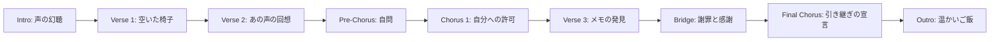

# もう、座っていいよ

## Source Facts

- **Creator:** Kamo（高知県）
- **Source:** https://suno.com/song/a87a5560-b542-489e-ae64-5ddd48b5cb30
- **Creator URL:** https://suno.com/@kondokazudeskkk
- **Collected at:** 2026-11-20T11:23:59+09:00
- **Published on page:** 2026年11月18日 12:37
- **Model shown on page:** V6-wild
- **Duration shown on page:** 4:21

### Caption (raw)

```text
いつも「ちゃんと食べたの？」と心配してくれた人。

あの頃は気づかなかった、その言葉の温かさ。

もう誰も座らない台所の椅子に、今もあの人の優しさが残っている。

言えなかった「ありがとう」を胸に、今日は温かいご飯を食べよう。
```

### Style (raw)

```text
Intimate Japanese cinematic ballad, 72 BPM, warm mature female alto vocal, emotionally fragile and natural, close-mic breathy delivery, nostalgic felt piano, expressive solo cello, delicate acoustic guitar harmonics, subtle orchestral strings, gentle analog warmth, spacious natural reverb, gradual emotional build, bittersweet Japanese melody, memorable simple chorus, heartbreaking quiet bridge with near silence, final chorus blooming with restrained strings, no belting, no dramatic drums, no excessive vibrato, deeply human storytelling, beautiful lingering piano outro, 4/4, 4 minutes 30 seconds
```

### Lyrics (raw)

```text
[Intro — Solo Piano, Intimate Female Whisper]

おかえり

今日は　どうだった？

そんな声が

まだ　聞こえる気がした

[Verse 1 — Gentle, Almost Spoken]

台所の　小さな椅子に

誰も座らなくなって

何年たったか　数えることも

いつしか　やめていた

冷めたお茶を　飲み干して

明日の支度を　始める

自分のために　生きることが

どうにも　下手なままで

[Verse 2 — Warm Cello Enters]

昔は　うるさいと思ってた

「ちゃんと食べたの？」の声

今なら　何度でも聞きたい

返事も　ちゃんとするから

あの日の私は　急いでいて

振り向きも　しなかった

何でもない　夕暮れが

あんなに　大切だったなんて

[Pre-Chorus — Fragile, Breathing Vocal]

何かを　残せただろうか

誰かを　笑わせただろうか

答えの出ない　夜ばかり

それでも　朝を迎えてきた

[Chorus 1 — Restrained, Tender]

もう　座っていいよ

少し　休んでいいよ

誰にも　見えない一日を

今日も　生きてきたんだから

何も　できなかったなんて

そんなふうに　言わないで

あなたが　帰ってくるだけで

灯る窓が　あったんだよ

[Verse 3 — Piano Only, Nostalgic]

引き出しの　いちばん奥に

折りたたまれた　古い紙

買い物の　走り書きの下

小さな文字が　残ってた

「無理しないでね」

たった　それだけなのに

あの人の　声になって

文字が　にじんで見えた

[Bridge — Near Silence, Voice Cracking Gently]

ごめんね

あのとき　優しくできなくて

ありがとう

あのとき　言えなかった

もう一度　会えるなら

何を話そう

……きっと　何も話せずに

ただ　隣に座るんだろう

[Final Chorus — Strings Bloom, Emotional but Never Shouted]

もう　座っていいよ

そう言ってくれた人が

どれほど　疲れていたのか

今なら　少しわかるよ

何も　返せなかったけど

ひとつだけ　伝えたい

あなたが　生きていてくれた

それだけで　よかったんだ

もう　座っていいよ

今度は　私が言うから

あなたが　守ってくれた日々を

私も　大事に生きるよ

[Outro — Piano Fades, Long Silence]

冷めたお茶を　入れ直して

空いた椅子に　目を向ける

「ちゃんと食べるね」

小さく　声にした

今日は　ちゃんと

あたたかいうちに　食べよう
```

---

## Clean Lyrics

[Intro]

おかえり
今日は　どうだった？
そんな声が　まだ　聞こえる気がした

[Verse 1]

台所の　小さな椅子に　誰も座らなくなって
何年たったか　数えることも　いつしか　やめていた
冷めたお茶を　飲み干して　明日の支度を　始める
自分のために　生きることが　どうにも　下手なままで

[Verse 2]

昔は　うるさいと思ってた　「ちゃんと食べたの？」の声
今なら　何度でも聞きたい　返事も　ちゃんとするから
あの日の私は　急いでいて　振り向きも　しなかった
何でもない　夕暮れが　あんなに　大切だったなんて

[Pre-Chorus]

何かを　残せただろうか　誰かを　笑わせただろうか
答えの出ない　夜ばかり　それでも　朝を迎えてきた

[Chorus 1]

もう　座っていいよ　少し　休んでいいよ
誰にも　見えない一日を　今日も　生きてきたんだから
何も　できなかったなんて　そんなふうに　言わないで
あなたが　帰ってくるだけで　灯る窓が　あったんだよ

[Verse 3]

引き出しの　いちばん奥に　折りたたまれた　古い紙
買い物の　走り書きの下　小さな文字が　残ってた
「無理しないでね」
たった　それだけなのに　あの人の　声になって　文字が　にじんで見えた

[Bridge]

ごめんね　あのとき　優しくできなくて
ありがとう　あのとき　言えなかった
もう一度　会えるなら　何を話そう
……きっと　何も話せずに　ただ　隣に座るんだろう

[Final Chorus]

もう　座っていいよ
そう言ってくれた人が　どれほど　疲れていたのか　今なら　少しわかるよ
何も　返せなかったけど　ひとつだけ　伝えたい
あなたが　生きていてくれた　それだけで　よかったんだ
もう　座っていいよ　今度は　私が言うから
あなたが　守ってくれた日々を　私も　大事に生きるよ

[Outro]

冷めたお茶を　入れ直して　空いた椅子に　目を向ける
「ちゃんと食べるね」　小さく　声にした
今日は　ちゃんと　あたたかいうちに　食べよう

---

## Lyrics Analysis

### Summary

「ちゃんと食べたの？」と心配してくれた人を失った後の歌。誰も座らなくなった台所の椅子、引き出しの奥に残っていた「無理しないでね」の走り書きを経て、タイトルフレーズ「もう座っていいよ」は意味を変えながら反復される。Chorus 1 では自分への許可として、Final Chorus では「そう言ってくれた人」への理解と「今度は私が言うから」という引き継ぎとして。最後は冷めたお茶を入れ直し、「ちゃんと食べるね」と、あの声への遅い返事で閉じる。

### Themes

- 喪失と、遅れて届く感謝
- 「ちゃんと食べたの？」という日常の言葉に宿る愛情
- 自分を労わることを学ぶ過程
- 何でもない夕暮れの大切さへの気づき

### Core Keywords

- 椅子
- ちゃんと食べたの？
- もう座っていいよ
- 無理しないでね
- あたたかいご飯

### Symbols / Motifs

- 台所の椅子: 不在の中心。誰も座らないことで、あの人の存在を指し続ける
- 冷めたお茶 → 入れ直すお茶: 止まっていた時間と、自分のために生き直す小さな再開
- 走り書きのメモ: 遅れて届いた声。「文字がにじんで見えた」で紙が声に変わる
- 灯る窓: 帰ってくる人を待つ家そのものの比喩

### Perspective

一人称。過去の自分への後悔（振り向きもしなかった）から、相手の疲れへの理解、そして自分の生を引き受ける現在へ、視点が静かに移動する。

### Repetition / Contrast / Notable Wording

- 「もう座っていいよ」が Chorus 1 と Final Chorus で反復され、担う意味がずれる（自分への許可 → 相手への労わり → 引き継ぎの宣言）
- 「ちゃんと食べたの？」（Verse 2、あの人の声）と「ちゃんと食べるね」（Outro、私の返事）の呼応で曲が閉じる
- 「座る」が、椅子・隣に座る・座っていいよ、と形を変えて全体を貫く

---

## Structure Analysis

- **Structure type:** linear_narrative + spiral_repetition
- **Summary:** 幻聴のような Intro から、空いた椅子の現在、声の回想、自問、メモの発見、謝罪と感謝の Bridge を経て、タイトルフレーズが意味を変えて戻る Final Chorus へ至る直線的な物語。その上で「もう座っていいよ」が反復のたびに意味をずらす螺旋構造を持つ。Verse 3（メモの発見）を Chorus の後に置く配置が、物語の転回点になっている。

### Mermaid



### Structural Notes

- Chorus 1 の時点では「座っていいよ」の言い主は曖昧で、Final Chorus で「そう言ってくれた人」の存在が明かされる。フレーズの主語を後から回収する構成
- Bridge は style でも "near silence" と指定される最も静かな場所で、「ごめんね」「ありがとう」を置く
- Outro の「あたたかいうちに食べよう」は、キャプションの最後の一文と呼応する

---

## Suno Prompt Knowledge

### Style Raw

```text
Intimate Japanese cinematic ballad, 72 BPM, warm mature female alto vocal, emotionally fragile and natural, close-mic breathy delivery, nostalgic felt piano, expressive solo cello, delicate acoustic guitar harmonics, subtle orchestral strings, gentle analog warmth, spacious natural reverb, gradual emotional build, bittersweet Japanese melody, memorable simple chorus, heartbreaking quiet bridge with near silence, final chorus blooming with restrained strings, no belting, no dramatic drums, no excessive vibrato, deeply human storytelling, beautiful lingering piano outro, 4/4, 4 minutes 30 seconds
```

### Directives Observed in Lyrics

| Directive | Position | Structural role | Source/Inference |
|---|---|---|---|
| [Intro — Solo Piano, Intimate Female Whisper] | Intro | ピアノのみ＋囁きで幻聴の場面を作る | Page text |
| [Verse 2 — Warm Cello Enters] | Verse 2 | 回想の温かさにチェロを重ねる | Page text |
| [Bridge — Near Silence, Voice Cracking Gently] | Bridge | ほぼ無音に近い静けさで謝罪と感謝を置く | Page text |
| [Final Chorus — Strings Bloom, Emotional but Never Shouted] | Final Chorus | 弦を広げつつ「叫ばない」上限を守る | Page text |
| [Outro — Piano Fades, Long Silence] | Outro | 長い沈黙で余韻を残す | Page text |
| no belting, no dramatic drums, no excessive vibrato（style本文） | Style全体 | 否定形で感情表現の上限を固定 | Page text |

### Reusable Notes

- style に BPM（72）、拍子（4/4）、想定曲長（4 minutes 30 seconds）まで明記し、楽曲の骨格を先に固定する書き方
- "no belting, no dramatic drums, no excessive vibrato" と否定形を重ねて、静かな曲の「やらないこと」を明確にする書き方
- セクション見出しに「— 」区切りで演奏・歌唱指示を併記する形式。感情の上限（Never Shouted）をセクション側でも繰り返している
- ※いずれもページ上の書き方の観察。実際の出音や静けさの実現度は Az のリスニングで要確認

---

## Az Listening Notes

> No listening note yet.

### Raw Notes from Az

- 

### Structured Listening Tags

- **Perceived mood:**
- **Perceived instrumentation / texture:**
- **Energy change:**
- **Vocal impression:**
- **Favorite sonic moment:**
- **Useful reference for:**

> These fields must be based on Az's own listening notes. Do not infer them from audio files, Style, or lyrics alone.

---

## Az Impression

### Raw Notes from Az

> No Az note yet.

### Structured Impression

- **First impression:**
- **Favorite moment:**
- **Emotion words:**
- **Colors / scenery:**
- **Physical sensation:**
- **What felt unusual:**
- **Useful reference for:**

---

## Review Hooks

Points worth discussing when Az writes a review. These are prompts, not a finished review.

- 「もう座っていいよ」の意味が、反復のたびにずれていくこと（許可 → 理解 → 引き継ぎ）
- 「ちゃんと食べたの？」への返事「ちゃんと食べるね」が、曲の最後にやっと出る構成
- 引き出しのメモ「無理しないでね」が、あの人の声になって聞こえる場面
- Chorus 1 では曖昧だった「言い主」が Final Chorus で回収される仕掛け
- 冷めたお茶を入れ直す、という小さな行為で締める Outro の静かさ

---

## Provenance / Confidence

Clearly distinguish facts from interpretation.

- **Page-derived facts:** タイトル、作者、キャプション、style、歌詞、公開日、モデル、長さ、再生数29／いいね14／コメント2（収集時点）。2026-11-20に公開ページから機械収集
- **AI text analysis:** Summary、Themes、Symbols、Structure、Review Hooks は歌詞と style のテキスト分析による
- **Az listening notes:** なし（未記入）
- **Az impression:** なし（未記入）
- **Unavailable / uncertain:** 歌詞中の「あの人」と作者の関係はページからは分からない（解釈に含めていない）。実際の静けさや歌唱の実現度は未聴取

### Audio Handling Policy

- Do not search for direct audio file URLs.
- Do not download or convert m4a/mp3/wav files.
- Do not perform automated audio analysis.
- Sound-related notes must come from Az's own listening comments.
