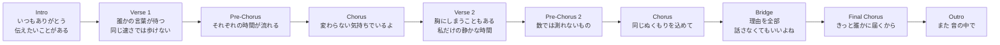

# 少し遅れて、届く言葉

## Source Facts

- **Creator:** Kamo（高知県）
- **Source:** https://suno.com/song/40aaa3ec-e5b3-4f5f-9612-820de0a34a2d
- **Creator URL:** https://suno.com/@kondokazudeskkk
- **Collected at:** 2026-11-21T20:58:35+09:00
- **Published on page:** 2026年11月20日 13:03
- **Model shown on page:** V6-wild
- **Duration shown on page:** 4:24
- **Play count shown on page:** 18
- **Like count shown on page:** 7
- **Comments shown on page:** 2

### Caption (raw)

```text
いつも音楽を聴いてくださり、ありがとうございます。☺️🌸

しばらくの間、コメントへのお返事や交流が遅れることがあるかもしれません。

それでも、皆さんからいただく温かい言葉への感謝は変わりません。

これからも自分のペースで、音楽を届けていけたらと思います。🦆✨
```

### Style (raw)

```text
いつも音楽を聴いてくださり、ありがとうございます。☺️🌸

しばらくの間、コメントへのお返事や交流が遅れることがあるかもしれません。

それでも、皆さんからいただく温かい言葉への感謝は変わりません。

これからも自分のペースで、音楽を届けていけたらと思います。🦆✨
```

> 注：ページから取得した Style 欄にはキャプションと同一の文面が入っており、Style としての記載は確認できなかった。Style 原文は上記の通り収集したものをそのまま記録する。

### Lyrics (raw)

```text
[Intro — Gentle Piano, Warm Acoustic Guitar]

いつもありがとう

今日は少しだけ

伝えたいことがあるんだ


[Verse 1 — Soft, Natural Vocal]

いつものように　音を開けば
誰かの言葉が　待っている
何気ないひとことに
笑顔をもらう日もある

ひとつひとつに　返したくて
言葉を探しているけれど
毎日同じ速さでは
歩けない日もあるから


[Pre-Chorus — Gentle Strings Enter]

見えないところで
それぞれの時間が流れてる

きっと誰にでも
そんな日があるよね


[Chorus — Warm, Memorable Melody]

少し遅れて　届く言葉も
変わらない気持ちでいるよ

すぐに返せない日があっても
忘れているわけじゃない

音楽が好きで
ここにいること

それだけは　変わらないから

またひとつ　音が生まれたら
そっと届けに来るよ


[Verse 2 — Intimate Storytelling]

誰かの歌に　耳を澄ませて
心が動く瞬間がある

伝えたいことが　浮かんでも
今日は胸にしまうこともある

画面の向こうの　それぞれに
それぞれの日々があるように

私にもまた　私だけの
静かな時間が流れてる


[Pre-Chorus 2 — Soft Emotional Rise]

言葉の数では
測れないものがある

離れた時間も
消えないものがある


[Chorus — Fuller, Emotional]

少し遅れて　届く言葉も
同じぬくもりを込めて

返事ができない日があっても
ありがとうは　ここにある

急がなくても
つながれるなら

そんな優しさが　嬉しいから

またいつか　いつものように
笑って話せたらいいな


[Bridge — Piano Only, Quiet and Honest]

何も言わずに
休む日があっても

理由を全部
話さなくてもいいよね

あなたもどうか
あなたの時間を大切に

私も少し
自分の歩幅で進むから


[Final Chorus — Gentle Soaring Vocal]

少し遅れて　届く言葉も
きっと誰かに届くから

今日もどこかで　鳴っている
あなたの好きな歌のように

毎日ここに
いられなくても

音楽を好きな気持ちは
変わらない

また会えたとき
いつものように

「聴いてくれてありがとう」


[Outro — Soft Piano, Fading Guitar]

返事は少し
遅れるかもしれないけれど

今日もありがとう

また　音の中で
```

---

## Clean Lyrics

[Intro]

いつもありがとう
今日は少しだけ
伝えたいことがあるんだ

[Verse 1]

いつものように　音を開けば
誰かの言葉が　待っている
何気ないひとことに
笑顔をもらう日もある

ひとつひとつに　返したくて
言葉を探しているけれど
毎日同じ速さでは
歩けない日もあるから

[Pre-Chorus]

見えないところで
それぞれの時間が流れてる

きっと誰にでも
そんな日があるよね

[Chorus]

少し遅れて　届く言葉も
変わらない気持ちでいるよ

すぐに返せない日があっても
忘れているわけじゃない

音楽が好きで
ここにいること

それだけは　変わらないから

またひとつ　音が生まれたら
そっと届けに来るよ

[Verse 2]

誰かの歌に　耳を澄ませて
心が動く瞬間がある

伝えたいことが　浮かんでも
今日は胸にしまうこともある

画面の向こうの　それぞれに
それぞれの日々があるように

私にもまた　私だけの
静かな時間が流れてる

[Pre-Chorus 2]

言葉の数では
測れないものがある

離れた時間も
消えないものがある

[Chorus]

少し遅れて　届く言葉も
同じぬくもりを込めて

返事ができない日があっても
ありがとうは　ここにある

急がなくても
つながれるなら

そんな優しさが　嬉しいから

またいつか　いつものように
笑って話せたらいいな

[Bridge]

何も言わずに
休む日があっても

理由を全部
話さなくてもいいよね

あなたもどうか
あなたの時間を大切に

私も少し
自分の歩幅で進むから

[Final Chorus]

少し遅れて　届く言葉も
きっと誰かに届くから

今日もどこかで　鳴っている
あなたの好きな歌のように

毎日ここに
いられなくても

音楽を好きな気持ちは
変わらない

また会えたとき
いつものように

「聴いてくれてありがとう」

[Outro]

返事は少し
遅れるかもしれないけれど

今日もありがとう

また　音の中で

---

## Lyrics Analysis

### Summary

音を開けば誰かの言葉が待っている。ひとつひとつに返したいのに、毎日同じ速さでは歩けない。Chorus は「少し遅れて届く言葉も変わらない気持ちでいるよ」という言い訳ではなく約束で、2回目は「同じぬくもりを込めて」と、遅れの言い訳から感謝の表明へ重心が移る。Verse 2 では画面の向こうのそれぞれの日々を認め、Bridge で「理由を全部話さなくてもいいよね」と、休むことの許可を自分にも相手にも与える。Final Chorus では「届く言葉」の届き先が「きっと誰かに」へ広がり、最後は「聴いてくれてありがとう」という聴き手への言葉で閉じる。Outro の「また音の中で」が、再会の場所を音の中に置く。

### Themes

- 返信の遅れと、それでも変わらない気持ち
- 毎日同じ速さでは歩けない、自分のペースの肯定
- 言葉の数では測れないもの、離れた時間も消えないもの
- 休むことの許可と、相手の時間への配慮
- 音楽への愛と、音の中でまた会う約束

### Core Keywords

- 遅れる
- 届く言葉
- ありがとう
- 歩幅
- 音
- ぬくもり
- それぞれの時間

### Symbols / Motifs

- **音:** 曲を開く行為、届けるもの、再会の場所。「音を開けば」「音が生まれたら」「また音の中で」と、曲全体を貫く。
- **届く言葉:** タイトルフレーズ。Chorus の反復のたびに意味がずれる。1回目は自分の気持ちの表明、2回目はぬくもりを込めた感謝、Final では誰かへ届く確信へ。
- **それぞれの時間:** Pre-Chorus で提示される、見えないところで流れる時間。自分の遅れを正当化するのではなく、誰にでもあるものとして共有する。
- **歩幅:** Bridge の中心語。「自分の歩幅で進む」が、速さではなく歩幅の問題として自分のペースを言い換える。
- **ありがとう:** Intro の「いつもありがとう」から、Final Chorus の「聴いてくれてありがとう」へ。感謝の向きが、受け取る側から送る側へ変わる。

### Perspective

一人称の「私」が、聴き手へ直接語りかける。視点は自分の遅れの説明から始まり、画面の向こうの「それぞれの日々」へ広がり、Bridge で相手の時間へ向きを変え、Final Chorus で「あなたの好きな歌」にまで届く。

### Repetition / Contrast / Notable Wording

- 「少し遅れて　届く言葉も」が Chorus 3 回の頭に反復される。後続は「変わらない気持ちでいるよ」→「同じぬくもりを込めて」→「きっと誰かに届くから」と変化し、遅れの言い訳から感謝、確信へ意味が進む。
- 「毎日同じ速さでは歩けない日もあるから」（Verse 1）と「自分の歩幅で進むから」（Bridge）が対応し、速さの問題が歩幅の問題へ言い換えられる。
- 「言葉の数では測れないものがある／離れた時間も消えないものがある」（Pre-Chorus 2）は、数と時間という二つの尺度を並べて否定する。
- 「忘れているわけじゃない」「ありがとうはここにある」は、返事ができないことと感謝の不在を切り離す言い回し。
- 「またひとつ　音が生まれたら／そっと届けに来るよ」と「また　音の中で」は、再会の約束を音に託す対応。
- キャプションの「しばらくの間、コメントへのお返事や交流が遅れることがあるかもしれません」は、歌詞のテーマと直接対応しており、曲が現実の連絡として機能している。

---

## Structure Analysis

- **Structure type:** chorus_variation + bridge_return
- **Summary:** Intro、Verse 1、Pre-Chorus、Chorus、Verse 2、Pre-Chorus 2、Chorus、Bridge、Final Chorus、Outro という標準的な構成。核は Chorus の3回の反復で、同じ頭のフレーズを持ちながら後続の言葉が変わり、意味が段階的に進む。Bridge はピアノのみの静かな区間で、休むことの許可と相手への配慮を置き、Final Chorus へつなぐ。

### Mermaid



### Structural Notes

- Chorus の3回は、ラベル上は Chorus / Chorus / Final Chorus と区別され、2回目は "Fuller, Emotional"、Final は "Gentle Soaring Vocal" と演出指示が付いている。
- Verse 1 は自分の遅れの説明、Verse 2 は相手の歌を聴く側の視点で、1番と2番で語りの向きが変わる。
- Bridge の演出指示は "Piano Only, Quiet and Honest" で、編成を絞って言葉だけを残す設計。
- Outro は "Soft Piano, Fading Guitar" で、Intro の "Gentle Piano, Warm Acoustic Guitar" と対応する。
- キャプションが現実の連絡（交流が遅れるお知らせ）であることと、歌詞のテーマが一致しており、曲自体がその連絡の延長として作られている。

---

## Suno Prompt Knowledge

### Style Raw

```text
いつも音楽を聴いてくださり、ありがとうございます。☺️🌸

しばらくの間、コメントへのお返事や交流が遅れることがあるかもしれません。

それでも、皆さんからいただく温かい言葉への感謝は変わりません。

これからも自分のペースで、音楽を届けていけたらと思います。🦆✨
```

> 注：ページから取得した Style 欄にはキャプションと同一の文面が入っており、Style としての記載は確認できなかった。Style 原文は上記の通り収集したものをそのまま記録する。

### Directives Observed in Lyrics

| Directive | Position | Structural role | Source/Inference |
|---|---|---|---|
| `[Intro — Gentle Piano, Warm Acoustic Guitar]` | Intro | 優しいピアノと温かいアコギで、語りかけの場面を設定 | Page-derived directive; role is AI text analysis |
| `[Verse 1 — Soft, Natural Vocal]` | Verse 1 | 柔らかく自然な歌唱で、日常の説明を進める | Page-derived directive; role is AI text analysis |
| `[Pre-Chorus — Gentle Strings Enter]` | Pre-Chorus | 優しいストリングスの参加で、Chorus への移行を示す | Page-derived directive; role is AI text analysis |
| `[Chorus — Warm, Memorable Melody]` | Chorus | 温かく覚えやすいメロディで、主題を提示 | Page-derived directive; role is AI text analysis |
| `[Verse 2 — Intimate Storytelling]` | Verse 2 | 親密な語り口で、相手の側の視点へ向きを変える | Page-derived directive; role is AI text analysis |
| `[Pre-Chorus 2 — Soft Emotional Rise]` | Pre-Chorus 2 | 柔らかい感情の高まりで、2回目の Chorus へつなぐ | Page-derived directive; role is AI text analysis |
| `[Chorus — Fuller, Emotional]` | Chorus 2回目 | より豊かで感情的に、同じ主題を深める | Page-derived directive; role is AI text analysis |
| `[Bridge — Piano Only, Quiet and Honest]` | Bridge | ピアノのみで編成を絞り、言葉だけを残す | Page-derived directive; role is AI text analysis |
| `[Final Chorus — Gentle Soaring Vocal]` | Final Chorus | 優しく高まる歌唱で、主題を確信へ進める | Page-derived directive; role is AI text analysis |
| `[Outro — Soft Piano, Fading Guitar]` | Outro | 柔らかいピアノとフェードするギターで、Intro と対応する終わり | Page-derived directive; role is AI text analysis |

### Reusable Notes

- セクションラベルに演出指示を短い英語句で添える形式（例：`[Bridge — Piano Only, Quiet and Honest]`）は、編成・感情・正直さの3要素を一行で指定する方法。
- Chorus の反復に "Fuller, Emotional"、Final Chorus に "Gentle Soaring Vocal" と段階の異なる演出を付けることで、同じフレーズの意味の進みを音楽へ対応させる設計。
- 歌詞のテーマが現実の連絡（交流の遅れ）と一致している場合、曲そのものが連絡の延長として機能する。キャプションと歌詞の対応は、曲の制作意図を読み取る手がかりになる。
- 上記は Lyrics Directive のテキスト設計に関する知見であり、実際の音響結果についての評価ではない。

---

## Az Listening Notes

> No listening note yet.

### Raw Notes from Az

- 未提供

### Structured Listening Tags

- **Perceived mood:** 未提供
- **Perceived instrumentation / texture:** 未提供
- **Energy change:** 未提供
- **Vocal impression:** 未提供
- **Favorite sonic moment:** 未提供
- **Useful reference for:** 未提供

> These fields must be based on Az's own listening notes. Do not infer them from audio files, Style, or lyrics alone.

---

## Az Impression

### Raw Notes from Az

> No Az note yet.

### Structured Impression

- **First impression:** 未提供
- **Favorite moment:** 未提供
- **Emotion words:** 未提供
- **Colors / scenery:** 未提供
- **Physical sensation:** 未提供
- **What felt unusual:** 未提供
- **Useful reference for:** 未提供

---

## Review Hooks

Points worth discussing when Az writes a review. These are prompts, not a finished review.

- キャプション（しばらくの間、交流が遅れるお知らせ）と歌詞のテーマの一致。曲が現実の連絡として機能している点。
- Chorus の「少し遅れて　届く言葉も」の反復で、後続の言葉が「変わらない気持ち」→「同じぬくもり」→「きっと誰かに届くから」と変わる点。
- Bridge の「理由を全部話さなくてもいいよね」「あなたの時間を大切に」という、休むことの許可と相手への配慮。
- 「毎日同じ速さでは歩けない」から「自分の歩幅で進む」への言い換え。
- Outro の「また　音の中で」という再会の場所の置き方。
- Style 欄にキャプションと同一の文面が入っていた収集上の注意点。

---

## Provenance / Confidence

Clearly distinguish facts from interpretation.

- **Page-derived facts:** 曲名、作者、作者URL、Suno URL、Caption、Lyrics、公開日時、V6-wild表記、4:24の表示、再生数・いいね数・コメント数。Style 欄にはキャプションと同一の文面が入っており、Style としての記載は未確認。
- **AI text analysis:** 歌詞要約、主題、キーワード、モチーフ、視点、反復と対照、構造分類、Directive の構造的役割、再利用ノート、レビュー観点。
- **Az listening notes:** 未提供。
- **Az impression:** 未提供。
- **Unavailable / uncertain:** 実際の音響上の実現度、演奏・歌唱・ミックスの聴感評価、Style の正式な記載内容。音源ファイルの取得や自動音響解析は行っていない。

### Audio Handling Policy

- Do not search for direct audio file URLs.
- Do not download or convert m4a/mp3/wav files.
- Do not perform automated audio analysis.
- Sound-related notes must come from Az's own listening comments.
