# あなたのままでいい…ずっと友達

## Source Facts

- **Creator:** ここね-Kokone-
- **Source:** https://suno.com/song/3a6a410f-24af-4a2b-a0be-2075cbd2461c
- **Creator URL:** https://suno.com/@kokone617709
- **Collected at:** 2026-11-24T20:58:52+09:00
- **Published on page:** 2026年11月23日 13:34
- **Model shown on page:** V6
- **Duration shown on page:** 4:56
- **Play count shown on page:** 40
- **Like count shown on page:** 14
- **Comments shown on page:** 4

### Caption (raw)

```text
🎵『あなたのままでいい…ずっと友達』
一度は離れた友人と、長い時を経て再びつながった。この曲は、そんな大切な友人への誕生日プレゼントとして生まれました。
もう十分、頑張っている。上手く生きなくてもいい。誰かと比べなくてもいい。あなたは、あなたのままでいい。
最初は軽やかで温かみのあるポップソングとして贈った一曲。今回は歌詞はそのままに、R&Bバラードとして新たに仕上げました。
🍀この曲が生まれた背景をnoteに綴っています。
📖noteはこちら：https://note.com/rio_pekoshii_yu/n/n72667dd10c4c
```

### Style (raw)

```text
Japanese R&B, Alternative R&B; intimate, smooth, soulful, breathy female lead in Japanese, close and dry in verses, opening into emotional falsetto with lush stereo reverb and gentle echoes; unhurried groove; crisp close drum transients against warm midground piano and distant pads, deep layered ambient reverb, distinct vocal pre-delay, long diffuse tails, depth-dependent high-frequency roll-off, wide mono-compatible atmosphere, focused center image, clear front-to-back separation; moody electric piano, atmospheric synth pads, subtle trap beat and warm deep bass; pre-chorus harmonies expand, choruses widen, bridge strips back before distant outro reverb.
```

### Lyrics (raw)

```text
[Intro - Distant atmospheric pads, soft piano reflections, deep background ambience]

[Verse 1 - Very close dry lead vocal, crisp breath details, piano behind the singer, distant soft ambience]
あのころ 楽しかったね
朝まで部屋で話して
何でもないことで笑って
気づけば朝になってた

ほんの行き違いで
離れてしまったあとも
あの日 街が壊れた時も
本当は心配してくれてた

連絡した時 初めて知った
言葉を交わさなかった時間にも
友情は消えてなかった

[Pre-Chorus - Gradual increase in spatial depth, mid-distance reflections, distant harmonies emerging]
誰もが懸命に生きてる
見えないところで涙して
笑っているその裏側に
どれだけの想いがあっただろう

今 見えている姿だけで
あなたの人生を決めないで

[Chorus - Strong front-to-back contrast, dry centered lead vocal, warm midground piano, distant lush pads and diffuse reverb tails]
もう 充分だよ
上手く生きなくていいんよ
誰かの言葉より
自分の中の言葉を信じて

どう思われたいかより
どうしたいか どう生きたいか
うちらはうちらでおったらええんやけん
自信もって生きていい
あなたのままでいい

[Verse 2 - Intimate dry vocals up front, close rhythmic details, soft distant instrumental layers]
優しすぎるから
自分の想いは後回し
誰かのために頑張って
自分のことは置き去りにして

誰かの言葉も
誰かの人生も
もう拾わなくていい
背負わなくていい

できなくなったことより
積み重ねてきた日々を
どうか忘れないで
あなたが歩いてきた道を

[Pre-Chorus 2 - Deepening background ambience, gradual emotional lift, clear separation between near and far sounds]
誰にも見えない時間にも
あなたが生きてきた人生がある
何かができるかどうかで
あなたの価値は変わらない

今のあなたの姿に
元気をもらってるのは私の方

[Chorus - Close powerful lead vocal, layered midground harmonies, distant atmospheric reflections, strong spatial depth]
もう 充分だよ
上手く生きなくていいんよ
誰かに認められなくても
何も証明しなくていい

これからは自由に生きて
心のブロックを外していい
誰のためでもない
あなた自身の人生なんだから

うちらは うちらでおったらええんやけん
自信もって生きていい
あなたのままでいい

[Bridge - Stripped-back arrangement, whisper-close vocal, distant piano echoes, deep quiet space]
あのころの私たちも
今の私たちも
変わってしまったことはあっても
変わらないものがある

離れていた時間さえ
消せなかったものがある

[Final Chorus - Intimate lead vocal in front, rich harmonies behind, vast distant ambience, dramatic near-far contrast]
もう 充分だよ
これ以上 頑張らなくていい
あなたがあなたでいてくれる
それだけで嬉しいんよ

上手く生きなくていい
自分の心を信じて
これからは自由に
あなたらしく生きていい

ずっと友達
うちらはずっと……

[Outro - Tender close vocal, instruments receding into the distance, long diffuse background reverb]
言葉を交わさなかった時間にも
友情は消えてなかった

うちらはずっと……
ずっと友達
```

---

## Clean Lyrics

[Intro]

[Verse 1]

あのころ 楽しかったね
朝まで部屋で話して
何でもないことで笑って
気づけば朝になってた

ほんの行き違いで
離れてしまったあとも
あの日 街が壊れた時も
本当は心配してくれてた

連絡した時 初めて知った
言葉を交わさなかった時間にも
友情は消えてなかった

[Pre-Chorus]

誰もが懸命に生きてる
見えないところで涙して
笑っているその裏側に
どれだけの想いがあっただろう

今 見えている姿だけで
あなたの人生を決めないで

[Chorus]

もう 充分だよ
上手く生きなくていいんよ
誰かの言葉より
自分の中の言葉を信じて

どう思われたいかより
どうしたいか どう生きたいか
うちらはうちらでおったらええんやけん
自信もって生きていい
あなたのままでいい

[Verse 2]

優しすぎるから
自分の想いは後回し
誰かのために頑張って
自分のことは置き去りにして

誰かの言葉も
誰かの人生も
もう拾わなくていい
背負わなくていい

できなくなったことより
積み重ねてきた日々を
どうか忘れないで
あなたが歩いてきた道を

[Pre-Chorus 2]

誰にも見えない時間にも
あなたが生きてきた人生がある
何かができるかどうかで
あなたの価値は変わらない

今のあなたの姿に
元気をもらってるのは私の方

[Chorus]

もう 充分だよ
上手く生きなくていいんよ
誰かに認められなくても
何も証明しなくていい

これからは自由に生きて
心のブロックを外していい
誰のためでもない
あなた自身の人生なんだから

うちらは うちらでおったらええんやけん
自信もって生きていい
あなたのままでいい

[Bridge]

あのころの私たちも
今の私たちも
変わってしまったことはあっても
変わらないものがある

離れていた時間さえ
消せなかったものがある

[Final Chorus]

もう 充分だよ
これ以上 頑張らなくていい
あなたがあなたでいてくれる
それだけで嬉しいんよ

上手く生きなくていい
自分の心を信じて
これからは自由に
あなたらしく生きていい

ずっと友達
うちらはずっと……

[Outro]

言葉を交わさなかった時間にも
友情は消えてなかった

うちらはずっと……
ずっと友達

---

## Lyrics Analysis

### Summary

一度は離れた友人と、長い時を経て再びつながった——その友人への誕生日プレゼントとして作られた歌。Verse 1 は「あのころ 楽しかったね／朝まで部屋で話して」という、離れる前の日々から始まり、「ほんの行き違いで／離れてしまったあとも」「あの日 街が壊れた時も／本当は心配してくれてた」と、連絡を取らなかった時間にも友情が続いていたことが明かされる。連絡して初めて知ったのは、「言葉を交わさなかった時間にも／友情は消えてなかった」という事実。Pre-Chorus は「誰もが懸命に生きてる／見えないところで涙して」と、見えている姿だけで人の人生を決めないでほしいという視点の転換を置く。Chorus は「もう 充分だよ／上手く生きなくていいんよ」から始まり、「どう思われたいかより／どうしたいか どう生きたいか」「うちらはうちらでおったらええんやけん／自信もって生きていい／あなたのままでいい」と、肯定の言葉が重ねられる。Verse 2 は相手の優しさ（自分の想いは後回し、誰かのために頑張る）を描き、「もう拾わなくていい／背負わなくていい」と、抱え込んできたものを下ろすことを許す。Pre-Chorus 2 は「何かができるかどうかで／あなたの価値は変わらない」と、価値と能力を切り離す。Bridge は「変わってしまったことはあっても／変わらないものがある」「離れていた時間さえ／消せなかったものがある」と、変化と不変を並べて結論づける。Final Chorus は「これ以上 頑張らなくていい／あなたがあなたでいてくれる／それだけで嬉しいんよ」と、存在そのものへの肯定で締められ、Outro は Verse 1 の「言葉を交わさなかった時間にも／友情は消えてなかった」を繰り返して閉じる。キャプションによれば、最初は軽やかなポップソングとして贈られ、今回は歌詞はそのままに R&B バラードとして新たに仕上げられた。同じ歌詞が、贈る形を変えて二度届けられた曲。

### Themes

- 一度離れた友人との再会（行き違い、街が壊れた日、連絡の再開）
- 頑張らなくていいという肯定（もう充分だよ、上手く生きなくていい）
- 比べない・証明しない生き方（誰かの言葉より自分の言葉を、認められなくても、何も証明しなくていい）
- 変わらないもの（離れていた時間さえ消せなかったもの）

### Core Keywords

- あなたのままでいい
- ずっと友達
- もう充分だよ
- うちら
- 友情
- 頑張らなくていい

### Symbols / Motifs

- **言葉を交わさなかった時間:** Verse 1 と Outro で繰り返されるフレーズ。沈黙の期間が、友情の終わりではなく、消えなかったことの証拠として置かれる。
- **うちら:** 関西弁の二人称複数。Chorus で「うちらはうちらでおったらええんやけん」と、世間ではなく二人の単位で生きることを肯定する。語り手と相手の距離の近さを示す言葉。
- **拾う・背負う:** Verse 2 の「もう拾わなくていい／背負わなくていい」で、他人の言葉や人生を自分の荷物にしてきたことが描かれる。肯定の歌でありながら、まず下ろすことを許す。
- **ブロック:** Chorus 2 の「心のブロックを外していい」で、自分を縛っていた枠組みが、取り外せるものとして描かれる。
- **見えない時間:** Pre-Chorus の「見えないところで涙して」と Pre-Chorus 2 の「誰にも見えない時間にも」で、見えている姿の裏側にある人生が、繰り返し肯定される。

### Perspective

一人称「私」が、再会した友人「あなた」へ語りかける歌。視点は終始「私」から「あなた」への呼びかけで、聴き手は「あなた」の位置に置かれる。Pre-Chorus 2 の「今のあなたの姿に／元気をもらってるのは私の方」では、励ます側だった「私」が、逆に相手から元気をもらっていることが明かされ、肯定が一方通行ではないことが示される。

### Repetition / Contrast / Notable Wording

- 「言葉を交わさなかった時間にも／友情は消えてなかった」が Verse 1 の末尾と Outro で繰り返され、曲の始まりと終わりを同じ結論で結ぶ。
- Chorus の「もう 充分だよ」が3回（Chorus 1、Chorus 2、Final Chorus）繰り返され、毎回その後に続く言葉が変わる。「上手く生きなくていいんよ」→「何も証明しなくていい」→「これ以上 頑張らなくていい」と、肯定の範囲が広がっていく。
- 「うちらはうちらでおったらええんやけん」が Chorus 1 と Chorus 2 で繰り返され、関西弁のフレーズが曲の核として固定される。
- 「どう思われたいかより／どうしたいか どう生きたいか」と「誰かに認められなくても／何も証明しなくていい」の対応。他者の評価と自分の意思、認められることと証明することの対比。
- 「変わってしまったことはあっても／変わらないものがある」と「離れていた時間さえ／消せなかったものがある」の Bridge での並置。変化と不変、時間と友情の対比。
- 「ずっと友達」が Final Chorus と Outro の末尾で繰り返され、「うちらはずっと……」の余韻で閉じる。

---

## Structure Analysis

- **Structure type:** verse_prechorus_chorus_arc + bridge + final_chorus_outro
- **Summary:** Intro → Verse 1 → Pre-Chorus → Chorus → Verse 2 → Pre-Chorus 2 → Chorus → Bridge → Final Chorus → Outro という、再会と肯定の弧を描く構成。Intro は歌唱なしの雰囲気作り。Verse 1 が離れる前の日々と連絡の再開を描き、Pre-Chorus が「見えている姿だけで決めないで」という視点の転換を置いて、Chorus の肯定へ上げる。Verse 2 は相手の優しさと抱え込んできたものを描き、Pre-Chorus 2 が「何かができるかどうかで／あなたの価値は変わらない」と、価値と能力を切り離して、2番の Chorus へ上げる。Bridge が「変わらないものがある」という結論を置き、Final Chorus は「これ以上 頑張らなくていい」と存在そのものへの肯定で締める。Outro は Verse 1 の結論を繰り返して閉じる。4分56秒という長さは、Verse・Pre-Chorus・Chorus の2周と、Bridge・Final Chorus・Outro の余韻から来ている。

### Mermaid

```mermaid
flowchart LR
    I[Intro]
    I --> V1[Verse 1<br/>あのころ 楽しかったね]
    V1 --> P1[Pre-Chorus<br/>見えている姿だけで<br/>決めないで]
    P1 --> C1[Chorus<br/>もう 充分だよ<br/>あなたのままでいい]
    C1 --> V2[Verse 2<br/>優しすぎるから]
    V2 --> P2[Pre-Chorus 2<br/>あなたの価値は<br/>変わらない]
    P2 --> C2[Chorus<br/>何も証明しなくていい]
    C2 --> B[Bridge<br/>変わらないものがある]
    B --> FC[Final Chorus<br/>これ以上<br/>頑張らなくていい]
    FC --> O[Outro<br/>うちらはずっと……<br/>ずっと友達]

    classDef chorus fill:#fef3c7,stroke:#d97706,color:#78350f;
    classDef verse fill:#eef2ff,stroke:#6366f1,color:#1e1b4b;
    classDef bridge fill:#ecfdf5,stroke:#10b981,color:#064e3b;
    class C1,C2,FC chorus;
    class V1,V2,P1,P2 verse;
    class B bridge;
```



### Structural Notes

- セクションラベルは公開ページの歌詞に明示されているため、上記の構造はページ由来である。ただし各ラベルには音響的な指示（例：`[Intro - Distant atmospheric pads, soft piano reflections, deep background ambience]`）が併記されており、Clean Lyrics ではセクションラベルだけを残し、指示部分は除いた。
- Intro は歌唱なしで、雰囲気だけが指定されている。
- Chorus は3回（Chorus 1、Chorus 2、Final Chorus）あり、毎回「もう 充分だよ」から始まるが、その後の内容が変わる。同じ入り口から異なる肯定へ進む設計。
- Outro は Verse 1 の末尾の2行を繰り返し、「うちらはずっと……／ずっと友達」で閉じる。
- 歌詞は関西弁のフレーズ（「うちらはうちらでおったらええんやけん」「上手く生きなくていいんよ」）を含む。

---

## Suno Prompt Knowledge

### Style Raw

```text
Japanese R&B, Alternative R&B; intimate, smooth, soulful, breathy female lead in Japanese, close and dry in verses, opening into emotional falsetto with lush stereo reverb and gentle echoes; unhurried groove; crisp close drum transients against warm midground piano and distant pads, deep layered ambient reverb, distinct vocal pre-delay, long diffuse tails, depth-dependent high-frequency roll-off, wide mono-compatible atmosphere, focused center image, clear front-to-back separation; moody electric piano, atmospheric synth pads, subtle trap beat and warm deep bass; pre-chorus harmonies expand, choruses widen, bridge strips back before distant outro reverb.
```

### Directives Observed in Lyrics

| Directive | Position | Structural role | Source/Inference |
|---|---|---|---|
| `[Intro - Distant atmospheric pads, soft piano reflections, deep background ambience]` | Intro | 歌唱なしで雰囲気だけを作る導入 | Page-derived directive; role is AI text analysis |
| `[Verse 1 - Very close dry lead vocal, crisp breath details, piano behind the singer, distant soft ambience]` | Verse 1 | 近くてドライなボーカルで、離れる前の日々を親密に描く | Page-derived directive; role is AI text analysis |
| `[Pre-Chorus - Gradual increase in spatial depth, mid-distance reflections, distant harmonies emerging]` | Pre-Chorus 1 | 空間的な奥行きを広げながら、サビへ上げる橋 | Page-derived directive; role is AI text analysis |
| `[Chorus - Strong front-to-back contrast, dry centered lead vocal, warm midground piano, distant lush pads and diffuse reverb tails]` | Chorus 1 | 前後のコントラストで肯定の言葉を際立たせる | Page-derived directive; role is AI text analysis |
| `[Verse 2 - Intimate dry vocals up front, close rhythmic details, soft distant instrumental layers]` | Verse 2 | 近いボーカルで、相手の優しさと抱え込んできたものを描く | Page-derived directive; role is AI text analysis |
| `[Pre-Chorus 2 - Deepening background ambience, gradual emotional lift, clear separation between near and far sounds]` | Pre-Chorus 2 | 奥行きを深めながら感情を上げ、2番のサビへ上げる橋 | Page-derived directive; role is AI text analysis |
| `[Chorus - Close powerful lead vocal, layered midground harmonies, distant atmospheric reflections, strong spatial depth]` | Chorus 2 | 力強いボーカルと重なるハーモニーで、2番の肯定を広げる | Page-derived directive; role is AI text analysis |
| `[Bridge - Stripped-back arrangement, whisper-close vocal, distant piano echoes, deep quiet space]` | Bridge | 編成を削ぎ落として、変わらないものの結論を静かに置く | Page-derived directive; role is AI text analysis |
| `[Final Chorus - Intimate lead vocal in front, rich harmonies behind, vast distant ambience, dramatic near-far contrast]` | Final Chorus | 前後のコントラストを最大にして、存在そのものへの肯定で締める | Page-derived directive; role is AI text analysis |
| `[Outro - Tender close vocal, instruments receding into the distance, long diffuse background reverb]` | Outro | 楽器を遠ざけながら、Verse 1 の結論を繰り返して閉じる | Page-derived directive; role is AI text analysis |

### Reusable Notes

- セクションラベルに音響的な指示が併記されている書き方（例：`[Verse 1 - Very close dry lead vocal, ...]`）。Clean Lyrics ではラベルだけを残したが、原文のまま残しておくことで、セクションごとの音響設計を歌詞欄に書き込む方法が記録できる。
- Style が非常に長い例。ボーカルの距離感（close and dry → falsetto with lush reverb）、リバーブの層（pre-delay、long diffuse tails、depth-dependent roll-off）、空間の前後関係（front-to-back separation、focused center image）まで詳細に指定している。音の「距離」を言語で設計する方法として再利用できる。
- キャプションによれば、最初は軽やかなポップソングとして贈られ、今回は歌詞はそのままに R&B バラードとして新たに仕上げられた。同じ歌詞でジャンルを変えて再生成する、という作り方の例。
- 「もう 充分だよ」から始まる Chorus を3回繰り返し、毎回その後の内容を変える書き方は、同じ入り口から異なる肯定へ進む方法として再利用できる。
- 上記は Style / Lyrics Directive のテキスト設計に関する知見であり、実際の音響結果についての評価ではない。

---

## Az Listening Notes

> No listening note yet.

### Raw Notes from Az

- 未提供

### Structured Listening Tags

- **Perceived mood:** 未提供
- **Perceived instrumentation / texture:** 未提供
- **Energy change:** 未提供
- **Vocal impression:** 未提供
- **Favorite sonic moment:** 未提供
- **Useful reference for:** 未提供

> These fields must be based on Az's own listening notes. Do not infer them from audio files, Style, or lyrics alone.

---

## Az Impression

### Raw Notes from Az

> No Az note yet.

### Structured Impression

- **First impression:** 未提供
- **Favorite moment:** 未提供
- **Emotion words:** 未提供
- **Colors / scenery:** 未提供
- **Physical sensation:** 未提供
- **What felt unusual:** 未提供
- **Useful reference for:** 未提供

---

## Review Hooks

Points worth discussing when Az writes a review. These are prompts, not a finished review.

- 「言葉を交わさなかった時間にも／友情は消えてなかった」という、沈黙の期間が友情の証拠として置かれる点。
- 「もう 充分だよ」から始まる Chorus が3回繰り返され、毎回その後の肯定が広がっていく点。
- 「うちらはうちらでおったらええんやけん」という関西弁のフレーズが、曲の核として繰り返される点。
- 「もう拾わなくていい／背負わなくていい」という、抱え込んできたものを下ろすことを許す書き方。
- Bridge の「変わってしまったことはあっても／変わらないものがある」という、変化と不変の並置。
- キャプションの「最初は軽やかなポップソングとして贈った一曲。今回は歌詞はそのままに、R&Bバラードとして新たに仕上げました」という、同じ歌詞でジャンルを変えて二度贈られた経緯。
- Style と歌詞のセクションラベルに併記された音響指示（ボーカルの距離感、リバーブの層、前後のコントラスト）という、音の「距離」を言語で設計する方法。

---

## Provenance / Confidence

Clearly distinguish facts from interpretation.

- **Page-derived facts:** 曲名、作者、作者URL、Suno URL、Caption、Style、Lyrics（セクションラベル付き）、公開日時、V6表記、4:56の表示、再生数・いいね数・コメント数。
- **AI text analysis:** 歌詞要約、主題、キーワード、モチーフ、視点、反復と対照、構造分類、Directiveの構造的役割、再利用ノート、レビュー観点。Clean Lyrics からは各セクションラベルに併記された音響的な指示部分を除き、ラベルだけを残した。
- **Az listening notes:** 未提供。
- **Az impression:** 未提供。
- **Unavailable / uncertain:** 実際の音響上の実現度、演奏・歌唱・ミックスの聴感評価、Hooks の映像内容、note記事の内容（URLのみ確認し、内容は読んでいない）。音源ファイルの取得や自動音響解析は行っていない。

### Audio Handling Policy

- Do not search for direct audio file URLs.
- Do not download or convert m4a/mp3/wav files.
- Do not perform automated audio analysis.
- Sound-related notes must come from Az's own listening comments.
