# Furious

## Source Facts

- **Creator:** 試作にゃん
- **Source:** https://suno.com/song/f8152f68-1227-4cec-be8b-c430b99c8abd
- **Creator URL:** https://suno.com/@sisaku
- **Collected at:** 2026-11-21T20:58:53+09:00
- **Published on page:** 2026年11月21日 17:29
- **Model shown on page:** V6
- **Duration shown on page:** 4:02
- **Play count shown on page:** 32
- **Like count shown on page:** 6
- **Comments shown on page:** 3
- **Caption shown on page:** （表示なし）

### Caption (raw)

```text
（ページにキャプションの表示なし）
```

### Style (raw)

```text
Immediate DRY FEMALE DOUBLE-TIME RAP on beat one, no intro; hip-hop first, never sung verses. D minor, 184 BPM double-time over a heavy 92-BPM live boom-bap backbeat, 4/4, ~3:10. (I) Punchy live kick/snare, melodic deep bass, clipped grand-piano chords; gaps for sharp consonants, no trap or synths. (II) Domenico Scarlatti Sonata K.141 in D minor: recast its furious repeated piano notes as short two-bar sixteenth-note ostinati in straight 4/4; no 3/8 meter shifts or keyboard solos. (III) Verses dry, low-mid, percussive RAP; Pre uses rapid P/T/K/S attacks, then one beat of silence. (IV) ONLY choruses sing: breathtaking original soprano minor-key melody, gradual ascent to sustained A5 on HOLD, long connected legato, expressive suspensions and delayed resolution. Repeat the identical eight-bar chorus hook; final chorus adds cello counterpoint. D minor to the end. Four-bar piano-bass hard stop. No humming, spoken skits, major-key escape, or modulation.
```

### Lyrics (raw)

```text
[Verse 1A: 0:00 Immediate Dry Double-Time Female RAP / Low-Mid / Sharp Consonants / No Intro / No Sung Verse]

OPEN! 段(だん)ボール three, five PM
恋愛(れんあい) DIY, build it again
理想(りそう)の彼氏(かれし)は custom-made
返信(へんしん) 即(そく) 謝罪(しゃざい)は丁寧(ていねい)

優(やさ)しさパーツは 袋(ふくろ)の B
共感(きょうかん)ネジ six 笑顔(えがお)は free
身長(しんちょう)は棚板(たないた) 規格(きかく)は大型(おおがた)
恋愛(れんあい)設計(せっけい) 既(すで)に雑(ざつ)だな

保証(ほしょう)は一年(いちねん) 愛(あい)は別売(べつう)り
組立(くみたて)担当(たんとう) 女子(じょし)ひとり
「二人(ふたり)で作業(さぎょう)」って先(さき)に書(か)け!
説明書(せつめいしょ)だけが 先(さき)に敗北(はいぼく)

[Verse 1B: Faster Internal Rhymes / Dry Aggressive RAP]

レンチを右(みぎ)へ 逆向(ぎゃくむ)き screw
板(いた)はナナメで thirty-two
ピサの斜塔(しゃとう)に 棚(たな)が勝(か)つ
星(ほし)ひとつでも レビューは書(か)く

ネジ穴(あな)やたらと 余(あま)ってる
隣(となり)の壁(かべ)まで 震(ふる)えてる
knock, knock, knock! 苦情(くじょう)の予感(よかん)
開(あ)けた瞬間(しゅんかん) heartbeat 異常(いじょう)

ドアの向(む)こうは 隣(となり)のきみ
手(て)には軍手(ぐんて) 笑(わら)ってるし
工具(こうぐ)の貸出(かしだし) ただの親切(しんせつ)
脳内(のうない)だけで 婚約(こんやく)成立(せいりつ)!

[Pre-Chorus 1: Very Fast P/T/K/S Consonant Bursts / Low-Mid / Compressed Pitch / One-Beat Stop Before Chorus]

PACK! PICK! PRESS! PULL!
BOLT! BEND! BREAK! FULL!
SNAP! STACK! STOP! SCREW!
説明書(せつめいしょ) says NEED TWO!

TICK! TACK! TIGHT! TRY!
KICK! CLICK! CRACK! WHY!
一拍(いっぱく)だけ blank in my chest
触(ふ)れた指(ゆび)だけ passed the test

[One-Beat Stop]

[Chorus: ONLY Sung Section / Kawaii Crystal Soprano / Beautiful Minor-Key Legato / Gradual Ascent to Sustained A5 on HOLD / Connected Eight-Bar Melody / Delayed Resolution]

HOLD—! その手(て)を 覚(おぼ)えてる
斜(なな)めの棚(たな)に 夕陽(ゆうひ)が差(さ)した
足(た)りないネジは ひとつだけ
言(い)えない言葉(ことば)も ひとつだけ

GLOW—! 図面(ずめん)に なかった
ふたつの影(かげ)が 並(なら)んだ日(ひ)
棚(たな)は明日(あした)に 完成(かんせい)する
この恋(こい)だけ まだ未完成(みかんせい)

[Verse 2A: Immediate Return to Dry Double-Time RAP / Scientific Black Comedy / Sharp Rhythmic Flow]

BOX! ORIGAMI! LEGO! TEST!
手作(てづく)り作品(さくひん) over-invest
素人(しろうと)工作(こうさく) プロ級(きゅう)判定(はんてい)
自分(じぶん)の値札(ねふだ)は 毎回(まいかい)満点(まんてん)

自作(じさく)に割増(わりま)し 価格(かかく)の魔法(まほう)
他人(たにん)も同意(どうい)と 勝手(かって)に予想(よそう)
ただし未完成(みかんせい) 効果(こうか)は消滅(しょうめつ)
完成(かんせい)が条件(じょうけん)？ それは猛烈(もうれつ)

ならば恋(こい)まで 完成(かんせい)必須(ひっす)?
片思(かたおも)いに 合格(ごうかく)基準(きじゅん)?
待(ま)って! 人間(にんげん)は適用外(てきようがい)
研究(けんきゅう)の拡大解釈(かくだいかいしゃく) それ私(わたし)!

[Verse 2B: Denser RAP / Increasingly Ridiculous / Dry Delivery]

きみが支(ささ)える 棚(たな)の板(いた)
こっちは揺(ゆ)れる 情緒(じょうちょ)の桁(けた)
AI見積(みつも)り「買替(かいか)え推奨(すいしょう)」
待(ま)って! 隣人(りんじん)は非売品(ひばいひん)でしょう!

保証(ほしょう)対象(たいしょう) ネジの欠品(けっぴん)
好意(こうい)対象(たいしょう) きみで確定(かくてい)
恋(こい)は経費(けいひ)? いや交際費(こうさいひ)?
勘定科目(かんじょうかもく)は 重症(じゅうしょう)の勘違(かんちが)い!

直(なお)すふりして 近(ちか)づく一(いっ)センチ
工具箱(こうぐばこ)より うるさい心拍値(しんぱくち)
完成写真(かんしんしゃしん)は うまく撮(と)れない
きみの笑顔(えがお)だけ 保存(ほぞん)したい

[Pre-Chorus 2: Accelerating Percussive Consonants / No Sung Melody / One-Beat Stop]

PICK! PACK! PRICE! PROOF!
SCREW! SNAP! SHIFT! MOVE!
CLIP! CLAP! COUNT! TWO!
未完成(みかんせい)でも I CHOOSE YOU!

RIP! RIP! RETURN! REFUND!
LOVE! LOSS! LITTLE WOUND!
一拍(いっぱく) 何(なに)も言(い)えなくて
きみの手(て)だけ 見(み)てた

[One-Beat Stop]

[Chorus: Exact Same Eight-Bar Soprano Melody / Sustained High A5 on HOLD / No Reharmonization]

HOLD—! その手(て)を 覚(おぼ)えてる
斜(なな)めの棚(たな)に 夕陽(ゆうひ)が差(さ)した
足(た)りないネジは ひとつだけ
言(い)えない言葉(ことば)も ひとつだけ

GLOW—! 図面(ずめん)に なかった
ふたつの影(かげ)が 並(なら)んだ日(ひ)
棚(たな)は明日(あした)に 完成(かんせい)する
この恋(こい)だけ まだ未完成(みかんせい)

[Instrumental Break: Eight Bars / Scarlatti Repeated-Note Piano Pattern / Live Boom-Bap Pulse / Cello Answering Chorus Motif / No Vocal]

[Bridge: Tender Fully Pitched Female Soprano / Quiet Minor Harmony / No Dialogue / No Spoken Section]

説明書(せつめいしょ)の 最後(さいご)のページ
赤字(あかじ)で「二人(ふたり)以上(いじょう)」
ずっとひとりで 読(よ)んでいた
きみはそれを 知(し)らずに来(き)た

木屑(きくず)ひとつ きみの袖(そで)
払(はら)う指(ゆび)が 途中(とちゅう)で止(と)まる
棚(たな)の角(かど)は まだ斜(なな)め
それでいいと 思(おも)ってしまった

[Final Rap: Beat Returns / Fast Dry Female RAP / Playful / Full Rhythmic Force]

FINAL CHECK! 棚(たな)の水準(すいじゅん)
合格(ごうかく)ラインは 二(に)ミリの誤差(ごさ)
理想(りそう)の彼氏(かれし)は 発注停止(はっちゅうていし)
本命(ほんめい)のきみは 在庫(ざいこ)にないし!

ネジは不足(ふそく)で 恋(こい)は過剰(かじょう)
返品(へんぴん)期限(きげん)も 当然(とうぜん)無効(むこう)
取説(とりせつ)の最後(さいご)に 記載漏(きさいも)れ
好意(こうい)のパーツは 同梱(どうこん)されねえ!

[Final Chorus: Same Main Melody / High Soprano A5 / Cello Countermelody / Stronger Emotional Release / Strictly D Minor]

HOLD—! その手(て)を 覚(おぼ)えてる
斜(なな)めの棚(たな)に 夕陽(ゆうひ)が差(さ)した
足(た)りないネジは ひとつだけ
言(い)えない言葉(ことば)も ひとつだけ

GLOW—! 図面(ずめん)に なかった
ふたつの影(かげ)が 並(なら)んだ日(ひ)
棚(たな)は明日(あした)に 完成(かんせい)する
この恋(こい)だけ まだ未完成(みかんせい)

[Outro: Dry RAP / Four-Bar D-Minor Piano-Bass Hard Stop]

検品終了(けんぴんしゅうりょう) 棚(たな)は合格(ごうかく)
恋(こい)は未完成(みかんせい) なお継続(けいぞく)
取説最終(とりせつさいしゅう) 追記(ついき)に曰(いわ)く
相手(あいて)の好意(こうい)は 同梱(どうこん)なし!
```

---

## Clean Lyrics

[Verse 1A]

OPEN! 段(だん)ボール three, five PM
恋愛(れんあい) DIY, build it again
理想(りそう)の彼氏(かれし)は custom-made
返信(へんしん) 即(そく) 謝罪(しゃざい)は丁寧(ていねい)

優(やさ)しさパーツは 袋(ふくろ)の B
共感(きょうかん)ネジ six 笑顔(えがお)は free
身長(しんちょう)は棚板(たないた) 規格(きかく)は大型(おおがた)
恋愛(れんあい)設計(せっけい) 既(すで)に雑(ざつ)だな

保証(ほしょう)は一年(いちねん) 愛(あい)は別売(べつう)り
組立(くみたて)担当(たんとう) 女子(じょし)ひとり
「二人(ふたり)で作業(さぎょう)」って先(さき)に書(か)け!
説明書(せつめいしょ)だけが 先(さき)に敗北(はいぼく)

[Verse 1B]

レンチを右(みぎ)へ 逆向(ぎゃくむ)き screw
板(いた)はナナメで thirty-two
ピサの斜塔(しゃとう)に 棚(たな)が勝(か)つ
星(ほし)ひとつでも レビューは書(か)く

ネジ穴(あな)やたらと 余(あま)ってる
隣(となり)の壁(かべ)まで 震(ふる)えてる
knock, knock, knock! 苦情(くじょう)の予感(よかん)
開(あ)けた瞬間(しゅんかん) heartbeat 異常(いじょう)

ドアの向(む)こうは 隣(となり)のきみ
手(て)には軍手(ぐんて) 笑(わら)ってるし
工具(こうぐ)の貸出(かしだし) ただの親切(しんせつ)
脳内(のうない)だけで 婚約(こんやく)成立(せいりつ)!

[Pre-Chorus 1]

PACK! PICK! PRESS! PULL!
BOLT! BEND! BREAK! FULL!
SNAP! STACK! STOP! SCREW!
説明書(せつめいしょ) says NEED TWO!

TICK! TACK! TIGHT! TRY!
KICK! CLICK! CRACK! WHY!
一拍(いっぱく)だけ blank in my chest
触(ふ)れた指(ゆび)だけ passed the test

[One-Beat Stop]

[Chorus]

HOLD—! その手(て)を 覚(おぼ)えてる
斜(なな)めの棚(たな)に 夕陽(ゆうひ)が差(さ)した
足(た)りないネジは ひとつだけ
言(い)えない言葉(ことば)も ひとつだけ

GLOW—! 図面(ずめん)に なかった
ふたつの影(かげ)が 並(なら)んだ日(ひ)
棚(たな)は明日(あした)に 完成(かんせい)する
この恋(こい)だけ まだ未完成(みかんせい)

[Verse 2A]

BOX! ORIGAMI! LEGO! TEST!
手作(てづく)り作品(さくひん) over-invest
素人(しろうと)工作(こうさく) プロ級(きゅう)判定(はんてい)
自分(じぶん)の値札(ねふだ)は 毎回(まいかい)満点(まんてん)

自作(じさく)に割増(わりま)し 価格(かかく)の魔法(まほう)
他人(たにん)も同意(どうい)と 勝手(かって)に予想(よそう)
ただし未完成(みかんせい) 効果(こうか)は消滅(しょうめつ)
完成(かんせい)が条件(じょうけん)？ それは猛烈(もうれつ)

ならば恋(こい)まで 完成(かんせい)必須(ひっす)?
片思(かたおも)いに 合格(ごうかく)基準(きじゅん)?
待(ま)って! 人間(にんげん)は適用外(てきようがい)
研究(けんきゅう)の拡大解釈(かくだいかいしゃく) それ私(わたし)!

[Verse 2B]

きみが支(ささ)える 棚(たな)の板(いた)
こっちは揺(ゆ)れる 情緒(じょうちょ)の桁(けた)
AI見積(みつも)り「買替(かいか)え推奨(すいしょう)」
待(ま)って! 隣人(りんじん)は非売品(ひばいひん)でしょう!

保証(ほしょう)対象(たいしょう) ネジの欠品(けっぴん)
好意(こうい)対象(たいしょう) きみで確定(かくてい)
恋(こい)は経費(けいひ)? いや交際費(こうさいひ)?
勘定科目(かんじょうかもく)は 重症(じゅうしょう)の勘違(かんちが)い!

直(なお)すふりして 近(ちか)づく一(いっ)センチ
工具箱(こうぐばこ)より うるさい心拍値(しんぱくち)
完成写真(かんしんしゃしん)は うまく撮(と)れない
きみの笑顔(えがお)だけ 保存(ほぞん)したい

[Pre-Chorus 2]

PICK! PACK! PRICE! PROOF!
SCREW! SNAP! SHIFT! MOVE!
CLIP! CLAP! COUNT! TWO!
未完成(みかんせい)でも I CHOOSE YOU!

RIP! RIP! RETURN! REFUND!
LOVE! LOSS! LITTLE WOUND!
一拍(いっぱく) 何(なに)も言(い)えなくて
きみの手(て)だけ 見(み)てた

[One-Beat Stop]

[Chorus]

HOLD—! その手(て)を 覚(おぼ)えてる
斜(なな)めの棚(たな)に 夕陽(ゆうひ)が差(さ)した
足(た)りないネジは ひとつだけ
言(い)えない言葉(ことば)も ひとつだけ

GLOW—! 図面(ずめん)に なかった
ふたつの影(かげ)が 並(なら)んだ日(ひ)
棚(たな)は明日(あした)に 完成(かんせい)する
この恋(こい)だけ まだ未完成(みかんせい)

[Instrumental Break]

[Bridge]

説明書(せつめいしょ)の 最後(さいご)のページ
赤字(あかじ)で「二人(ふたり)以上(いじょう)」
ずっとひとりで 読(よ)んでいた
きみはそれを 知(し)らずに来(き)た

木屑(きくず)ひとつ きみの袖(そで)
払(はら)う指(ゆび)が 途中(とちゅう)で止(と)まる
棚(たな)の角(かど)は まだ斜(なな)め
それでいいと 思(おも)ってしまった

[Final Rap]

FINAL CHECK! 棚(たな)の水準(すいじゅん)
合格(ごうかく)ラインは 二(に)ミリの誤差(ごさ)
理想(りそう)の彼氏(かれし)は 発注停止(はっちゅうていし)
本命(ほんめい)のきみは 在庫(ざいこ)にないし!

ネジは不足(ふそく)で 恋(こい)は過剰(かじょう)
返品(へんぴん)期限(きげん)も 当然(とうぜん)無効(むこう)
取説(とりせつ)の最後(さいご)に 記載漏(きさいも)れ
好意(こうい)のパーツは 同梱(どうこん)されねえ!

[Final Chorus]

HOLD—! その手(て)を 覚(おぼ)えてる
斜(なな)めの棚(たな)に 夕陽(ゆうひ)が差(さ)した
足(た)りないネジは ひとつだけ
言(い)えない言葉(ことば)も ひとつだけ

GLOW—! 図面(ずめん)に なかった
ふたつの影(かげ)が 並(なら)んだ日(ひ)
棚(たな)は明日(あした)に 完成(かんせい)する
この恋(こい)だけ まだ未完成(みかんせい)

[Outro]

検品終了(けんぴんしゅうりょう) 棚(たな)は合格(ごうかく)
恋(こい)は未完成(みかんせい) なお継続(けいぞく)
取説最終(とりせつさいしゅう) 追記(ついき)に曰(いわ)く
相手(あいて)の好意(こうい)は 同梱(どうこん)なし!

---

## Lyrics Analysis

### Summary

段ボール家具の組み立てを恋愛のDIYに喩える。理想の彼氏は custom-made、愛は別売り、組み立て担当は女子ひとり。説明書には「二人で作業」とあるのに一人で進め、斜めの棚、余るネジ穴、壁まで震える音で隣人が現れる。Pre-Chorus の英単語の連打と一拍の空白を挟み、Chorus だけが歌唱になる。「HOLD—!」で始まるサビは、斜めの棚に差す夕陽と、足りないネジひとつ、言えない言葉ひとつを対応させる。2番では自作への割増評価や「恋は経費？いや交際費？」という勘定科目の勘違いが続き、Bridge で説明書の最後のページの赤字「二人以上」が回収される。棚は合格、恋は未完成のまま継続、という Outro で閉じる。

### Themes

- DIY恋愛と段ボール家具の組み立て
- 隣人への恋と、未完成の肯定
- 説明書・保証・検品という事務的な言葉の恋愛への転用
- 完成の条件と、未完成のまま続く恋の対比

### Core Keywords

- 段ボール
- 説明書
- ネジ
- 未完成
- HOLD
- GLOW
- スカルラッティ

### Symbols / Motifs

- **段ボール／棚:** 恋愛のDIYの対象。斜めの棚、余るネジ穴、2ミリの誤差といった組み立ての失敗が、恋の不完全さと対応する。
- **説明書:** 恋の手引きとして機能するが、常に一人で読まれ、最後のページの赤字「二人以上」が遅れて回収される。
- **ネジ:** 足りないもの、余るもの、欠品するもの。足りないネジひとつと言えない言葉ひとつが、Chorus で対応する。
- **HOLD／GLOW:** Chorus の頭に置かれる英単語の叫び。HOLD は手の記憶と夕陽、GLOW は図面になかった二つの影へつながる。
- **未完成:** 棚の未完成と恋の未完成が重ねられ、最後は「恋は未完成なお継続」と肯定される。
- **スカルラッティ K.141:** Style で指定された引用元。激しい反復音型のピアノ曲が、組み立ての焦燥と対応する設計。

### Perspective

一人称の「私」が、段ボール家具の組み立てと隣人への恋を同時に進めながら語る。視点は作業の現場にあり、説明書や保証書といった事務的な言葉で恋を語る。

### Repetition / Contrast / Notable Wording

- Chorus は3回とも同じ8小節のメロディで、歌詞も同一。2回目は "Exact Same Eight-Bar Soprano Melody"、Final はチェロの対旋律が加わると指定されている。
- 「説明書 says NEED TWO!」（Pre-Chorus 1）と Bridge の赤字「二人以上」が対応し、説明書の指示が曲の後半で回収される。
- 「足りないネジはひとつだけ／言えない言葉もひとつだけ」は、物の不足と言葉の不足を対応させる中心行。
- 「棚は明日(あした)に完成(かんせい)する／この恋(こい)だけ まだ未完成(みかんせい)」は、物の完成と恋の未完成の対比。
- Verse 2A の「ならば恋(こい)まで 完成(かんせい)必須(ひっす)?／片思(かたおも)いに 合格(ごうかく)基準(きじゅん)?」は、完成の条件を恋に適用することの滑稽さを問う。
- Outro の「棚(たな)は合格(ごうかく)／恋(こい)は未完成(みかんせい) なお継続(けいぞく)」は、検品の言葉で恋の継続を宣言する結び。
- 「好意(こうい)のパーツは 同梱(どうこん)されねえ!」と「相手(あいて)の好意(こうい)は 同梱(どうこん)なし!」が、Final Rap と Outro で対応する。
- Pre-Chorus の英単語の連打（PACK! PICK! PRESS! PULL! 等）は、子音の連打で組み立ての作業音を模している。

---

## Structure Analysis

- **Structure type:** rap_verse_sung_chorus_alternation
- **Summary:** Verse はすべてドライなダブルタイム・ラップで、歌唱になるのは Chorus だけという明確な二層構造。Verse 1A/1B、Pre-Chorus 1、Chorus、Verse 2A/2B、Pre-Chorus 2、Chorus、Instrumental Break、Bridge、Final Rap、Final Chorus、Outro。Pre-Chorus は英単語の子音連打と一拍の空白で Chorus への切れ目を作る。Bridge はピアノのみの静かな歌唱で説明書の「二人以上」を回収し、Final Rap で検品の言葉へ戻ってから Final Chorus へつなぐ。

### Mermaid

```mermaid
flowchart LR
    V1A[Verse 1A<br/>恋愛DIY<br/>段ボール three] --> V1B[Verse 1B<br/>斜めの棚<br/>隣人の登場]
    V1B --> P1[Pre-Chorus 1<br/>子音連打<br/>NEED TWO!]
    P1 --> C1[Chorus<br/>HOLD—! GLOW—!<br/>未完成の恋]
    C1 --> V2A[Verse 2A<br/>自作の割増<br/>完成が条件？]
    V2A --> V2B[Verse 2B<br/>隣人は非売品<br/>恋は経費？]
    V2B --> P2[Pre-Chorus 2<br/>未完成でも<br/>I CHOOSE YOU!]
    P2 --> C2[Chorus<br/>同一メロディ<br/>同一歌詞]
    C2 --> IB[Instrumental Break<br/>スカルラッティ<br/>反復音型]
    IB --> B[Bridge<br/>説明書の最後のページ<br/>赤字で二人以上]
    B --> FR[Final Rap<br/>FINAL CHECK!<br/>好意のパーツは同梱されねえ]
    FR --> FC[Final Chorus<br/>チェロ対旋律<br/>強い解放]
    FC --> O[Outro<br/>棚は合格<br/>恋は未完成 なお継続]
```



### Structural Notes

- Style は「ONLY choruses sing」「never sung verses」と、Verse のラップと Chorus の歌唱の分離を明記している。
- Chorus は "Repeat the identical eight-bar chorus hook" と指定され、3回とも同じメロディと歌詞。変化は Final Chorus のチェロ対旋律だけ。
- Pre-Chorus は "rapid P/T/K/S attacks, then one beat of silence" で、子音の連打の後に一拍の空白を置く設計。歌詞上も `[One-Beat Stop]` が明記されている。
- Instrumental Break はスカルラッティ K.141 の反復音型を 8 小節で扱い、チェロが Chorus のモチーフに応答すると指定されている。
- Bridge は "Tender Fully Pitched Female Soprano" で、ラップの世界から歌唱の世界へ一時的に移り、説明書のオチを回収する。
- Style の想定尺は約 3:10 だが、ページ表示の長さは 4:02。Style の "~3:10" と実際の長さの差は、生成結果の長さが指定と異なることを示す可能性がある。

---

## Suno Prompt Knowledge

### Style Raw

```text
Immediate DRY FEMALE DOUBLE-TIME RAP on beat one, no intro; hip-hop first, never sung verses. D minor, 184 BPM double-time over a heavy 92-BPM live boom-bap backbeat, 4/4, ~3:10. (I) Punchy live kick/snare, melodic deep bass, clipped grand-piano chords; gaps for sharp consonants, no trap or synths. (II) Domenico Scarlatti Sonata K.141 in D minor: recast its furious repeated piano notes as short two-bar sixteenth-note ostinati in straight 4/4; no 3/8 meter shifts or keyboard solos. (III) Verses dry, low-mid, percussive RAP; Pre uses rapid P/T/K/S attacks, then one beat of silence. (IV) ONLY choruses sing: breathtaking original soprano minor-key melody, gradual ascent to sustained A5 on HOLD, long connected legato, expressive suspensions and delayed resolution. Repeat the identical eight-bar chorus hook; final chorus adds cello counterpoint. D minor to the end. Four-bar piano-bass hard stop. No humming, spoken skits, major-key escape, or modulation.
```

### Directives Observed in Lyrics

| Directive | Position | Structural role | Source/Inference |
|---|---|---|---|
| `[Verse 1A: 0:00 Immediate Dry Double-Time Female RAP / Low-Mid / Sharp Consonants / No Intro / No Sung Verse]` | Verse 1A | イントロなしで即ラップに入り、歌唱しないことを明記 | Page-derived directive; role is AI text analysis |
| `[Verse 1B: Faster Internal Rhymes / Dry Aggressive RAP]` | Verse 1B | 内部韻を速めて、ラップの密度を上げる意図 | Page-derived directive; role is AI text analysis |
| `[Pre-Chorus 1: Very Fast P/T/K/S Consonant Bursts / Low-Mid / Compressed Pitch / One-Beat Stop Before Chorus]` | Pre-Chorus 1 | 子音の連打と一拍の空白で、Chorus への切れ目を作る意図 | Page-derived directive; role is AI text analysis |
| `[One-Beat Stop]` | Pre-Chorus 1 直後 | 空白を明記し、Chorus の頭を際立たせる意図 | Page-derived directive; role is AI text analysis |
| `[Chorus: ONLY Sung Section / Kawaii Crystal Soprano / Beautiful Minor-Key Legato / Gradual Ascent to Sustained A5 on HOLD / Connected Eight-Bar Melody / Delayed Resolution]` | Chorus | 唯一の歌唱区間として、A5 への上昇と遅延解決を指定 | Page-derived directive; role is AI text analysis |
| `[Verse 2A: Immediate Return to Dry Double-Time RAP / Scientific Black Comedy / Sharp Rhythmic Flow]` | Verse 2A | ラップへ即戻り、科学的なブラックコメディの方向を示す意図 | Page-derived directive; role is AI text analysis |
| `[Verse 2B: Denser RAP / Increasingly Ridiculous / Dry Delivery]` | Verse 2B | ラップの密度と滑稽さを高める意図 | Page-derived directive; role is AI text analysis |
| `[Pre-Chorus 2: Accelerating Percussive Consonants / No Sung Melody / One-Beat Stop]` | Pre-Chorus 2 | 子音の加速と一拍の空白で、2回目の Chorus へつなぐ意図 | Page-derived directive; role is AI text analysis |
| `[Chorus: Exact Same Eight-Bar Soprano Melody / Sustained High A5 on HOLD / No Reharmonization]` | Chorus 2回目 | 同一メロディ・同一歌詞の反復を明記 | Page-derived directive; role is AI text analysis |
| `[Instrumental Break: Eight Bars / Scarlatti Repeated-Note Piano Pattern / Live Boom-Bap Pulse / Cello Answering Chorus Motif / No Vocal]` | Instrumental Break | スカルラッティの反復音型とチェロの応答で、器楽の区間を設ける意図 | Page-derived directive; role is AI text analysis |
| `[Bridge: Tender Fully Pitched Female Soprano / Quiet Minor Harmony / No Dialogue / No Spoken Section]` | Bridge | 優しい歌唱で、説明書のオチを回収する区間 | Page-derived directive; role is AI text analysis |
| `[Final Rap: Beat Returns / Fast Dry Female RAP / Playful / Full Rhythmic Force]` | Final Rap | ビートの復帰とともにラップへ戻り、検品の言葉で締める意図 | Page-derived directive; role is AI text analysis |
| `[Final Chorus: Same Main Melody / High Soprano A5 / Cello Countermelody / Stronger Emotional Release / Strictly D Minor]` | Final Chorus | 同一メロディにチェロの対旋律を加え、解放感を強める意図 | Page-derived directive; role is AI text analysis |
| `[Outro: Dry RAP / Four-Bar D-Minor Piano-Bass Hard Stop]` | Outro | ドライなラップと4小節のハードストップで閉じる意図 | Page-derived directive; role is AI text analysis |

### Reusable Notes

- Style を (I)〜(IV) の番号付きで分割し、リズム／引用／歌唱／コーラスの役割を分けて記述する書き方。
- 古典曲の引用を「原曲の反復音型を2小節の16分音符オスティナートへ書き換える」と具体化し、拍子の変更禁止（no 3/8 meter shifts）まで明記する方法。
- Verse と Chorus の歌唱方法の分離を "never sung verses" / "ONLY choruses sing" と両面から禁止・許可で明記する設計。
- Pre-Chorus の子音の連打（P/T/K/S attacks）と一拍の空白を組み合わせ、Chorus の頭を際立たせる方法。
- BPM を「184 BPM double-time over a heavy 92-BPM live boom-bap backbeat」と二重に記述し、体感テンポと刻みのテンポを分ける書き方。
- 禁止事項を "No humming, spoken skits, major-key escape, or modulation" のように列挙し、曲の性格を守る方法。
- 上記は Style / Lyrics Directive のテキスト設計に関する知見であり、実際の音響結果についての評価ではない。

---

## Az Listening Notes

> No listening note yet.

### Raw Notes from Az

- 未提供

### Structured Listening Tags

- **Perceived mood:** 未提供
- **Perceived instrumentation / texture:** 未提供
- **Energy change:** 未提供
- **Vocal impression:** 未提供
- **Favorite sonic moment:** 未提供
- **Useful reference for:** 未提供

> These fields must be based on Az's own listening notes. Do not infer them from audio files, Style, or lyrics alone.

---

## Az Impression

### Raw Notes from Az

> No Az note yet.

### Structured Impression

- **First impression:** 未提供
- **Favorite moment:** 未提供
- **Emotion words:** 未提供
- **Colors / scenery:** 未提供
- **Physical sensation:** 未提供
- **What felt unusual:** 未提供
- **Useful reference for:** 未提供

---

## Review Hooks

Points worth discussing when Az writes a review. These are prompts, not a finished review.

- ラップ（Verse）と歌唱（Chorus）の明確な分離。「ONLY choruses sing」という設計。
- スカルラッティ K.141 の引用。激しい反復音型を2小節のオスティナートへ書き換える指定。
- Chorus の「HOLD—!」「GLOW—!」のフックと、A5 への上昇。
- 「足りないネジはひとつだけ／言えない言葉もひとつだけ」という物の不足と言葉の不足の対応。
- Bridge での説明書の最後のページの赤字「二人以上」の回収。
- Outro の「棚は合格／恋は未完成 なお継続」という検品の言葉での結び。
- Style の想定尺（約3:10）とページ表示の長さ（4:02）の差。

---

## Provenance / Confidence

Clearly distinguish facts from interpretation.

- **Page-derived facts:** 曲名、作者、作者URL、Suno URL、Style、Lyrics、公開日時、V6表記、4:02の表示、再生数・いいね数・コメント数。キャプションの表示なし。
- **AI text analysis:** 歌詞要約、主題、キーワード、モチーフ、視点、反復と対照、構造分類、Directive の構造的役割、再利用ノート、レビュー観点。
- **Az listening notes:** 未提供。
- **Az impression:** 未提供。
- **Unavailable / uncertain:** 実際の音響上の実現度、演奏・歌唱・ミックスの聴感評価、スカルラッティ引用の実現度。音源ファイルの取得や自動音響解析は行っていない。

### Audio Handling Policy

- Do not search for direct audio file URLs.
- Do not download or convert m4a/mp3/wav files.
- Do not perform automated audio analysis.
- Sound-related notes must come from Az's own listening comments.
