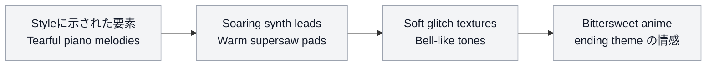

# Those Days

## Source Facts

- **Creator:** 鳥栖沿線
- **Source:** https://suno.com/song/5f9593c5-a6a2-422f-84d8-ee72996358bf
- **Creator URL:** https://suno.com/@tosuensen
- **Collected at:** 2026-11-21T20:58:30+09:00
- **Published on page:** 2026年11月19日 16:00
- **Model shown on page:** （表示なし）
- **Duration shown on page:** 3:48
- **Play count shown on page:** 153
- **Like count shown on page:** 4
- **Comments shown on page:** 3

### Caption (raw)

```text
Museの実力テスト3弾です。今回のHooksは実写風景の描写力を見てみましたが…なかなかやるんじゃないですか？っていうか日本の郊外の学校とその周りの風景を実写でお願い！って言ったらこれ出てくるの凄いですよね…少しだけ、懐かしい気分になれましたか？
```

### Style (raw)

```text
Instrumental only, emotional mid-tempo EDM artcore, BPM 128-135, bittersweet anime ending theme, Tearful piano melodies, soaring synth leads, warm supersaw pads, soft glitch textures, bell-like tones
```

### Lyrics (raw)

```text
（インストゥルメンタル — 歌詞なし）
```

---

## Clean Lyrics

（インストゥルメンタル — 歌詞なし）

---

## Lyrics Analysis

### Summary

歌詞のないインストゥルメンタル曲のため、歌詞からの分析はできない。キャプションと Style から読み取れるのは、日本の郊外の学校とその周りの風景を実写で描く Hooks の描写力を試す「Museの実力テスト3弾」という企画意図と、楽曲の方向性としての「bittersweet anime ending theme」である。Style が並べる「tearful piano melodies」「soaring synth leads」「warm supersaw pads」といった要素は、懐かしさと切なさを軸にした音作りを意図している。

### Themes

- 懐かしさ（郊外の学校とその周りの風景）
- 実写風景の描写力という Hooks の検証テーマ
- アニメのエンディングテーマ的な切なさ

### Core Keywords

- 懐かしい
- 郊外の学校
- 実写風景
- ピアノ
- シンセリード

### Symbols / Motifs

- **郊外の学校:** キャプションで明示された Hooks の題材。作者が実写描写の試金石として選んだ風景。
- **懐かしい気分:** キャプションの結びの問いかけ。楽曲の狙いが、風景の再現そのものではなく、見る者の記憶を呼び起こすことにあると示す。
- **ピアノとシンセリード:** Style の中心要素。涙ぐむようなピアノと高く舞うシンセリードの対比が、切なさと高揚の両方を担う設計。

### Perspective

歌詞がないため視点の分析はできない。キャプションの語り手は、Muse の Hooks の描写力を試す実験者の立場で、読者へ「懐かしい気分になれましたか？」と問いかける。

### Repetition / Contrast / Notable Wording

- キャプションの「なかなかやるんじゃないですか？」「これ出てくるの凄いですよね…」は、実写描写の出来に対する作者自身の驚きを示す。
- Style の "bittersweet" は、甘さと苦さの同居を一語で示す楽曲の方向性。
- 「日本の郊外の学校とその周りの風景」という具体的な題材指定が、Hooks の描写力テストの条件になっている。

---

## Structure Analysis

- **Structure type:** instrumental_arc (text-inferred only)
- **Summary:** 歌詞もセクション情報も公開ページにないため、楽曲の構造はテキストからは分からない。Style からは、ピアノのメロディを核に、シンセリードの高揚、スーパーソウ・パッドの温かさ、グリッチの質感、ベルの音色を重ねる EDM artcore の構成が意図されていることが読み取れる。BPM 128-135 のミッドテンポで、アニメのエンディングテーマ的な情感の起伏を持つ設計。

### Mermaid



### Structural Notes

- 公開ページにセクション情報がないため、上記は Style テキストの要素の並びを図にしたもので、実際の楽曲のセクション分けではない。
- キャプションからは、この曲の Hooks が「日本の郊外の学校とその周りの風景」の実写描写であることが分かる。楽曲と Hooks の題材が対応している。
- BPM 128-135、ミッドテンポの EDM artcore という指定は、疾走感よりも情感の起伏を重視した設計を示唆する。

---

## Suno Prompt Knowledge

### Style Raw

```text
Instrumental only, emotional mid-tempo EDM artcore, BPM 128-135, bittersweet anime ending theme, Tearful piano melodies, soaring synth leads, warm supersaw pads, soft glitch textures, bell-like tones
```

### Directives Observed in Lyrics

| Directive | Position | Structural role | Source/Inference |
|---|---|---|---|
| （なし） | — | インストゥルメンタルで歌詞が存在しないため、Lyrics Directive はなし | Page-derived fact |

### Reusable Notes

- 楽曲の方向性を "bittersweet anime ending theme" のように、既存のメディア形式に喩えて一語で示す書き方。
- 音色を役割語つきで並べる指定（tearful piano / soaring synth leads / warm supersaw pads / soft glitch textures / bell-like tones）は、各音色の情感的な役割まで含めて伝える方法。
- BPM を 128-135 の範囲指定にすることで、テンポの幅を持たせつつミッドテンポの帯域を固定する書き方。
- "Instrumental only" を Style の先頭に置くことで、歌詞の不在を明確化している。
- 上記は Style テキストの設計に関する知見であり、実際の音響結果についての評価ではない。

---

## Az Listening Notes

> No listening note yet.

### Raw Notes from Az

- 未提供

### Structured Listening Tags

- **Perceived mood:** 未提供
- **Perceived instrumentation / texture:** 未提供
- **Energy change:** 未提供
- **Vocal impression:** 未提供
- **Favorite sonic moment:** 未提供
- **Useful reference for:** 未提供

> These fields must be based on Az's own listening notes. Do not infer them from audio files, Style, or lyrics alone.

---

## Az Impression

### Raw Notes from Az

> No Az note yet.

### Structured Impression

- **First impression:** 未提供
- **Favorite moment:** 未提供
- **Emotion words:** 未提供
- **Colors / scenery:** 未提供
- **Physical sensation:** 未提供
- **What felt unusual:** 未提供
- **Useful reference for:** 未提供

---

## Review Hooks

Points worth discussing when Az writes a review. These are prompts, not a finished review.

- Hooks の実写描写力という企画意図。「日本の郊外の学校とその周りの風景」を実写で頼んだら何が出てくるか、という検証の枠組み。
- 作者自身の驚き（「なかなかやるんじゃないですか？」「これ出てくるの凄いですよね…」）と、読者への「懐かしい気分になれましたか？」という問いかけ。
- EDM artcore とアニメのエンディングテーマ風の組み合わせ。BPM 128-135 のミッドテンポでの情感の作り方。
- 「Museの実力テスト3弾」という連作の文脈。1弾・2弾との比較の観点。
- 歌詞のない曲として、タイトル "Those Days" が担う意味。

---

## Provenance / Confidence

Clearly distinguish facts from interpretation.

- **Page-derived facts:** 曲名、作者、作者URL、Suno URL、Caption、Style、公開日時、3:48の表示、再生数・いいね数・コメント数。モデル表示なし。インストゥルメンタルで歌詞なし。
- **AI text analysis:** キャプションと Style からの読み、主題、キーワード、モチーフ、構造に関する注記、再利用ノート、レビュー観点。
- **Az listening notes:** 未提供。
- **Az impression:** 未提供。
- **Unavailable / uncertain:** 実際の音響上の実現度、演奏・ミックスの聴感評価、楽曲のセクション構造、Hooks の映像内容。音源ファイルの取得や自動音響解析は行っていない。

### Audio Handling Policy

- Do not search for direct audio file URLs.
- Do not download or convert m4a/mp3/wav files.
- Do not perform automated audio analysis.
- Sound-related notes must come from Az's own listening comments.
