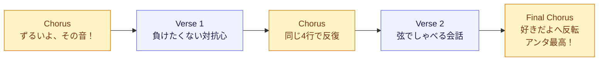

# ずるいよ、その音！

## Source Facts

- **Creator:** 鳥栖沿線
- **Source:** https://suno.com/song/693c6dec-d3b1-403d-a605-65f192b143f8
- **Creator URL:** https://suno.com/@tosuensen
- **Collected at:** 2026-11-23T20:58:11+09:00
- **Published on page:** 2026年11月20日 22:08
- **Model shown on page:** （表示なし）
- **Duration shown on page:** 2:33
- **Play count shown on page:** 60
- **Like count shown on page:** 5
- **Comments shown on page:** 2

### Caption (raw)

```text
今回もHooksが本体です🙇グラフィカルな歌詞表示を試してみたくて過去素材をかき集めチャッピーに編集してもらいました☺️英語歌詞だとわけわかんなかったので珍しく日本語歌詞です😅この2人の物語に見せかけてますが、私が皆さんに思ってる事でもあります。皆さん、ずるいよ！その音！
```

### Style (raw)

```text
Funky Electronic Rock breakbeat, energetic 148 BPM syncopated groove with continuous forward drive, stylish modern production
```

### Lyrics (raw)

```text
ずるいよ ずるいよ その音！
あたしがノっちゃう 誰よりも
ずるいよ ずるいよ その音！
そこの歓声 あたしにも！

今日も遅刻で 「おはようさん」
こっちはとっくに 準備万端
みんなに手を振る 「また明日！」
アンプの灯りは つけたまま
もう一回 あと一回
アンタにだけは 負けたくない
もう一回 あと一回
そのすまし顔 崩したい

今日はあたしが 沸かせる番
アンタが鳴らせば このありさま！

ずるいよ ずるいよ その音！
あたしがノっちゃう 誰よりも
ずるいよ ずるいよ その音！
そこの歓声 あたしにも！

昨日こっそり 弾いたリフ
今日はアンタに ぶつけてみる
すぐにベースが 歌い出す
悔しいけどさ ニヤケちゃう
普段はちっとも しゃべんない
弦でしゃべれば 止まんない
あたしが歌えば その隙間
そうそう、その音！　待ってたんだ

隣でちょっと 笑ったな？
その顔 ずっと見たかった
いちばん近くで 聴いてるアンタ
いちばん聴かせたいのも アンタなの！

ずるいよ ずるいよ その音！
今日もノっちゃう 誰よりも
ずるいよ ずるいよ その音！
アンタの音を あたしにも！
好きだよ 好きだよ その音！
明日も隣で 鳴らしてよ
歌うよ 歌うよ その音で
くやしいけれど アンタ最高！
```

---

## Clean Lyrics

[Chorus]

ずるいよ ずるいよ その音！
あたしがノっちゃう 誰よりも
ずるいよ ずるいよ その音！
そこの歓声 あたしにも！

[Verse 1]

今日も遅刻で 「おはようさん」
こっちはとっくに 準備万端
みんなに手を振る 「また明日！」
アンプの灯りは つけたまま
もう一回 あと一回
アンタにだけは 負けたくない
もう一回 あと一回
そのすまし顔 崩したい

今日はあたしが 沸かせる番
アンタが鳴らせば このありさま！

[Chorus]

ずるいよ ずるいよ その音！
あたしがノっちゃう 誰よりも
ずるいよ ずるいよ その音！
そこの歓声 あたしにも！

[Verse 2]

昨日こっそり 弾いたリフ
今日はアンタに ぶつけてみる
すぐにベースが 歌い出す
悔しいけどさ ニヤケちゃう
普段はちっとも しゃべんない
弦でしゃべれば 止まんない
あたしが歌えば その隙間
そうそう、その音！　待ってたんだ

隣でちょっと 笑ったな？
その顔 ずっと見たかった
いちばん近くで 聴いてるアンタ
いちばん聴かせたいのも アンタなの！

[Final Chorus]

ずるいよ ずるいよ その音！
今日もノっちゃう 誰よりも
ずるいよ ずるいよ その音！
アンタの音を あたしにも！
好きだよ 好きだよ その音！
明日も隣で 鳴らしてよ
歌うよ 歌うよ その音で
くやしいけれど アンタ最高！

---

## Lyrics Analysis

### Summary

隣で鳴る「アンタ」の音に、嫉妬と憧れを同時にぶつける歌。語り手の「あたし」はライバルの音にノってしまい、歓声を横取りされた悔しさと、「そのすまし顔 崩したい」という対抗心を歌う。だが2番では「普段はちっとも しゃべんない」相手が「弦でしゃべれば 止まんない」こと、「あたしが歌えば その隙間」と、音で会話が成立している関係が明かされる。最後のサビで「ずるいよ」が「好きだよ」へ、「そこの歓声 あたしにも！」が「アンタの音を あたしにも！」へ変わり、嫉妬の言葉がそのまま告白へ反転する。キャプションによれば、この2人の物語に見せかけているが、作者が皆さんに思っていることでもある。

### Themes

- ライバルへの嫉妬と憧れの同居
- 音で会話する二人
- 「ずるい」という言葉の賛辞への反転
- 隣にいることの近さ（いちばん近くで聴いている相手）

### Core Keywords

- ずるいよ
- その音
- 隣
- 悔しい
- 最高
- もう一回

### Symbols / Motifs

- **その音:** 相手の演奏そのもの。嫉妬の対象であり、憧れの対象であり、最終的には「好き」の対象。同じ語が反復されるたびに意味が変わる。
- **アンプの灯り:** つけたままの灯りは、演奏の余韻と、まだ終わっていない勝負の気配を示す。
- **すまし顔:** 相手の無表情さ。崩したい対象であり、2番の終わりで「ちょっと 笑った」ことで崩れるもの。
- **弦でしゃべる:** 言葉ではしゃべらない相手の本音が、楽器を通して出るという関係性の核。
- **隣:** 「いちばん近くで 聴いてるアンタ」「明日も隣で 鳴らしてよ」と、距離の近さが嫉妬と親しさの両方を支える。

### Perspective

一人称「あたし」が、隣の「アンタ」に向けて語りかける二人称の歌。視点は終始「あたし」から「アンタ」へ向かい、聴き手は「アンタ」の位置に置かれる。キャプションの「私が皆さんに思ってる事でもあります」により、歌の中の「アンタ」は作者の仲間たちへも開かれている。

### Repetition / Contrast / Notable Wording

- サビの「ずるいよ ずるいよ その音！」が3回反復される。1回目・2回目は同じ4行だが、最終サビでは「そこの歓声 あたしにも！」が「アンタの音を あたしにも！」へ変わり、さらに「好きだよ 好きだよ その音！」が追加される。
- 「悔しいけどさ ニヤケちゃう」「くやしいけれど アンタ最高！」は、悔しさと喜びの同居を繰り返し示す中心行。
- 「もう一回 あと一回」の反復は、負けたくない気持ちの執着を、そのままのリズムで示す。
- 「アンタが鳴らせば このありさま！」は、相手の音のせいで自分がノってしまう、という責任転嫁めいた言い方が笑いと親しさを生む。
- 「その顔 ずっと見たかった」は、ライバルへの関心が、実は相手をよく見ていたことの告白になっている。

---

## Structure Analysis

- **Structure type:** opening_chorus + chorus_repetition_with_variation
- **Summary:** サビから始まり、Verse 1 → サビ → Verse 2 → 最終サビという構成。サビが曲の冒頭に置かれることで、タイトルフレーズ「ずるいよ、その音！」が最初の一音から提示される。1番と2番の Verse は「対抗心の表明」と「音での会話の告白」という役割分担があり、最終サビは4行の追加で「ずるい」から「好き」への反転を果たす。2分33秒という短さの中で、同じサビの意味だけが段階的に変わる設計。

### Mermaid



### Structural Notes

- 公開ページの歌詞にセクションラベルはないため、上の [Chorus] / [Verse 1] / [Verse 2] / [Final Chorus] は歌詞の反復構造からの推定である。
- 冒頭サビは4行で、曲のテーマとタイトルフレーズを先に提示する「つかみ」の役割。
- Verse 1 の後半「もう一回 あと一回」と Verse 2 の後半「隣でちょっと 笑ったな？」は、それぞれの Verse の結論にあたる4行で、1番は対抗心、2番は親密さへ着地する。
- 最終サビだけが8行に拡張され、「好きだよ」「明日も隣で」「歌うよ」「アンタ最高！」という4行の追加で、嫉妬の歌が告白の歌へ変わる。
- 148 BPM のシンコペートしたグルーヴという Style と、短いフレーズの反復が、ライバル同士の掛け合いの速さに対応している。

---

## Suno Prompt Knowledge

### Style Raw

```text
Funky Electronic Rock breakbeat, energetic 148 BPM syncopated groove with continuous forward drive, stylish modern production
```

### Directives Observed in Lyrics

| Directive | Position | Structural role | Source/Inference |
|---|---|---|---|
| （なし） | — | 公開ページの歌詞にセクションラベルや歌唱指示はない | Page-derived fact |

### Reusable Notes

- 148 BPM という具体的なテンポ指定と "syncopated groove with continuous forward drive" というグルーヴの質感の指定を組み合わせ、速さだけでなく前進感まで伝える書き方。
- "Funky Electronic Rock breakbeat" のように、ジャンルを3要素で掛け合わせることで、単一ジャンルでは表せない音の方向を示す書き方。
- タイトルフレーズを曲の冒頭に置く構成は、短い曲で印象を先に固定する方法として再利用できる。
- 上記は Style テキストの設計に関する知見であり、実際の音響結果についての評価ではない。

---

## Az Listening Notes

> No listening note yet.

### Raw Notes from Az

- 未提供

### Structured Listening Tags

- **Perceived mood:** 未提供
- **Perceived instrumentation / texture:** 未提供
- **Energy change:** 未提供
- **Vocal impression:** 未提供
- **Favorite sonic moment:** 未提供
- **Useful reference for:** 未提供

> These fields must be based on Az's own listening notes. Do not infer them from audio files, Style, or lyrics alone.

---

## Az Impression

### Raw Notes from Az

> No Az note yet.

### Structured Impression

- **First impression:** 未提供
- **Favorite moment:** 未提供
- **Emotion words:** 未提供
- **Colors / scenery:** 未提供
- **Physical sensation:** 未提供
- **What felt unusual:** 未提供
- **Useful reference for:** 未提供

---

## Review Hooks

Points worth discussing when Az writes a review. These are prompts, not a finished review.

- 「ずるいよ」が3回のサビで意味を変え、最終的に「好きだよ」へ反転する点。嫉妬の言葉がそのまま告白になる構造。
- キャプションの「この2人の物語に見せかけてますが、私が皆さんに思ってる事でもあります」により、歌の中の「アンタ」が作者の仲間たちへ開かれている点。
- 「弦でしゃべれば 止まんない」「あたしが歌えば その隙間」という、音で会話する二人の関係性。
- 「くやしいけれど アンタ最高！」の、悔しさと称賛の同居する締め方。
- サビから始まる構成と2分33秒の短さ。Hooks が本体というキャプションの意図と、グラフィカルな歌詞表示の試み。
- 日本語歌詞が「珍しい」という作者の言葉。英語歌詞との違いが、聴き手の理解にどう影響するか。

---

## Provenance / Confidence

Clearly distinguish facts from interpretation.

- **Page-derived facts:** 曲名、作者、作者URL、Suno URL、Caption、Style、Lyrics、公開日時、2:33の表示、再生数・いいね数・コメント数。モデル表示なし。セクションラベルなし。
- **AI text analysis:** 歌詞要約、主題、キーワード、モチーフ、視点、反復と対照、構造分類（セクション分けは反復構造からの推定）、再利用ノート、レビュー観点。
- **Az listening notes:** 未提供。
- **Az impression:** 未提供。
- **Unavailable / uncertain:** 実際の音響上の実現度、演奏・歌唱・ミックスの聴感評価、Hooks の映像内容。音源ファイルの取得や自動音響解析は行っていない。

### Audio Handling Policy

- Do not search for direct audio file URLs.
- Do not download or convert m4a/mp3/wav files.
- Do not perform automated audio analysis.
- Sound-related notes must come from Az's own listening comments.
