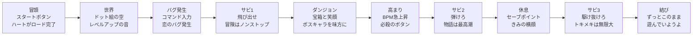

# エイトビットのファンタジー

## Source Facts

- **Creator:** wiNK296
- **Source:** https://suno.com/song/22b41a32-ffb3-44b3-aa1d-36ab1f41225b
- **Creator URL:** https://suno.com/@k7a7t7u
- **Collected at:** 2026-11-21T20:58:49+09:00
- **Published on page:** 2026年11月20日 17:34
- **Model shown on page:** （表示なし）
- **Duration shown on page:** 3:18
- **Play count shown on page:** 325
- **Like count shown on page:** 25
- **Comments shown on page:** 5

### Caption (raw)

```text
シマちゃん (shimachan) に「楽しみに待ってるね」といただいたので、8-bit曲に挑戦してみました😄シマちゃん 、お待たせ❣️
```

### Style (raw)

```text
Expert 8-bit Chiptune, Denpa Hardcore, Denpa Rock
```

### Lyrics (raw)

```text
ピコピコ弾ける スタートボタン
わたしのハートが ロード完了！


ドット絵の空に 虹がかかって
スライムも踊る 浮かれ気分
きみと並んだ 画面のなかで
レベルアップの音 鳴り止まない


コマンド入力 右・左・ジャンプ！
予測不能な 恋のバグ発生
無敵のスターを 手に入れたみたい


飛び出せ 8ビットの ファンタジー！
きみとわたしの 冒険は ノンストップ
ハートのゲージは いつも満タン
コンティニューなんて 必要ないの！


さまようダンジョン 宝箱あけて
見つけたのは キラキラの笑顔
ボスキャラさえも 味方につけて
リズムに合わせて ステップふもう


BPM急上昇 止まらない鼓動
画面の枠さえ 飛び越えそうだよ
せーので押すんだ 必殺のボタン！


弾けろ カラフルな ステージで！
きみとわたしの 物語は 最高潮
スコアの数字が どこまでも伸びる
ゲームオーバーは 辞書にないの！


ちょっと休憩 セーブポイントで
きみの横顔 見つめるわたし
次のエリアも 一緒にいこうね


駆け抜けろ 夢の エンドレス・ワールド！
きみとわたしの トキメキは 無限大
最高記録を 更新し続けて
ずっとこのまま 遊んでいようよ！
```

---

## Clean Lyrics

ピコピコ弾ける スタートボタン
わたしのハートが ロード完了！

ドット絵の空に 虹がかかって
スライムも踊る 浮かれ気分
きみと並んだ 画面のなかで
レベルアップの音 鳴り止まない

コマンド入力 右・左・ジャンプ！
予測不能な 恋のバグ発生
無敵のスターを 手に入れたみたい

飛び出せ 8ビットの ファンタジー！
きみとわたしの 冒険は ノンストップ
ハートのゲージは いつも満タン
コンティニューなんて 必要ないの！

さまようダンジョン 宝箱あけて
見つけたのは キラキラの笑顔
ボスキャラさえも 味方につけて
リズムに合わせて ステップふもう

BPM急上昇 止まらない鼓動
画面の枠さえ 飛び越えそうだよ
せーので押すんだ 必殺のボタン！

弾けろ カラフルな ステージで！
きみとわたしの 物語は 最高潮
スコアの数字が どこまでも伸びる
ゲームオーバーは 辞書にないの！

ちょっと休憩 セーブポイントで
きみの横顔 見つめるわたし
次のエリアも 一緒にいこうね

駆け抜けろ 夢の エンドレス・ワールド！
きみとわたしの トキメキは 無限大
最高記録を 更新し続けて
ずっとこのまま 遊んでいようよ！

---

## Lyrics Analysis

### Summary

スタートボタンとともに恋がロードされる。ドット絵の空、踊るスライム、レベルアップの音というゲームの世界で、コマンド入力の先に「恋のバグ」が発生する。サビ的なスタンザが3回、「飛び出せ」「弾けろ」「駆け抜けろ」と動詞を変えながら戻り、冒険はノンストップ、物語は最高潮、トキメキは無限大へ段階的に高まる。途中の「ちょっと休憩 セーブポイントで」だけが速度を落とし、きみの横顔を見つめる静かな場面を置く。最後は「ずっとこのまま遊んでいようよ」で、終わらない遊びとして閉じる。

### Themes

- ゲームの世界での恋と冒険
- 8ビットの音と画面のときめき
- ノンストップの勢いと、セーブポイントでの休息の対比
- 記録の更新と、終わらない遊び

### Core Keywords

- 8ビット
- ピコピコ
- コンティニュー
- スコア
- セーブポイント
- バグ
- ハートのゲージ

### Symbols / Motifs

- **スタートボタン／ロード完了:** 恋の始まりをゲームの開始に喩える。ハートがロードされるという、感情の起動の表現。
- **恋のバグ:** 予測不能な出来事としての恋。バグを不具合ではなく、恋の発生そのものとして肯定的に使う。
- **無敵のスター:** 恋の高揚を、ゲームの無敵アイテムに喩える。
- **セーブポイント:** 唯一の休息の場面。冒険の途中で横顔を見つめる静けさが、勢いの中に置かれた対照。
- **スコア／最高記録:** 恋の進行を数値の更新で表す。終わりはゲームオーバーではなく、記録の更新の継続。
- **画面の枠:** 「画面の枠さえ飛び越えそうだよ」は、ゲームの世界から現実へはみ出す勢いを示す。

### Perspective

一人称の「わたし」が、きみと並んで画面の中で冒険する語り。視点はゲームの画面の中にあり、きみとわたしの二人称の関係が中心。

### Repetition / Contrast / Notable Wording

- 「飛び出せ 8ビットの ファンタジー！」「弾けろ カラフルな ステージで！」「駆け抜けろ 夢の エンドレス・ワールド！」の3つのスタンザが、同じ4行構造で戻る。後続は「冒険はノンストップ」→「物語は最高潮」→「トキメキは無限大」と段階的に高まる。
- 「コンティニューなんて必要ないの！」と「ゲームオーバーは辞書にないの！」は、終わりの否定を2回繰り返す。
- 「BPM急上昇 止まらない鼓動」は、ゲームのテンポと心臓の鼓動を重ねる。
- 「ボスキャラさえも味方につけて」は、敵対するはずの存在を仲間にする、ゲームの文法の転用。
- セーブポイントのスタンザだけが「ちょっと休憩」で速度を落とし、横顔を見つめる静かな場面を置く。勢いの中の唯一の減速。
- キャプションではシマちゃんからの「楽しみに待ってるね」への応答として作られた曲で、待たせた相手への「お待たせ」が制作の背景にある。

---

## Structure Analysis

- **Structure type:** stanza_flow + chorus_variant_return
- **Summary:** 公開ページの歌詞にはセクションラベルがなく、9つのスタンザの連なりで進む。核は「飛び出せ」「弾けろ」「駆け抜けろ」の3つのサビ的スタンザで、同じ4行構造を持ちながら動詞と到達点を変えて戻る。間に置かれるダンジョンやBPM上昇のスタンザが勢いを保ち、セーブポイントのスタンザだけが休息を置く。

### Mermaid



### Structural Notes

- セクションラベルがないため、構造は歌詞テキストの内容から読み取ったもので、実際の楽曲のセクション分けとは一致しない可能性がある。
- 3つのサビ的スタンザは、冒険→物語→トキメキと、主語になる言葉が変わりながら段階的に高まる。
- セーブポイントのスタンザは、3つ目のサビの直前に置かれた休息で、最後の高まりへの助走になっている。
- Style は "Expert 8-bit Chiptune, Denpa Hardcore, Denpa Rock" と短く、ジャンルの組み合わせだけを指定している。
- 5件のコメントと25件のいいね、325回の再生は、今回の5曲の中で最も多い。

---

## Suno Prompt Knowledge

### Style Raw

```text
Expert 8-bit Chiptune, Denpa Hardcore, Denpa Rock
```

### Directives Observed in Lyrics

| Directive | Position | Structural role | Source/Inference |
|---|---|---|---|
| （なし） | — | 公開ページの歌詞には `[Verse]` 等のセクションラベルや演出指示が含まれていなかった | Page-derived fact |

### Reusable Notes

- Style をジャンル名の組み合わせだけに絞る書き方（Expert 8-bit Chiptune, Denpa Hardcore, Denpa Rock）。短い指定で方向性を示す。
- ゲーム用語を恋愛の比喩へ翻訳する歌詞設計（スタートボタン、ロード、バグ、セーブポイント、スコア）は、題材の文法をそのまま恋の文法へ転用する方法。
- サビ的なスタンザを同じ行数・同じリズムで3回置き、動詞と到達点だけを変えることで、反復と段階的な高まりを両立させる書き方。
- 上記は Style / 歌詞テキストの設計に関する知見であり、実際の音響結果についての評価ではない。

---

## Az Listening Notes

> No listening note yet.

### Raw Notes from Az

- 未提供

### Structured Listening Tags

- **Perceived mood:** 未提供
- **Perceived instrumentation / texture:** 未提供
- **Energy change:** 未提供
- **Vocal impression:** 未提供
- **Favorite sonic moment:** 未提供
- **Useful reference for:** 未提供

> These fields must be based on Az's own listening notes. Do not infer them from audio files, Style, or lyrics alone.

---

## Az Impression

### Raw Notes from Az

> No Az note yet.

### Structured Impression

- **First impression:** 未提供
- **Favorite moment:** 未提供
- **Emotion words:** 未提供
- **Colors / scenery:** 未提供
- **Physical sensation:** 未提供
- **What felt unusual:** 未提供
- **Useful reference for:** 未提供

---

## Review Hooks

Points worth discussing when Az writes a review. These are prompts, not a finished review.

- ゲーム用語の恋愛への翻訳。スタートボタン、ロード、バグ、セーブポイント、スコアが恋の言葉になっている点。
- 「飛び出せ」「弾けろ」「駆け抜けろ」の3つのサビ的スタンザが、同じ構造で段階的に高まる点。
- セーブポイントのスタンザだけが速度を落とし、きみの横顔を見つめる静かな場面を置く点。
- 「ボスキャラさえも味方につけて」「ゲームオーバーは辞書にないの！」というゲーム文法の転用。
- キャプションのシマちゃんへの応答という制作背景。「楽しみに待ってるね」への「お待たせ」。
- 今回の5曲の中で最も再生数・いいね数が多い点。

---

## Provenance / Confidence

Clearly distinguish facts from interpretation.

- **Page-derived facts:** 曲名、作者、作者URL、Suno URL、Caption、Style、Lyrics、公開日時、3:18の表示、再生数・いいね数・コメント数。モデル表示なし。
- **AI text analysis:** 歌詞要約、主題、キーワード、モチーフ、視点、反復と対照、構造分類、再利用ノート、レビュー観点。
- **Az listening notes:** 未提供。
- **Az impression:** 未提供。
- **Unavailable / uncertain:** 実際の音響上の実現度、演奏・歌唱・ミックスの聴感評価。歌詞にセクションラベルがないため、実際の楽曲のセクション分けは不明。音源ファイルの取得や自動音響解析は行っていない。

### Audio Handling Policy

- Do not search for direct audio file URLs.
- Do not download or convert m4a/mp3/wav files.
- Do not perform automated audio analysis.
- Sound-related notes must come from Az's own listening comments.
