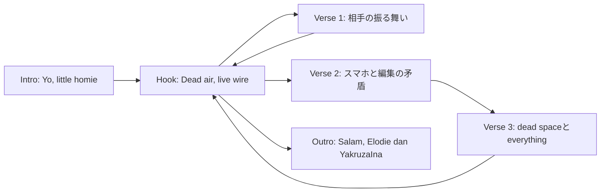

# Dead Air, Live Wire #ボッシーremix

## Source Facts

- **Creator:** YakruzaIna
- **Source:** https://suno.com/song/12e01664-9abf-413f-af44-3147f7d87033
- **Creator URL:** https://suno.com/@yakruzaina
- **Collected at:** 2026-11-26T20:58:56+09:00
- **Published on page:** 2026年11月26日 2:21
- **Model shown on page:** V6
- **Duration shown on page:** 3:03

### Caption (raw)

```text
gaihanbushikoの#ボッシーremixに参加したよ。ラップにオペラとクワイアの雰囲気をちょっと混ぜた感じだね。元の曲もXのポストも、リンクと歌詞のボックスにあるからチェックしてみて。ありがとうみんな💛 // I joined gaihanbushiko's #ボッシーremix. It's a rap with a bit of opera and choir vibe mixed in. The original song and the X post are in the link and lyrics box, so check them out. Thanks everyone 💛 🔗 https://suno.com/s/s5nVXtw5aY8I65Qj 🔗
```

### Style (raw)

```text
Technical SwanCore, Opera Rap, Minimalist Hip-Hop, 147 BPM, D Dorian; sparse half-time groove with sudden double-time rap bursts.
Organic Pipe Cathedral Organ, Double bass as Melodic instrument, Deep TR-808 sub kicks, distorted sliding 808 bass, dry rimshot snares, syncopated ghost notes, rapid hi-hat rolls. Piercing sawtooth synth stabs, shrill pitch bends, short dissonant arpeggios, abrupt rhythmic mutes.
Operatic rap vocalist: theatrical baritone, chest resonance, precise consonants, rapid multisyllabic articulation, sarcastic spoken phrasing, sudden bel canto legato, controlled vibrato, explosive operatic projection. Choir Call-and-response ad-libs, rhythmic stop-start punchlines. Minimal minor-modal harmony, tense chromatic accents.
Production: gritty analogue saturation, abrupt beat cuts.
Mix: dry upfront vocals, tight sub-bass, hard transient snare, wide synth stabs, short gated reverb. No orchestral strings, rock guitars, lush pads, autotune, long fade-out.
```

### Lyrics (raw)

```text
#ボッシーremix
Original song by @gaihanbushiko
▶ https://suno.com/s/s5nVXtw5aY8I65Qj

X Post 
🔗 https://x.com/gaihanboshiko/status/2124834498462511235?a=1HFP7vqEG_clOISB-m8&s=20

______________________
ORIGINAL LYRICS
______________________

Yo, little homie — wrong spot, bold move.
You brought a camera. Better bring your proof.
You want that smoke? Step up. Let's find out.

YOU READY?
THREE! TWO! ONE! LET'S GO!

Dead air, live wire — kill that flash.
Clout in the caption, cap in the chat.
Want a ghost in your post? Put a ghost on the track.
Now your own little roast got you cooked on wax.

Dead air, live wire — check that tone.
You came for a clip; got a diss of your own.
Read the room, leave the blooms, let the candle glow.
Cut the live, tuck the phone — take your ego home.


Past twelve, black rail, flash up, laugh loud.
Group chat gas — now you're brave for a small crowd.
Fresh creps, cheap flex, lens set, chin raised.
Funny how your punchline needs somebody else's name.

Gold rope, cold smoke, grin with the shades low.
I was reppin' this address before your first upload.
You crop out the dates just to fit in your face.
All that high-definition, still missing the weight.

You want views? Try a point of view.
Earn a little grace 'fore you chase that revenue.
You sampled the silence; I flipped your admission.
Now your whole expedition's a free audition.


Dead air, live wire — kill that flash.
Clout in the caption, cap in the chat.
Want a ghost in your post? Put a ghost on the track.
Now your own little roast got you cooked on wax.

Dead air, live wire — check that tone.
You came for a clip; got a diss of your own.
Read the room, leave the blooms, let the candle glow.
Cut the live, tuck the phone — take your ego home.


You got bars on your phone; I got bars in the pocket.
Signal hit zero. Your hype man lost it.
Ghostwriter? Sure — but I keep my own credit.
Your caption says fearless. Your cut says edit.

B-roll bravado, borrowed bravado.
Big talk by the door, then you're gone by the car, bro.
Quick cut, jump cut, shake in the close-up.
You can trim that clip; can't trim how you froze up.


One date, one dash, one life in between.
You saw dead space. Somebody sees everything.
You came for a plot twist? Here's your eviction.
This address got a voice — and it questions your diction.


Dead air, live wire — kill that flash.
Clout in the caption, cap in the chat.
Want a ghost in your post? Put a ghost on the track.
Now your own little roast got you cooked on wax.

Dead air, live wire — check that tone.
You came for a clip; got a diss of your own.
Read the room, leave the blooms, let the candle glow.
Cut the live, tuck the phone — take your ego home.

Salam, Elodie dan YakruzaIna


______________________
⚠ Based Mash-Up and Meta-tags
▶ https://suno.com/s/M9t0cDPEOCmdhzbs
```

---

## Clean Lyrics

[Intro]

Yo, little homie — wrong spot, bold move.
You brought a camera. Better bring your proof.
You want that smoke? Step up. Let's find out.
YOU READY?
THREE! TWO! ONE! LET'S GO!

[Hook]

Dead air, live wire — kill that flash.
Clout in the caption, cap in the chat.
Want a ghost in your post? Put a ghost on the track.
Now your own little roast got you cooked on wax.
Dead air, live wire — check that tone.
You came for a clip; got a diss of your own.
Read the room, leave the blooms, let the candle glow.
Cut the live, tuck the phone — take your ego home.

[Verse 1]

Past twelve, black rail, flash up, laugh loud.
Group chat gas — now you're brave for a small crowd.
Fresh creps, cheap flex, lens set, chin raised.
Funny how your punchline needs somebody else's name.
Gold rope, cold smoke, grin with the shades low.
I was reppin' this address before your first upload.
You crop out the dates just to fit in your face.
All that high-definition, still missing the weight.
You want views? Try a point of view.
Earn a little grace 'fore you chase that revenue.
You sampled the silence; I flipped your admission.
Now your whole expedition's a free audition.

[Hook]

Dead air, live wire — kill that flash.
Clout in the caption, cap in the chat.
Want a ghost in your post? Put a ghost on the track.
Now your own little roast got you cooked on wax.
Dead air, live wire — check that tone.
You came for a clip; got a diss of your own.
Read the room, leave the blooms, let the candle glow.
Cut the live, tuck the phone — take your ego home.

[Verse 2]

You got bars on your phone; I got bars in the pocket.
Signal hit zero. Your hype man lost it.
Ghostwriter? Sure — but I keep my own credit.
Your caption says fearless. Your cut says edit.
B-roll bravado, borrowed bravado.
Big talk by the door, then you're gone by the car, bro.
Quick cut, jump cut, shake in the close-up.
You can trim that clip; can't trim how you froze up.

[Verse 3]

One date, one dash, one life in between.
You saw dead space. Somebody sees everything.
You came for a plot twist? Here's your eviction.
This address got a voice — and it questions your diction.

[Hook]

Dead air, live wire — kill that flash.
Clout in the caption, cap in the chat.
Want a ghost in your post? Put a ghost on the track.
Now your own little roast got you cooked on wax.
Dead air, live wire — check that tone.
You came for a clip; got a diss of your own.
Read the room, leave the blooms, let the candle glow.
Cut the live, tuck the phone — take your ego home.

[Outro]

Salam, Elodie dan YakruzaIna

---

## Lyrics Analysis

### Summary

gaihanbushiko の #ボッシーremix への参加曲。元の曲の歌詞をそのまま使い、ラップにオペラとクワイアの雰囲気を混ぜたリミックス。Intro で「Yo, little homie — wrong spot, bold move.」と、カメラを持ってきた相手に「証拠を持ってこい」と切り返し、「YOU READY? / THREE! TWO! ONE! LET'S GO!」で Hook へ入る。Hook は「Dead air, live wire — kill that flash.」を軸に、キャプションの見栄（Clout in the caption）とチャットの嘘（cap in the chat）を並べ、「自分のローストで自分が焼かれた（cooked on wax）」と締める。Verse 1 では深夜の黒い手すり、グループチャットの煽り、新品の靴と安い見栄と、相手の「撮る側」の振る舞いを並べ、「I was reppin' this address before your first upload.」と、この場所の先住者であることを主張する。Verse 2 では「You got bars on your phone; I got bars in the pocket.」と、スマホのバー（電波／小節）とポケットのバー（韻）を掛け、「Your caption says fearless. Your cut says edit.」と、キャプションと編集の矛盾を突く。Verse 3 は短く、「You saw dead space. Somebody sees everything.」と、相手の見た空白と、誰かが見ているすべてを対比してから、Hook へ戻る。Outro の「Salam, Elodie dan YakruzaIna」は、締めの挨拶として置かれる。

### Themes

- 撮られる側から撮る側への反撃
- 承認欲求と見せかけの強さ
- 言葉の切り返しによるディス
- リミックス企画への参加

### Core Keywords

- Dead air, live wire
- kill that flash
- cooked on wax
- take your ego home
- ボッシーremix

### Symbols / Motifs

- Dead air, live wire: タイトルであり Hook の軸。死んだ空気と生きた電線の対比が、曲の緊張を作る
- flash: カメラのフラッシュと、見せびらかす瞬間の両方。「kill that flash」はフラッシュを消すことと、見栄を消すことの両義
- wax: レコード（wax）に焼かれること。「cooked on wax」は、自分のローストで自分が焼かれたという逆転
- bars: スマホの電波のバーと、ラップの小節・韻のバーの掛け言葉。Verse 2 の「You got bars on your phone; I got bars in the pocket.」で使われる
- address: 「I was reppin' this address」と「This address got a voice」で繰り返される、この場所の主権の比喩
- ego: Hook の締め「take your ego home」。エゴを持ち帰れという、相手への送り出し

### Perspective

一人称の「I」が、カメラを持ってきた相手（you）に向けて語る。視点は「I」と「you」の対決で、Verse では相手の振る舞いを描写し、Hook では相手への宣告を繰り返す。

### Repetition / Contrast / Notable Wording

- Hook が3回繰り返され、毎回同じ8行。変わらない Hook が、Verse の変化を受け止める
- 「You came for a clip; got a diss of your own.」は、撮りに来た者がディスを持ち帰るという逆転の構造
- 「You want views? Try a point of view.」は、views（再生数）と point of view（視点）の掛け言葉
- 「Your caption says fearless. Your cut says edit.」は、キャプションの言葉と編集の現実の矛盾を一対で突く
- 「You can trim that clip; can't trim how you froze up.」は、編集できるものとできないものの対比
- 「You saw dead space. Somebody sees everything.」は、相手の見た空白と、誰かが見ているすべての対比
- 「This address got a voice — and it questions your diction.」は、場所に声を与え、相手の言葉遣いを問う締め

---

## Structure Analysis

- **Structure type:** hook_refrain + verse_variation
- **Summary:** Intro の呼びかけとカウントダウンから Hook へ入り、Verse 1（相手の振る舞い）→ Hook → Verse 2（スマホと編集の矛盾）→ Verse 3（短い転換）→ Hook → Outro の構成。Hook は3回とも同じ8行で、変わらない軸として置かれる。Verse は1番が12行、2番が8行、3番が4行と、短くなりながら Hook へ向かって収束する。Outro は1行の挨拶で締める。

### Mermaid



### Structural Notes

- Hook は3回とも同じ8行で、Verse の変化を受け止める軸として置かれる。Hook の締め「take your ego home」が、毎回相手への送り出しになる
- Verse は 12行 → 8行 → 4行と短くなり、Hook への収束が速くなる。3番は転換だけを置いてすぐ Hook へ戻る
- Intro の「YOU READY? / THREE! TWO! ONE! LET'S GO!」は、Hook へのカウントダウンとして置かれる
- Outro は1行の挨拶のみ。Hook の後の余韻を、挨拶で閉じる

---

## Suno Prompt Knowledge

### Style Raw

```text
Technical SwanCore, Opera Rap, Minimalist Hip-Hop, 147 BPM, D Dorian; sparse half-time groove with sudden double-time rap bursts.
Organic Pipe Cathedral Organ, Double bass as Melodic instrument, Deep TR-808 sub kicks, distorted sliding 808 bass, dry rimshot snares, syncopated ghost notes, rapid hi-hat rolls. Piercing sawtooth synth stabs, shrill pitch bends, short dissonant arpeggios, abrupt rhythmic mutes.
Operatic rap vocalist: theatrical baritone, chest resonance, precise consonants, rapid multisyllabic articulation, sarcastic spoken phrasing, sudden bel canto legato, controlled vibrato, explosive operatic projection. Choir Call-and-response ad-libs, rhythmic stop-start punchlines. Minimal minor-modal harmony, tense chromatic accents.
Production: gritty analogue saturation, abrupt beat cuts.
Mix: dry upfront vocals, tight sub-bass, hard transient snare, wide synth stabs, short gated reverb. No orchestral strings, rock guitars, lush pads, autotune, long fade-out.
```

### Directives Observed in Lyrics

| Directive | Position | Structural role | Source/Inference |
|---|---|---|---|
| #ボッシーremix / Original song by @gaihanbushiko | 歌詞ボックス冒頭 | リミックス企画への参加と原曲の明示 | Page text |
| ORIGINAL LYRICS | 歌詞ボックス | 歌われる歌詞の範囲の明示 | Page text |
| YOU READY? / THREE! TWO! ONE! LET'S GO! | Intro | Hook へのカウントダウン | Page text |
| ⚠ Based Mash-Up and Meta-tags | 歌詞ボックス末尾 | マッシュアップとメタタグの注記 | Page text |
| sparse half-time groove with sudden double-time rap bursts（style本文） | Style全体 | ハーフタイムのグルーヴと突然のダブルタイムの対比 | Page text |
| Operatic rap vocalist: theatrical baritone ... explosive operatic projection（style本文） | Style全体 | オペラとラップの声の使い分けの指定 | Page text |
| Choir Call-and-response ad-libs, rhythmic stop-start punchlines（style本文） | Style全体 | クワイアの掛け合いと止まるパンチラインの指定 | Page text |
| No orchestral strings, rock guitars, lush pads, autotune, long fade-out（style本文） | Style全体 | 否定形で「やらないこと」を固定 | Page text |

### Reusable Notes

- "Technical SwanCore, Opera Rap, Minimalist Hip-Hop" と、ジャンルを3語で並べ、147 BPM・D Dorian・ハーフタイムのグルーヴで骨格を固定する書き方
- オペラとラップの声の使い分け（theatrical baritone / bel canto legato / explosive operatic projection）を、ボーカリストの指定として一文で書く書き方
- 歌詞ボックスに原曲のリンクと X ポストのリンクを置き、リミックスの出自を明示する書き方
- "No orchestral strings, rock guitars, lush pads, autotune, long fade-out" と否定形を重ねて、ミニマルな編成を明確にする書き方
- ※いずれもページ上の書き方の観察。実際の出音やオペラとラップの混ざり具合は Az のリスニングで要確認

---

## Az Listening Notes

> No listening note yet.

### Raw Notes from Az

- 

### Structured Listening Tags

- **Perceived mood:**
- **Perceived instrumentation / texture:**
- **Energy change:**
- **Vocal impression:**
- **Favorite sonic moment:**
- **Useful reference for:**

> These fields must be based on Az's own listening notes. Do not infer them from audio files, Style, or lyrics alone.

---

## Az Impression

### Raw Notes from Az

> No Az note yet.

### Structured Impression

- **First impression:**
- **Favorite moment:**
- **Emotion words:**
- **Colors / scenery:**
- **Physical sensation:**
- **What felt unusual:**
- **Useful reference for:**

---

## Review Hooks

Points worth discussing when Az writes a review. These are prompts, not a finished review.

- Hook が3回とも同じ8行で、変わらない軸として置かれている点
- 「You got bars on your phone; I got bars in the pocket.」という、bars の掛け言葉
- 「Your caption says fearless. Your cut says edit.」という、キャプションと編集の矛盾
- 「You can trim that clip; can't trim how you froze up.」という、編集できるものとできないものの対比
- Verse が 12行 → 8行 → 4行と短くなり、Hook へ収束していく構成
- 「This address got a voice — and it questions your diction.」という、場所に声を与える締め
- ラップにオペラとクワイアを混ぜるという、キャプションの説明と style の "Operatic rap vocalist" の対応

---

## Provenance / Confidence

Clearly distinguish facts from interpretation.

- **Page-derived facts:** タイトル、作者、キャプション、style、歌詞、公開日、モデル、長さ、再生数40／いいね8／コメント1（収集時点）。2026-11-26に公開ページから機械収集
- **AI text analysis:** Summary、Themes、Symbols、Structure、Review Hooks は歌詞と style のテキスト分析による
- **Az listening notes:** なし（未記入）
- **Az impression:** なし（未記入）
- **Unavailable / uncertain:** 実際の音の実現度、オペラとラップの混ざり具合、クワイアの掛け合いは未聴取。歌詞ボックス冒頭の #ボッシーremix・原曲リンク・X ポストリンクと末尾の Based Mash-Up 注記は歌唱されないため、Clean Lyrics からは除いた。Clean Lyrics のセクションラベル（Intro / Hook / Verse 1-3 / Outro）は歌詞ボックスの構造からの推定で、ページ上の明示ではない

### Audio Handling Policy

- Do not search for direct audio file URLs.
- Do not download or convert m4a/mp3/wav files.
- Do not perform automated audio analysis.
- Sound-related notes must come from Az's own listening comments.
